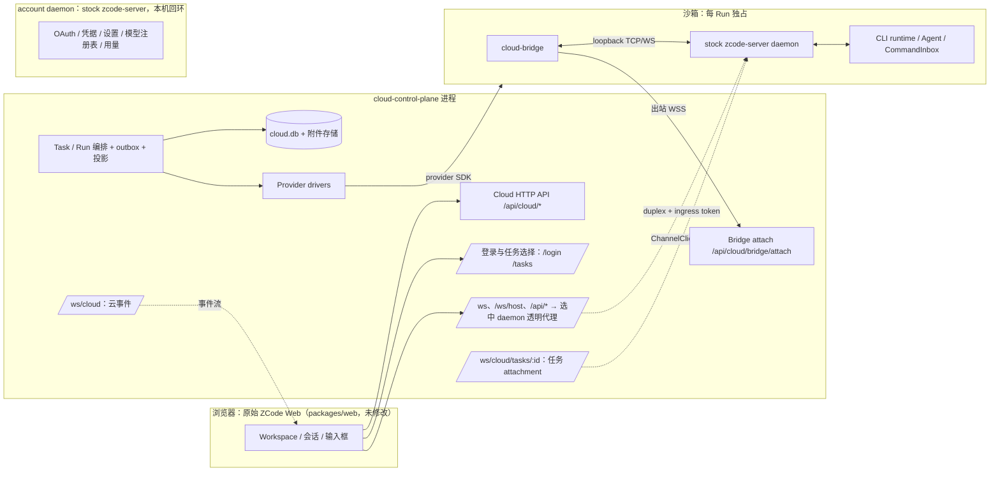

# Cloud Agent 总览

> 状态：目标设计。基线：`origin/main` @ `3c5b2276`（v3.16.2）。
> 本文与 01–05 共同构成 cloud agent 的唯一契约来源。

## 1. 产品目标

把 ZCode Agent 的执行迁移到云沙箱，Web（含手机浏览器）为主客户端：

1. 浏览器关闭后，已接受的任务仍能开始和继续执行。
2. 任务、输入和可回放历史不依赖浏览器，也不依赖某一次沙箱实例。
3. 产物的交付事实是 Git 分支与 PR。
4. 云模式与本地/远程模式明确区分，不互相隐式 fallback。

首版是**单用户受保护部署**：必须有认证和稳定的部署主体；多租户不在本版范围。

## 2. 设计原则（冲突时按此优先级裁决）

1. **零源码耦合**：不修改任何现有 package 的源码。云代码只通过公开入口（`package.json#exports`）、线协议和发行产物消费 ZCode。
2. **标准件优先**：沙箱执行节点、账号域宿主都使用**未修改的 `zcode-server` 发行版**。云侧不自建 daemon、不复制握手、不复制连接管理。
3. **唯一所有者**：每个事实只有一个写者（§5）。
4. **可提取**：四个新包只依赖 `@zcode/shared`、`@zcode/client`、`@zcode/rpc`、`@zcode/ui` 的公开入口；满足 04 的提取前置后可直接拆仓。
5. **事实与连接分离**：持久事实在控制面数据库；socket/attachment 是可丢失的内存缓存。
6. **失败显式**：不一致和未知一律 fail closed，不用超时或兜底掩盖同步问题。

## 3. 拓扑

所有连接的方向都是**控制面/沙箱主动发起**：

- 浏览器 → cloud-control（唯一公网入口）。
- 沙箱 bridge → cloud-control（出站 WSS，沙箱无入向网络）。
- cloud-control → account daemon（本机回环）。
- sandbox daemon 只监听 loopback，由 bridge 桥接。

## 4. 运行形态

| 组件                  | 来源                              | 说明                                                                     |
| --------------------- | --------------------------------- | ------------------------------------------------------------------------ |
| `cloud-control-plane` | 本仓新包                          | 唯一公网服务：云 API、通道代理、编排、存储、provider 驱动、静态 Web      |
| `account daemon`      | `zcode-server` 发行版（未修改）   | 由控制面作为子进程启动；账号域事实源                                     |
| `cloud-bridge`        | 本仓新包，构建为单文件 bundle     | 注入沙箱模板；只做 daemon 监督与字节桥接                                 |
| `sandbox daemon`      | `zcode-server` 发行版（未修改）   | 沙箱内执行节点；loopback ingress                                         |
| Web 客户端            | `packages/web` 既有构建（未修改） | 浏览器加载原始 ZCode Web；cloud-control 只负责鉴权门、任务选择与传输代理 |

控制面启动 account daemon 时使用 `ZCODE_DATA_BASE_DIR` 指向持久卷；沙箱 daemon 使用镜像内的数据目录。

## 5. 唯一所有者

| 事实                                                                   | 唯一所有者                         | 其他组件职责                       |
| ---------------------------------------------------------------------- | ---------------------------------- | ---------------------------------- |
| 云 Project、Task、Run、TaskInput、Projection、Checkpoint/Artifact 记录 | 控制面数据库                       | 客户端只读投影并提交命令           |
| 已接受、尚未 runtime admission 的输入与投递记录                        | 控制面 durable outbox              | 只投递与对账，不分配 running 顺序  |
| 已 admission 的 busy/running 输入、权限裁决、轮次                      | 沙箱 CLI runtime（`CommandInbox`） | 控制面保存 ACK 投影                |
| 会话、工具执行、运行时投影                                             | 沙箱 daemon / CLI                  | 控制面只存已 ingest 的副本         |
| 运行中的 attachment、generation、epoch                                 | 控制面内存注册表（持久事实在 DB）  | bridge 只携带路由上下文            |
| 账号域：OAuth、凭据、设置、模型注册表、用量、套餐                      | account daemon                     | 控制面只经 RPC 读取/触发           |
| provider 凭据的沙箱副本                                                | 沙箱 runtime（安装时点）           | 控制面只负责下发，不入库、不进日志 |
| Git 分支、SHA、PR                                                      | GitHub                             | 控制面保存投影与链接               |
| 浏览器草稿、未提交正文、焦点                                           | 浏览器本地                         | 不冒充服务端事实                   |

## 6. 身份与代际

| 概念                        | 定义                                                                                                                                                |
| --------------------------- | --------------------------------------------------------------------------------------------------------------------------------------------------- |
| `taskStableId`              | 控制面为每个 Task 生成的小写稳定标识（`[a-z0-9._-]`），跨 Run 不变                                                                                  |
| `workspaceIdentity`         | `remote:server:<taskStableId>:<checkoutPath>`，使用 main 原生格式；沙箱 daemon 以 `ZCODE_SERVER_ID=<taskStableId>` 启动，使 daemon 自身默认身份一致 |
| `workspacePath`             | 沙箱内固定 checkout 路径（模板约定），用于 IO/cwd/Git                                                                                               |
| `remoteSessionId`           | 每次 attachment 由控制面生成，用于请求关联；不按路径匹配                                                                                            |
| `runGeneration`             | Task 内单调递增；唯一有效写入 Run                                                                                                                   |
| `connectionEpoch`           | 同一 Run 每次 attach 接管单调递增；旧 epoch 帧一律拒绝                                                                                              |
| `logEpoch` / revision / seq | runtime 投影代际，用于游标恢复；不等同于网络 epoch                                                                                                  |

规则：

1. Task 跨 Run 稳定；新 Run 用相同 `workspaceIdentity`、新 `runGeneration`。
2. 输入和事件的路由必须校验 `(taskId, activeRunId, runGeneration, connectionEpoch)`，异步回写再 CAS。
3. 网络断连只改变 connectivity，不产生新的 Run，也不把 Run 置为终态。
4. 新 Run 创建前必须有旧 Run 的终止证据（provider 确认或 runtime 退出事实）；无法确认时返回 `recovery-required`，禁止自动重开。
5. `transport ACK`、`runtime ACK`、`durable ingest`、`accepted receipt` 是四类不同事实，禁止互相冒充。

## 7. 依赖账本（摘要，详见 04）

| 包                           | 允许依赖                                                                                               | 明确禁止                                                                             |
| ---------------------------- | ------------------------------------------------------------------------------------------------------ | ------------------------------------------------------------------------------------ |
| `@zcode/cloud-protocol`      | `zod`                                                                                                  | 任何 `@zcode/*`                                                                      |
| `@zcode/cloud-bridge`        | `@zcode/cloud-protocol`、`ws`、node 内置                                                               | 任何其他 `@zcode/*`（含 shared/client/rpc）                                          |
| `@zcode/cloud-control-plane` | `cloud-protocol`、`@zcode/shared`、`@zcode/client`、`@zcode/rpc`、provider SDK、`ws`、`hono`/node http | `@zcode/server`、`@zcode/services`、`@zcode/desktop`、`@zcode/web`、`apps/zcode-cli` |
| `@zcode/cloud-web`           | `cloud-protocol`、`@zcode/shared`、`@zcode/client`、`@zcode/rpc`、`@zcode/ui`、react                   | 同上 + `@zcode/cloud-control-plane`                                                  |

## 8. 文档地图

| 文档                                                     | 内容                                                   |
| -------------------------------------------------------- | ------------------------------------------------------ |
| [01-reverse-channel.md](./01-reverse-channel.md)         | 反向通道、bridge、attach 协议、fencing、重连           |
| [02-sandbox-lifecycle.md](./02-sandbox-lifecycle.md)     | Run 状态机、provider 驱动、bootstrap、截止期与暂停     |
| [03-task-management.md](./03-task-management.md)         | 云 Project/Task、输入 outbox、投影历史、API 与通道代理 |
| [04-module-architecture.md](./04-module-architecture.md) | 包结构、依赖规则、集成面、主仓改动预算、提取路径       |
| [05-implementation-plan.md](./05-implementation-plan.md) | 里程碑、验收、spike 与风险                             |

## 9. 非目标（本版）

- 多租户、RBAC、任务共享。
- Android 壳、Desktop 云入口。
- 沙箱快照恢复、运行中进程精确续跑。
- Modal/Daytona 的真实环境验收（只交付 adapter + 单测，能力门控默认隐藏）。
- 复用手机远控 relay（现有链路保持不动）。
- 完整 UI 对齐：任务视图首版覆盖会话流、输入、停止与历史回放；插件/Gen UI 等高级面板后续补齐。

## 10. 术语

| 术语           | 含义                                            |
| -------------- | ----------------------------------------------- |
| Project        | 控制面授权的仓库分组，不持有执行连接            |
| Task           | 一次稳定的工作委托，跨 Run 存在                 |
| Run            | Task 的一次执行尝试，独占一个沙箱               |
| attachment     | 控制面与某个 Run 的在线连接（可丢失缓存）       |
| account daemon | 运行在控制面本机、承载账号域的标准 zcode-server |
| bridge         | 沙箱内负责 daemon 监督与字节桥接的薄进程        |
| checkoutPath   | 沙箱内固定的代码目录，跨 Run 稳定               |
