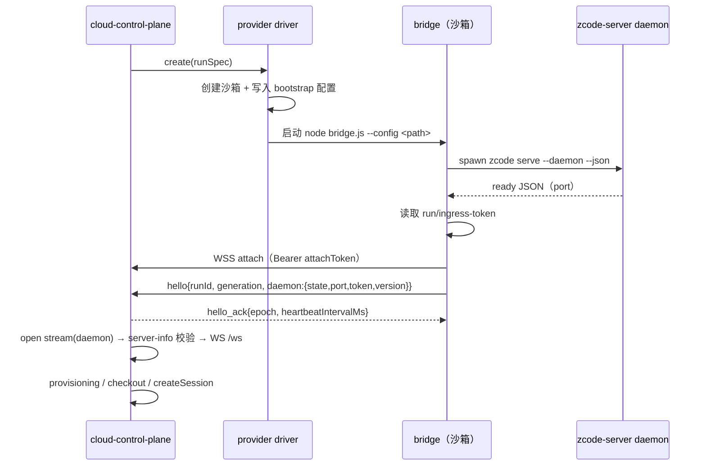

# 01 — 反向通道（Bridge / Attach）

> 状态：目标设计。父文档：[00-overview.md](./00-overview.md)。
> 关联：[02-sandbox-lifecycle.md](./02-sandbox-lifecycle.md)、[03-task-management.md](./03-task-management.md)。

## 1. 目标与不变量

云沙箱没有入向网络，而 `zcode-server` daemon 只监听 loopback。反向通道把"控制面 → daemon ingress"变成可能，同时**不引入任何新的业务协议**。

不变量：

1. daemon 零感知：bridge 只搬运字节，daemon 看到的是普通 HTTP/WS 连接。
2. 网络断连不等于执行停止：daemon 与 agent 进程不因 WSS 断开而退出。
3. 一个 Run 同时最多一个有效 attachment；同一 Run 可多次 attach，`connectionEpoch` 单调递增。
4. 旧代际（generation/epoch）的帧一律拒绝，不静默改写目标。
5. 浏览器永远不直接接触沙箱网络，也不持有 ingress token。
6. 隧道建立在认证之上；未认证连接在 WSS upgrade 阶段拒绝。

## 2. 组件

### 2.1 bridge（沙箱侧）

职责：

- 读取 bootstrap 配置；
- 启动/监督 `zcode-server` daemon（启动、健康、重启、退出上报）；
- 读取 daemon 的 `ingressToken`；
- 主动出站连接控制面；
- 按流多路复用，把 tunnel 字节原样转接到 `127.0.0.1:<daemonPort>`；
- 心跳与指数退避重连。

非职责（必须在控制面或 daemon 内）：

- 任务/输入队列、admission、权限裁决；
- 投影、持久化、WAL；
- 凭据逻辑、provisioning；
- 任何业务帧语义。

bridge 是单文件 Node bundle，运行在沙箱镜像自带的 Node（发行版 `runtime/node`）上。

### 2.2 attach endpoint（控制面）

- 入口：`WSS /api/cloud/bridge/attach?runId=<runId>`
- 认证：`Authorization: Bearer <attachToken>`（见 §5）
- 注册表（内存）：`runId → { socket, generation, epoch, daemon: { state, port, ingressToken, version, compatibility } }`
- 校验：
  - token 与 `runId/generation` 绑定；
  - `generation === run.activeGeneration`，否则拒绝（`generation_mismatch`）；
  - 同一 `runId` 的新连接接管：`epoch += 1`，旧 socket 以 `4001 superseded` 关闭；
  - 旧 epoch 的数据帧在旧 socket 上直接丢弃并关闭。

## 3. 启动与就绪时序



## 4. 帧协议

- 控制帧：WebSocket **text**，UTF-8 JSON，单帧 ≤ 64 KiB。
- 数据帧：WebSocket **binary**，`[uint32 BE streamId][payload]`，单帧 ≤ 1 MiB（超出由发送方切分）。
- 并发 stream 上限 32；超过返回 `stream_limit`。
- 协议版本：`v: 1`。

### 4.1 控制帧

| 方向 | type             | 字段                                                                                                     | 说明                                                          |
| ---- | ---------------- | -------------------------------------------------------------------------------------------------------- | ------------------------------------------------------------- |
| B→CP | `hello`          | `v, runId, taskId, generation, bridgeVersion, daemon{state,port?,ingressToken?,version?,compatibility?}` | 首次与每次重连都发送；`daemon.state ∈ starting/ready/stopped` |
| CP→B | `hello_ack`      | `epoch, heartbeatIntervalMs`                                                                             | 分配本次 attach 的 connectionEpoch                            |
| B→CP | `daemon_status`  | `state, port?, ingressToken?, version?`                                                                  | daemon 重启/崩溃/就绪变化时上报                               |
| CP→B | `stream_open`    | `streamId, kind`                                                                                         | `kind ∈ daemon \| exec`                                       |
| B→CP | `stream_opened`  | `streamId`                                                                                               | 目标连接已建立                                                |
| B→CP | `stream_error`   | `streamId, code, message`                                                                                | 建立失败                                                      |
| 双向 | `stream_close`   | `streamId, code?, message?`                                                                              | 任一侧关闭                                                    |
| B→CP | `heartbeat`      | `atMs`                                                                                                   | 每 `heartbeatIntervalMs`                                      |
| CP→B | `heartbeat_ack`  | `atMs`                                                                                                   | 超时判定见 §7                                                 |
| CP→B | `restart_daemon` | `reason`                                                                                                 | 受控重启；bridge 停止后重新拉起                               |
| CP→B | `shutdown`       | `reason`                                                                                                 | 桥接退出（daemon 是否停止由 Run 生命周期决定）                |

`stream kind`：

- `daemon`：bridge 连接 `127.0.0.1:<daemon.port>`；**只允许该端口**。用于 HTTP 请求与 WS upgrade。
- `exec`：bridge 在沙箱内 `spawn(argv[0], argv[1..])`，stdio 映射为一条 stream。仅用于控制面发起的受控维护（checkout、诊断），不走 daemon。

### 4.2 数据帧

- `streamId` 由发起方（控制面）分配，单调递增；
- 任一方向收到未知 `streamId` 的数据帧，丢弃并记录诊断，不关闭连接；
- `stream_close` 后同 id 不再复用。

## 5. 认证与凭证

| 凭证             | 生成                                              | 存放                                                         | 生命周期                                  |
| ---------------- | ------------------------------------------------- | ------------------------------------------------------------ | ----------------------------------------- |
| `attachToken`    | 控制面在 Run 供给时生成（32 字节随机，base64url） | 控制面 DB（加密存储 `enc:v1:`）+ 沙箱 bootstrap 配置（0600） | Run 终止即失效；同一 Run 多次 attach 复用 |
| `ingressToken`   | daemon 启动时生成（0600 文件）                    | 沙箱 `~/.zcode/server/run/ingress-token`                     | 每次 daemon 启动轮换                      |
| 浏览器会话 token | 部署级单用户 token                                | 浏览器 local storage（登录页输入）                           | 部署配置                                  |

规则：

- `attachToken` 只在 WSS upgrade 的 `Authorization` 头中传输，不进 URL、不进日志。
- bridge 在 `hello` 中上报 `ingressToken`，控制面只保存在内存；重连后以新值覆盖。
- 控制面对 daemon 的所有 HTTP/WS 请求携带 `Authorization: Bearer <ingressToken>`。
- 浏览器永远拿不到 `attachToken` / `ingressToken`。

## 6. 控制面客户端（daemon 连接）

控制面不导入 `@zcode/server/source-server`（它假设客户端主动传输，不适用于出站隧道），而是实现同等的**客户端侧**能力：

```text
stream_open(daemon) → TunnelDuplex（node Duplex）
  ├─ requestOverDuplex(duplex, "GET", "/api/server-info")
  ├─ requestOverDuplex(duplex, "GET", "/api/rpc-host-capability")
  └─ connectWebSocketOverDuplex(duplex, "ws://127.0.0.1:<port>/ws", { authorization })
        → SocketProtocol → ChannelClient → RemoteServiceAccess
```

- `requestOverDuplex`：基于 `node:http` 的 `Agent` + 自定义 `createConnection`，在单条 duplex 上完成 keep-alive 请求（与 main 的 `serverRemoteDuplexTransport` 行为等价，云侧自持实现，不 import）。
- `connectWebSocketOverDuplex`：使用 `ws` 客户端在既有 duplex 上完成 HTTP upgrade；upgrade 后 duplex 归 WebSocket 独占。
- 握手校验：`serverRemoteInfoSchema`（`@zcode/shared`）严格解析；`compatibility` 存在时校验控制面支持范围；`authRequired === true`。
- 失败分类：`transport` / `preflight` / `handshake` / `auth` / `version`，用于 Run 状态与 UI 诊断。

## 7. 心跳与重连

- bridge 每 `heartbeatIntervalMs`（默认 10s）发送 `heartbeat`；连续 3 次未收到 `heartbeat_ack` 视为连接失效，主动断开重连。
- 重连退避：0.5s 起，指数递增，上限 30s，带 ±20% 抖动。
- 重连成功后重新发送 `hello`（同一 `generation`），服务端分配新的 `epoch`。
- 服务端在网络断开后不立即把 Run 置为失败；按 [02 §7](./02-sandbox-lifecycle.md) 的恢复矩阵处理。
- daemon 侧连接（控制面的 ChannelClient）在 tunnel 断开时视为断开；重连后重新握手并重建 ChannelClient，不重启 daemon。

## 8. daemon 监督

bridge 负责：

1. **启动**：
   ```text
   <serverRoot>/bin/zcode serve --daemon --json --server-root <serverRoot>
   env:
     ZCODE_SERVER_SKIP_SERVICE_REGISTRATION=1
     ZCODE_SERVER_ID=<taskStableId>
     ZCODE_DATA_BASE_DIR=<dataDir>
     ZCODE_SERVER_WORKSPACE=<checkoutPath>
   ```
2. **就绪判定**：优先解析 `serve --daemon --json` stdout 的末行 JSON（含 `state:"ready"` 与 `port`）；缺失时读取 `<serverRoot>/run/status.json`，要求 `state === "ready"` 且 `port > 0`，超时 60s。
3. **token**：读取 `<serverRoot>/run/ingress-token`（0600），非空校验。
4. **健康**：heartbeat 周期内若无 daemon 事件，按 30s 间隔读取 `status.json`；`state` 变化上报 `daemon_status`。
5. **崩溃**：daemon 退出 → 上报 `daemon_status{state:"stopped"}`；受控重启最多 3 次/10 分钟，超出后停止重试并上报失败。
6. **重启**：收到 `restart_daemon` → 先 `zcode serve stop`（或对 supervisor PID 发送优雅终止），等待端口释放，再按 1 启动；新 token 通过 `daemon_status` 上报。

## 9. 错误码

| code                         | 场景                             | 处理                                                  |
| ---------------------------- | -------------------------------- | ----------------------------------------------------- |
| `attach.auth_failed`         | attachToken 无效/过期            | 关闭 4401                                             |
| `attach.generation_mismatch` | generation 不是当前有效 Run      | 关闭 4409                                             |
| `attach.superseded`          | 新连接接管                       | 旧连接关闭 4001                                       |
| `attach.not_found`           | runId 不存在                     | 关闭 4404                                             |
| `stream.limit`               | 并发流超限                       | `stream_error`                                        |
| `stream.target_denied`       | `daemon` 流目标不是 daemon 端口  | `stream_error`                                        |
| `stream.spawn_failed`        | `exec` 启动失败                  | `stream_error`                                        |
| `daemon.not_ready`           | bridge 无法取得 ready/port/token | `hello` 中 `daemon.state="starting"`，60s 后 Run 失败 |
| `daemon.exit`                | daemon 退出且重启预算耗尽        | Run 置 failed（带诊断）                               |

## 10. 验收场景

1. **端到端（local provider）**：控制面 → 本地"沙箱"（真实 daemon + 真实 bridge）→ `server-info` 校验通过 → `/ws` RPC 往返成功。
2. **断网继续执行**：杀掉 WSS 连接，确认 daemon 进程与 session 不变；bridge 重连后同一 session 可继续订阅/发送。
3. **代际围栏**：用旧 `epoch` 或旧 `generation` 发送帧，被拒绝且不影响新连接。
4. **daemon 崩溃恢复**：kill daemon，bridge 重启并上报新 token；控制面重新握手并恢复订阅。
5. **认证**：无 token / 错 token 在 upgrade 阶段被拒绝；token 不出现在日志。
6. **流目标限制**：请求非 daemon 端口的 `daemon` 流被拒绝。

## 11. 待验证（实施前 spike）

- `ws` 客户端在自定义 duplex 上完成 upgrade 的具体写法（`createConnection`/Agent vs 手工构造请求）。
- 沙箱容器内无 systemd 时 `ZCODE_SERVER_SKIP_SERVICE_REGISTRATION=1` 的 detached fallback 行为与 PID 监督方式。
- `serve --daemon --json` 的 ready JSON 字段与退出码在 v3.16.2 上是否稳定（需实测）。
- provider 暂停（pause）后 daemon 进程与 ingress token 的表现（Daytona/E2B）。
