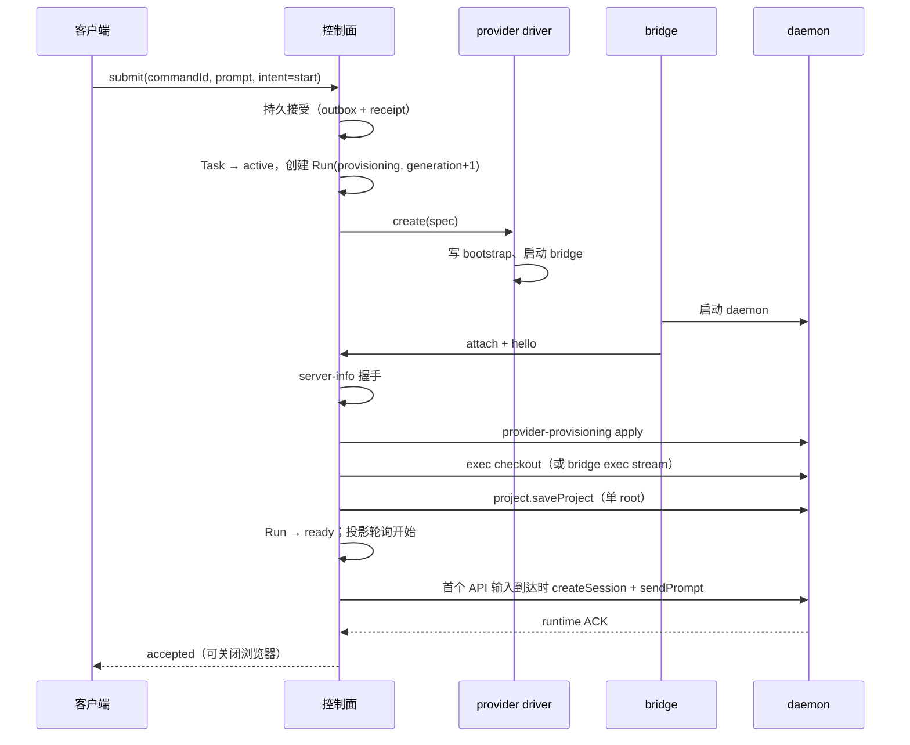

# 02 — 沙箱生命周期编排

> 状态：目标设计。父文档：[00-overview.md](./00-overview.md)。
> 关联：[01-reverse-channel.md](./01-reverse-channel.md)、[03-task-management.md](./03-task-management.md)。

## 1. 模型与所有者

```text
Project（repo 授权域） → Task（稳定工作委托） → Run（0..n 次执行尝试）
                                              └─ Sandbox（provider 实例）
```

- **Project**：控制面事实，repo + 授权 + 默认分支。
- **Task**：控制面事实，跨 Run 稳定，持有 `taskStableId`、`nextRunGeneration`、`activeRunId`。
- **Run**：控制面事实，易耗执行体；一个 Task 同时最多一个有效写入 Run。
- **Sandbox**：provider 资源，归属 Run；可由 provider 暂停/恢复/销毁。
- runtime 的会话、轮次、输入队列与权限裁决属于沙箱内 CLI，控制面不复制。

## 2. Run 状态机

| 状态           | 进入条件                                                                | 允许操作                  |
| -------------- | ----------------------------------------------------------------------- | ------------------------- |
| `provisioning` | 首输入已被持久接受                                                      | 取消；进入 ready/failed   |
| `ready`        | 沙箱创建、bridge attach、daemon ready、provisioning 完成、checkout 完成 | 投递输入；暂停；停止      |
| `paused`       | 无 watcher 且空闲达阈值（provider 支持 pause）                          | 恢复；停止                |
| `draining`     | 用户停止 / 截止期到达 / 预算耗尽                                        | 等待 checkpoint；强制终止 |
| `stopped`      | 正常终止                                                                | 只读                      |
| `expired`      | 超出硬截止期且已完成终止                                                | 只读                      |
| `failed`       | 供给/握手/daemon 失败且无法恢复                                         | 只读；可 reopen 新 Run    |

转移规则：

1. `provisioning → ready` 必须全部满足：bridge `hello` 的 daemon 为 ready、`server-info` 握手通过、provisioning 返回 `applied`/`already-applied`、checkout 成功。
2. `ready → paused` 只在 provider 能力 `pause: true` 时可用；daemon 进程保留在沙箱内。
3. 网络断开不改变 Run 状态；只标记 attachment `disconnected`。
4. `draining → stopped` 需要 runtime 停止确认或 provider 终止确认；二者不可互相替代。
5. 同一 Task 新建 Run 前必须确认旧 Run 已终止；否则返回 `recovery-required`。

## 3. Provider 驱动

```ts
interface SandboxDriver {
  readonly capabilities: {
    pause: boolean;
    /** 沙箱硬寿命上限（秒），控制面不得超过 */
    maxLifetimeSeconds: number;
    /** 是否支持在沙箱内执行命令（bootstrap/诊断） */
    exec: boolean;
  };
  create(spec: SandboxSpec): Promise<SandboxHandle>;
  status(handle: SandboxHandle): Promise<SandboxStatus>;
  pause?(handle: SandboxHandle): Promise<void>;
  resume?(handle: SandboxHandle): Promise<void>;
  terminate(handle: SandboxHandle): Promise<void>;
  exec(
    handle: SandboxHandle,
    argv: string[],
  ): Promise<{ exitCode: number; stdout: string; stderr: string }>;
}

interface SandboxSpec {
  runId: string;
  taskStableId: string;
  template: { image?: string; snapshot?: string; version: string };
  bootstrap: BootstrapConfig; // 见 §4.2
  checkout: {
    repoUrl: string;
    baseBranch: string;
    taskBranch: string;
    path: string;
    grantToken: string;
  };
  limits: { hardDeadlineAt: number; idlePauseSeconds?: number };
}
```

驱动清单：

| 驱动      | 本版状态       | 说明                                                        |
| --------- | -------------- | ----------------------------------------------------------- |
| `local`   | 完整实现       | 本机临时目录 + 子进程；用于开发与端到端验收，真实走反向通道 |
| `e2b`     | 完整实现       | 模板镜像；bootstrap 通过 SDK 写入                           |
| `modal`   | adapter + 单测 | 真实环境验收延后；能力门控默认隐藏                          |
| `daytona` | adapter + 单测 | 同上；pause/resume 走 snapshot                              |
| `fake`    | 测试           | 内存实现，用于控制面单测                                    |

## 4. 沙箱模板与 bootstrap

### 4.1 模板内容

模板由云侧构建，包含：

- 基础镜像（provider 提供）；
- `zcode-server` 发行版解压到 `<home>/.zcode/server`（stable launcher + runtime/node + 组件）；
- `cloud-bridge` bundle 到 `<home>/.zcode/cloud/bridge.js`；
- `git`、`ca-certificates`、基础 shell 工具；
- checkout 目录（默认 `<home>/workspace/<repoName>`）。

**发行版版本随镜像固定**。升级路径：重建模板（首选）；或控制面通过受控 `exec` 调 `zcode serve update`（后续能力，不在首版验收）。

### 4.2 Bootstrap 配置

写入 `<home>/.zcode/cloud/bootstrap.json`（0600），bridge 启动参数 `--config` 指向它：

```json
{
  "v": 1,
  "controlPlaneUrl": "wss://<host>/api/cloud/bridge/attach",
  "attachToken": "<secret>",
  "runId": "...",
  "taskId": "...",
  "taskStableId": "...",
  "generation": 3,
  "serverRoot": "<home>/.zcode/server",
  "dataDir": "<home>",
  "workspacePath": "<home>/workspace/repo",
  "checkout": { "done": false }
}
```

目录约束：

- `serverRoot` 必须是 `<dataDir>/.zcode/server`。`zcode serve` 仅在 `.../.zcode/server` 布局下把数据根推导为 `<dataDir>`；其它路径会把数据根固定到 serverRoot 自身，个人 provider 配置与会话历史将读不到。
- 本地 provider 还必须把 bridge 子进程的 `HOME`/`USERPROFILE` 指向 `<dataDir>`，否则 Agent CLI 的 `~/.zcode/cli` 会话存储会泄漏到宿主机并在 Run 之间共享。
- provider 配置预置写入 `<dataDir>/.zcode/v2/provider_config.json`（0600）。
- terminate 先执行 `zcode stop --server-root <serverRoot>` 停 supervisor，再结束 bridge 进程并删除目录；只杀 bridge 会留下 detached daemon。

### 4.3 供给时序



顺序约束：

1. `checkout` 与 `project.saveProject` 必须先于任何 session 操作；session 在首个 API 输入到达时惰性创建。
2. provisioning 失败时 Run 直接 failed（不进入 ready），错误码透出到 UI。
3. checkout 使用短时 git grant；失败重试 1 次，仍失败则 Run failed。
4. 首输入以 `commandId` 幂等投递；重复投递由 runtime `CommandInbox` 去重。
5. 浏览器可直接在原始 Web 中创建/使用会话；控制面通过 `listSessions` 轮询发现并持久化投影，不要求由控制面先建会话。

## 5. Provisioning 下发

- 通道：daemon 原生 `provider-provisioning-target`（`IProviderProvisioningTargetService.apply`），控制面通过 `/ws/host` RPC 调用。
- 兜底：沙箱启动前先把个人 provider 配置写入 `<ZCODE_DATA_BASE_DIR>/.zcode/v2/provider_config.json`；Host 通道不可用（隧道异常/旧 daemon）时 provisioning 尝试 30s 后降级继续，不阻断 Run ready。
- 信封构造：控制面读取本机账号事实（`provider_config.json`、`setting.json`、`credentials.json`），按 `providerProvisioningEnvelopeSchema` 校验。
- 触发：新 Run ready 前；账号配置可见变化时对在线 Run 重推（节流单飞）。
- 结果：`applied` / `already-applied` 为成功；`failed` / `unsupported` 或超时记录诊断并继续（依赖预置配置）。
- 凭据只存在于信封与沙箱正式 Store；控制面不把 Secret 写入日志或投影。

## 6. Git 与工作区

- 仓库 URL 使用 GitHub App installation token 生成的短时 clone URL（或 `http.extraHeader` 凭据）。
- `taskBranch` 从 `baseBranch` 创建；已存在则复用。
- checkout 路径固定为模板约定的绝对路径；跨 Run 不变，保证 `workspaceIdentity` 稳定。
- 控制面记录 `baseBranch` / `baseSha` / `taskBranch` / `publishedSha` / PR 引用；GitHub 是产物事实源。

## 7. 截止期、空闲暂停与恢复

### 7.1 截止期

- `hardDeadlineAt = createdAt + provider.capabilities.maxLifetimeSeconds`（可配置但不得超过 provider 上限）。
- 到期的处理：Run → `draining` → 请求 checkpoint → 等待（受 `checkpointTimeoutMs`）→ 强制 terminate → `expired`。
- `dataAtRisk`：checkpoint 或 push 失败时置位，UI 必须显示"可能丢失未保存改动"。

### 7.2 空闲暂停

- 触发条件：`capabilities.pause` 为真；无浏览器 watcher；runtime 无活动事件达 `idlePauseSeconds`；无待投递输入。
- 动作：先请求 checkpoint（如启用），再 provider pause；Run → `paused`。
- 恢复：收到新输入或用户打开任务 → provider resume → 等待 bridge 重连/daemon ready → `ready` → 投递。
- 不支持 pause 的 provider 不做空闲暂停，只受硬截止期约束。

### 7.3 恢复矩阵

| 事件                      | Run 状态            | attachment   | 处理                                                                |
| ------------------------- | ------------------- | ------------ | ------------------------------------------------------------------- |
| WSS 断开                  | 不变                | disconnected | bridge 重连；新 epoch；重新订阅                                     |
| 控制面重启                | 不变（DB 为准）     | 丢失         | 启动时对非终态 Run 做 reconcile：查 provider 状态，等待 bridge 重连 |
| daemon 崩溃               | 不变，标记 degraded | 在线         | bridge 重启 daemon；重新握手；旧 session 由 CLI 恢复                |
| 沙箱死亡（provider 确认） | failed              | 断开         | 保留已 ingest 投影；可 reopen 新 Run                                |
| provider 暂停             | paused              | 断开         | 恢复后重连                                                          |
| 旧 Run 未确认终止         | 不创建新 Run        | —            | 返回 `recovery-required` 并给出操作入口                             |

## 8. fencing 不变量

1. 每个 Task 只允许一个 `activeRunId`；新建 Run 在事务内递增 `nextRunGeneration` 并写入 `activeRunId`。
2. attachment 路由校验 `(taskId, runId, generation, epoch)`；所有异步回写在写入前再 CAS。
3. 旧 generation 不得修改新 Run；旧 epoch 不得投递或发布在线状态。
4. `transport ACK`、`runtime ACK`、`durable ingest` 不互相冒充，也不能证明任务完成或产物已保存。
5. RPC fencing 不能替代 provider 隔离：旧沙箱可能继续持有 Git/模型凭据，终止必须走 provider 真实终止。

## 9. 验收场景

1. `local` 驱动完整供给：Run 从 provisioning 到 ready，首输入被 runtime ACK。
2. provisioning 失败：Run 直接 failed，错误码与诊断可见，输入保留在 outbox 可重试。
3. checkout 失败：重试 1 次后 failed，沙箱终止，无孤儿资源。
4. 硬截止期：到点 drain → checkpoint → terminate → expired。
5. 空闲暂停（支持 pause 的 fake driver）：无 watcher 空闲后 paused；新输入后 resume → ready。
6. 控制面重启：非终态 Run 被 reconcile，投影与 outbox 不丢。
7. 旧 Run 未终止时创建新 Run 被拒绝（`recovery-required`）。
8. 重复 `commandId` 投递只被 runtime 执行一次。

## 10. 待验证

- E2B/Modal/Daytona 的沙箱内 Node 与 git 可用性、bootstrap 文件写入路径。
- pause/resume 后 daemon 的 ingress token、socket 与 session 行为（需要真实 provider）。
- provider 终止确认的可得性（用于 fencing）。
