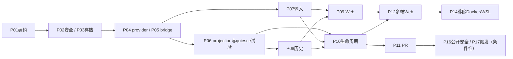

# Spec 10 — 实施计划、验收门槛与迁移

状态：计划，尚未执行。本文把00–09与11的设计转换为可审查的小步实施。此次仅修改spec，不安装provider SDK、不创建沙箱、不启动云服务、不提交或发布代码。

## 1. 已发现的设计问题与修订结果

| 原问题                                 | 修订                                                                                   | 主契约   |
| -------------------------------------- | -------------------------------------------------------------------------------------- | -------- |
| 原有云代码已撤销，文档仍称已实现       | 所有cloud功能标计划；当前源码证据与目标路径分开                                        | 00       |
| provision后依赖浏览器autoSend          | 接受前持久input，服务端ready后投递；首输入关联createSession                            | 03/08    |
| Task状态用connected，混淆工作与机器    | Task/Run/Execution/保存/PR分别建模                                                     | 08       |
| repo/provider/path身份随并发/重建漂移  | 仓库task不透明identity，run/连接代际单独路由                                           | 02/08    |
| ACK被当作可靠历史保证                  | transport/runtime/durable-ingest三类ACK与durable receipt分离；canonical projection出口 | 02       |
| 心跳丢失直接expired，再起新run         | disconnected + provider核验 + 旧写权限处置                                             | 01/02/08 |
| Git当全部持久层，聊天丢失              | 元数据/input/history/附件归控制面，Git保存产物                                         | 03/08    |
| push失败不停机却又有硬上限             | 周期安全点保存、期限drain、remote SHA、dataAtRisk                                      | 01/08    |
| 全凭据store推到沙箱                    | 按 run 用途授权白名单；账号/provider 凭据留 host 本体，App 私钥留 cloud 层（决议⑧）    | 01       |
| PR base/head同一branch，checks权限缺失 | baseBranch/baseSha/taskBranch分开、完整permission矩阵                                  | 09       |
| webhook验签等同用户授权                | delivery inbox、sender authorization、业务幂等、失败补投                               | 09       |
| 云禁本机仅隐藏按钮                     | 云入口独立服务图，绕过UI仍拒绝本机执行                                                 | 03/04    |
| APK默认同origin和热更新承诺            | webDir内置资源、显式controlPlaneOrigin、OAuth/deep-link契约                            | 05       |
| Docker/WSL类型和消费者分两个PR         | 类型/所有消费者同PR，旧身份invalid不回本地                                             | 06       |

这些是方案修订理由，不等于当前源码新增了相应实现。

本轮新增专项契约11：draftStartConfig、冻结submit attempt、start/append显式意图、firstInputCommandId/recipe、stop屏障与保存依赖。当前未提交骨架只作差距证据，不作为P03/P07/P09已完成的前提。

## 2. M0：实施前基线与决策冻结

### 2.1 基线工作

- 使用mise.toml固定的Node24.14.0与pnpm10.33.2。当前环境Node24.18.0、mise命令不可用，执行结果有环境偏差。
- 运行freshness正常fetch；权限问题先修复工作目录/生成物权限或使用合适工作树，不改用户业务代码来掩盖环境问题。
- 核对dist与当前source/package.json的差异，按现有真实构建入口刷新生成物；不得从dist恢复已撤销cloud源码。
- 将现有typecheck/lint问题记录成baseline。无关源码修复独立处理，不混入第一批cloud功能。
- `packages/server`、web/UI及CLI没有统一cloud单测/E2E命令；先为新增模块制定可执行runner入口，再引用命令。

### 2.2 需要冻结的架构选择

| 决策            | 推荐                                                                                            | 若改变的影响                                            |
| --------------- | ----------------------------------------------------------------------------------------------- | ------------------------------------------------------- |
| 部署模型        | 已决（2026-10-06）：**单用户本身就是本项目部署模型**（非过渡），强制认证保留；M7 不在当前路线图 | 若变更部署模型，租户隔离/Git写隔离/模型代理成为前置条件 |
| provider        | 已决（2026-10-05）：E2B+Modal+Daytona 三家 adapter                                              | 各家真实实测解禁前 capability 门控不显示可选            |
| 控制面存储      | 独立SQLite WAL + storage worker +附件目录                                                       | 多实例扩容需外部DB/operation lease，不直接共享JSON      |
| cloud模块       | `packages/server/src/cloud`受控分层                                                             | 独立包可以后续拆，先不增加独立HTTP服务                  |
| projection来源  | runtime canonical commit后结构化export                                                          | 需M2 spike确认hook；不可dump delivery/stdout替代        |
| bridge发布      | 正式新增源码/构建入口，保持stdio supervisor                                                     | 包位置M2冻结，不以旧空目录为实现                        |
| 恢复            | 同task分支新session +持久历史                                                                   | 完整runtime snapshot另立spec                            |
| 沙箱runtime配置 | 已决（2026-10-06）：控制面同源 provider/model 配置直连注入（可信单用户）                        | 公开/多租户前升级代理或等价最小授权（01 §7.1）          |
| Desktop模式     | 云客户端只有 Web（2026-10-06 决议移除 Desktop 云入口）；迁移期保留旧本地开发                    | 最终移除本地入口需独立范围确认                          |
| SSH             | （2026-10-06 决议移除云侧 attachment；SSH 仅作 Desktop 本机/远控与沙箱交互同构参考）            | 不适用                                                  |
| 期限/保留/预算  | 部署配置+provider能力较小值                                                                     | 实测校准；默认数值不冒充平台保证                        |

M0评审通过后才实施数据库schema与协议变更。CLI子仓库AGENTS要求数据库结构方案与维护者确认，当前计划提供了schema/迁移/回滚依据；正式执行时以用户已授权的范围和该要求判断是否仍需确认。

## 3. 目标模块和阅读范围

| 边界       | 必读当前文件                                                                                                     | 计划变化                                             |
| ---------- | ---------------------------------------------------------------------------------------------------------------- | ---------------------------------------------------- |
| server入口 | entry-http.ts、http.ts、stdio.ts、entry-stdio.ts                                                                 | 云服务图、cloud HTTP/WS挂载，保留local模式           |
| RPC        | rpc persistent-protocol.ts、channel/proxy/socket相关入口                                                         | 复用传输；新增cloud facade不改成业务owner            |
| shared     | remoteTarget.ts、remote-workspace-identity.ts、zcode-protocol/index.ts、zcode-protocol-v4/                       | cloud上下文/schema、严格版本/capability              |
| services   | node.ts、zcodeAgentConnectionScope.ts、zcodeAgent.ts、provider provisioning公开入口                              | 明确remote owner与cloud适配；不新增runtime实现导入   |
| CLI        | command-inbox.ts、v4-gateway.ts、conversation-topic-publisher.ts、persistent-command-facts.ts                    | 验证firstInput、canonical export、quiesce与持久facts |
| UI         | SessionPane.tsx、conversationProjectionStore.ts、pendingCommandRegistry.ts、store/remoteWorkspaceSessionStore.ts | cloud receipt投影、稳定路由、现有UI复用              |
| Desktop    | windowRemoteConnectionRegistry.ts、windowHostAttachmentRegistry.ts、hostWorkspaceTaskTracker.ts                  | cloud客户端和旧owner/lease回归                       |
| Web        | main.tsx、auth/webAuthService.ts                                                                                 | cloud boot、显式服务origin、按需attach               |

以上文件存在但不代表其中已有cloud能力。实施前用architecture:context生成目标模块阅读包，再打开语义一跳；新模块先注册managed policy和公开contract。建议cloud-control-plane父模块与cloud/execution下cloud-execution子模块分别归属，按最深root解析，分层和依赖均显式登记；子模块不深导入父app实现。UI代码执行前阅读DESIGN.md；如触及plugin同步/商店再阅读CONTEXT.md。

## 4. PR拆分和依赖

每个PR先落对应spec/test，再实现；列出的测试路径均为拟新增，不是现有覆盖。每批保持最小可运行/可关闭边界。

| PR  | 阶段与交付                                                                                                                                                                                                       | 前置                                                    | 退出证据                                                                                                                                     |
| --- | ---------------------------------------------------------------------------------------------------------------------------------------------------------------------------------------------------------------- | ------------------------------------------------------- | -------------------------------------------------------------------------------------------------------------------------------------------- |
| P01 | M0：决策、严格schema、cloud上下文、架构模块contract与示例                                                                                                                                                        | 方案冻结                                                | schema round-trip、非法输入、未知版本；旧local/SSH契约仍成立                                                                                 |
| P02 | M1：cloud安全服务装配、认证principal与capabilities                                                                                                                                                               | P01                                                     | 绕过UI无法本机Agent/file/terminal执行；未配置认证cloud启动失败                                                                               |
| P03 | M1：DB worker、迁移、Project/Task/run/input/operation存储                                                                                                                                                        | P01/P02                                                 | 临时DB事务/唯一约束/磁盘失败/重启恢复；零provider调用                                                                                        |
| P04 | M2：provider port、一个driver、GitHub read授权adapter/clone broker、创建意图与对账/清理                                                                                                                          | P03                                                     | mock故障点与真实create/inspect/terminate，create未知不重复                                                                                   |
| P05 | M2：固定baseSha/taskBranch的bootstrap、runtime发布与常驻bridge supervisor                                                                                                                                        | P04                                                     | 检验版本/摘要、真实出站WSS、断网不stdin EOF；无client也ready                                                                                 |
| P06 | M2：canonical projection/quiesce技术试验                                                                                                                                                                         | P01/P05                                                 | 确认hook/epoch/seq/snapshot屏障；结果不成立先修订02，不堆fallback                                                                            |
| P07 | M3：durable input delivery、runtime ACK/query和firstInput                                                                                                                                                        | P03/P05                                                 | accepted后关页、ACK丢失、并发firstInput、同ID不同payload                                                                                     |
| P08 | M3：durable projection ingest、snapshot/history与缺口恢复                                                                                                                                                        | P03/P06                                                 | 断网>transport缓存、重启、重复/乱序、retention超界                                                                                           |
| P09 | M3：Web cloud console、任务路由/列表/receipt与按需attach                                                                                                                                                         | P07/P08                                                 | 清存储/换浏览器、移动布局、真实远端交互E2E                                                                                                   |
| P10 | M4：Git write grant/push与remote SHA确认、安全checkpoint、期限drain、续期/配额/stop/reopen                                                                                                                       | P06/P07/P08                                             | concurrent writer、push失败、硬期限、旧run晚到、termination未知                                                                              |
| P11 | M4：PR publication幂等effect、最小权限与PR状态投影（分支/保存已在P01–P10落地）                                                                                                                                   | P10                                                     | base/head正确、创建响应丢失、noChanges、nonfastforward、撤权                                                                                 |
| P12 | M5：多端 Web 审批/订阅与delivery回归（桌面+移动浏览器）                                                                                                                                                          | P09/P10                                                 | desktop-continuous与web-remote-replayable各自通过                                                                                            |
| P13 | （已移除）原控制面 SSH attachment 与 workspace owner 映射                                                                                                                                                        | 不适用                                                  | 2026-10-06 决议移除，见 00 §11⑥；实施证据留 git 历史                                                                                         |
| P14 | M5：Docker/WSL远程目标原子删除                                                                                                                                                                                   | P12，仓库替代路径可用                                   | 类型+消费者+schema+文档同PR，legacy invalid、跨平台宿主回归                                                                                  |
| P15 | （已移除）原 Android 壳、origin、OAuth/deep-link                                                                                                                                                                 | 不适用                                                  | 2026-10-06 决议移除，见 00 §11⑥；apps/android-shell 已删                                                                                     |
| P16 | M7：多账号/Git写隔离/每用户预算与公开门槛                                                                                                                                                                        | 条件性；见 00 §11⑤（单用户不在路线图）                  | 跨租户隔离、恶意repo/越权ref、secret隔离、限额原子性                                                                                         |
| P17 | M7：GitHub durable webhook、sender授权、checks/comments                                                                                                                                                          | 条件性；见 00 §11⑤                                      | delivery重放/补投、bot防自激、fork/外部commenter拒绝                                                                                         |
| P18 | M8：契约扩展冻结（`bootstrap.resources` 帧 schema、profile store 契约、偏好快照 schema、上传端点形状）                                                                                                           | 方案冻结；按 [13 §5](./13-module-map.md) 走 W0 扩展流程 | schema round-trip/非法输入/未知版本拒绝；14 §8 U-01–U-12 反向核对字段；02/07/01 修订段落落档                                                 |
| P19 | M8：控制面 profile store + 上传 API + `bootstrap.resources` 下发与沙箱安装器（含 ready 条件 `resources-installed`、偏好快照实值化）                                                                              | P18、P05/P07（bridge 通道与 ready 闭环已通）            | 上传→新 Run 安装生效（7 类）；运行中 Run 不变；重连幂等；凭据不进日志/投影/attachment 面                                                     |
| P20 | M8：W8 设置页资源管理 UI（MCP 表单、归档上传、AGENTS.md 编辑、**条目级授权开关**（[14 §9.1②](./14-user-profile-sync.md)：v1 无任务粒度勾选 UI）、版本/错误展示）+ 两个契约小追加（PATCH 条目开关、GET 条目回显） | P19a、P19b                                              | 上传/编辑/删除/开关闭环；移动布局；浏览器 E2E 与 14 §8 U-01–U-12 的 UI 侧——**2026-10-11 已落**（见 §10 P20 记录；浏览器 E2E 未执行，列悬项） |



可并行schema/fixture/界面设计，不能在输入/恢复语义未冻结时用mock成功路径认定端到端完成。P06为真实设计验证门槛，不以大规模重写runtime取代证据。

按模块分工的执行入口见 [13-module-map](./13-module-map.md) 与 `modules/W0–W11`，对应关系：P01→W0；P02→W5；P03→W2；P04→W3/W4；P05/P06→W6；P07/P08→W1+W6；P09→W8/W9；P10/P11→W1/W3/W4/W6；P12→W10；P14→W10；P18→W11（W0 扩展）；P19/P20→W11。**W0 契约未冻结前不得并行开工其他工作单。**

**2026-10-11 简化定调后**：上表 P18–P20 中与"自举安装"相关的交付物（`bootstrap.resources` 帧、资源下发编排、沙箱安装器、ready 条件 `resources-installed`、Run 冻结列）已整体退役（[14 §4.8/§9.5](./14-user-profile-sync.md)）；后续实施按 [W11 §13](./modules/W11-user-profile-sync.md) 的 A 契约与 services / B 控制面 / C 沙箱清理 / D UI 四个批次执行（本表尚未单列新 PR 行；批次信息以 W11 §13 为准），见下方 §10 置顶记录。

## 5. 测试分层和入口

当前services/UI有node:test测试文件，但package.json没有统一test脚本；server/web当前也没有cloud E2E脚本。CLI各包有typecheck/lint/build，不等于已有cloud测试。实施时选择node:test或当前可用runner，新增正式脚本、依赖和fixture后才发布命令。

| 层级                  | 目标                                            | 环境                              | 必要断言                                               |
| --------------------- | ----------------------------------------------- | --------------------------------- | ------------------------------------------------------ |
| domain单测            | 状态迁移、到期、配额、代际和幂等                | 注入clock/无IO                    | 不用真实sleep等状态同步                                |
| repository集成        | 事务、唯一有效run、receipt、迁移、worker失败    | 临时SQLite/附件目录               | 提交前后crash、只提交一次、未引用附件清扫              |
| adapter contract      | provider/GitHub/secret/bridge消息               | 可控fake网络与operation查询       | 成功/明确失败/结果未知三分支                           |
| runtime集成           | firstInput、CommandInbox/query、quiesce、export | 受控CLI进程/临时repo              | ACK丢失不重复副作用、投影连续、无并行写                |
| 服务端集成            | auth、cloud服务白名单、WSS/restart              | 本机控制面但Agent只在测试远端     | 绕过UI的本机拒绝和所有权检查                           |
| Web/多端E2E           | 真实UI创建/发送/审批/恢复                       | Web+Desktop/移动视口+隔离provider | screenshot/trace+DB receipt/runtime log/remote SHA关联 |
| Android装机（已移除） | 不适用：随 Android 壳移除（2026-10-06 决议⑥）   | 不适用                            | 不适用                                                 |
| provider实测          | 资源/启动/续期/期限/清理                        | 测试账号、私有测试repo            | provider状态、进程、credential泄漏与账单资源关联       |

E2E不能只验证状态点变绿；至少断言commandId真实admission、输出真实出现、保存SHA真实在远端、旧run不能写新任务。

### 项目/草稿/首次启动专项门槛

P01/P03需补03/08的draftStartConfig、recipe、firstInputCommandId、stop意图、acceptanceSeq及迁移/严格schema；P07验证去重先CAS、失败输入收口及原commandId/ACK对账；P09复用原UI，加入Task scope、完整attempt跨刷新、配置CAS与能力门控；P05/P10验证固定recipe、创建途中stop及checkpoint→terminate依赖。不要只给现独立Cloud列表/textarea加按钮作为最终UI。

11的CT-01–CT-20全部为计划门槛，实施时登记真实runner及按用例所需的UI/事务/provider/runtime证据。正文首发是默认范围，首发附件须单独验证task-owned upload/materialization；Local/SSH与手机Desktop远控原预热/附件/delivery作为回归，不能统一改成云语义。

## 6. 高风险验收矩阵

全部场景均为计划；每项须保留setup/action/assertion/evidence和对应测试ID。

| 组               | 代表场景                                                           | 证据                                                                |
| ---------------- | ------------------------------------------------------------------ | ------------------------------------------------------------------- |
| B01身份          | 同repo两个task，同path/provider；换provider；仓库重命名            | task identity/run映射、两端独立projection                           |
| B02输入          | 202后关页；HTTP响应丢失；ACK丢失；不同payload同ID                  | durable receipt、runtime查询与执行次数                              |
| B03恢复          | 控制面重启；bridge断网数分钟；token旋转回包丢失                    | 同provider handle、ingest cursor、epoch与token状态                  |
| B04双写          | provideralive但bridge失联；旧ready/checkpoint晚到；reopen并发      | generation CAS、拒绝原因、旧token/实例终止证据                      |
| B05保存          | local commit后push失败；push成功回包丢失；ignored/secret未跟踪文件 | remote ref SHA、文件范围、dataAtRisk                                |
| B06期限          | running/idle/awaiting-input/只观看；续期失败；硬上限到达           | 真实expiresAt或明确deadlineEstimate/confidence、业务活动、drain结果 |
| B07背压          | >100帧/s慢消费；WAL/DB满；cursor过retention                        | 无未提交ACK、resync/snapshot、有限资源                              |
| B08权限          | 未登录；跨task/租户；伪trusted role；App撤权；恶意repo借broker     | 404/授权日志/无secret泄漏/无越权写入                                |
| B09GitHub        | PR创建未知、无diff、base改名、外部branch改动、workflow权限不足     | 单PR、head/base、publication错误不覆盖产物                          |
| B10多端          | 三端观看；同时审批；desktop连续与web恢复                           | 相同runtime事实、单裁决、各自delivery语义                           |
| B11SSH（已收敛） | 手机附加桌面、断连/重连                                            | 原workspace owner唯一、不另起runtime（云SSH用例随移除作废）         |
| B12平台          | Web 显式origin/OAuth callback、Windows/macOS/Linux                 | 真实平台执行记录，不把一端通过当全部通过                            |
| B13删除          | WSL/Docker历史identity、类型消费者原子移除                         | 无fallback至本地、保留旧数据、typecheck/knip                        |
| B14成本          | 创建未知、孤儿、stop未知、并发预留争用                             | provider资源对账、槽位保留、无超额实例                              |
| B15触发          | 验签成功但sender未授权、delivery补投、bot评论、fork PR             | 不创建任务或单input、拒绝/幂等记录                                  |

## 7. 数据与发布迁移

当前撤销后的原代码不存在旧cloud Project注册表，不能假定有`zcode-cloud-repo-projects`迁移来源。首版从空cloud数据库建项目；若真实部署存在历史试验数据，先单独读取其schema/来源并制定一次性import，不能猜字段。

原Desktop/本地task数据库、workspace history和session文件不搬到cloud，也不删除。新cloud DB schema独立版本化。runtime旧数据只通过已验证的兼容导入机制进入历史，不把浏览器草稿直接转换成已admitted事实。

DB migration默认additive：备份、事务、schema版本校验、兼容读窗口；无法兼容旧binary时阻止降级启动。生产回滚流程先停止accept新任务，保留持久delivery/reconciliation服务处理已有意图，核验活动run，不能简单关feature flag使已接受工作无人管理。

SDK/runtime/bridge分版本发布；控制面只接受兼容的capabilities。runtime资产使用固定版本与摘要校验，禁止任务启动时无限追最新。滚动更新中旧run可以在受支持版本继续，新增run使用新模板；需要中断时按drain保存策略处理。

MVP控制面单实例；不将sqlite文件放多进程共享网络盘作为扩容。水平扩展需要外部DB、operation lease与generation fencing设计，在独立变更中处理。

## 8. 运行与发布验收

- cloud模式认证配置缺失、持久卷不可写、migration失败、bridge版本不兼容时fail-closed，不隐式切local。
- cloud部署只开放需要的HTTP/WS入口，origin统一；不在spec中写真实用户域名、服务器地址、密钥或账号。
- （2026-10-06 决议移除）原"单用户SSH连接使用明确target allowlist"条款随云 SSH attachment 移除作废；Desktop 本机 SSH 目标不受云范围约束。
- provider创建/续期/销毁、Git写入与PR都带trace/operationId；所有日志按service logger和debug/info/warn/error层级，正文与token脱敏。
- 长期可见指标：active run、未确认input、projection lag/WAL bytes、last checkpoint、续期失败、unknown external operation、孤儿资源。
- DB/附件/secret备份一起演练；恢复后先核验旧provider与写凭据。进程重启零丢accepted输入与整卷灾难恢复不是同一承诺。
- 预算默认值由provider实测与部署配置决定；provider账单为事实，控制面估算标明估算。超预算停止新创建，已有任务按保存策略drain。

## 9. 必须执行的代码检查

代码实施阶段每个PR按真实package.json执行：

```bash
node scripts/check-workspace-freshness.mjs
pnpm architecture:check --changed
pnpm architecture:context <实际模块ID>
pnpm typecheck
pnpm lint
pnpm fmt:check
pnpm verify:pre-push
```

涉及CLI时还执行 `pnpm --dir apps/zcode-cli typecheck` 与 `pnpm --dir apps/zcode-cli lint`；涉及删除导出先用 `pnpm dep:refs --list-exports <file>`/symbol查询，最后 `pnpm knip`。新增测试/E2E入口建立后加入该PR的验证清单，不杜撰现有`pnpm test`或`pnpm e2e`。

architecture baseline不能自动刷新消除新增违规。报告改变模块、owner、event order、测试、行数和baseline/new violations。所有未执行/环境受限验证单列。

## 10. 文档修订验证记录

### 2026-10-13 M8 简化改造 A–D 验收记录（全量回归 + dev 服务重启 + 无头浏览器/接口验收）

触发与来源：用户 2026-10-12 派发 M8 简化改造 A–D（W11 §13）的**全量回归 + dev 服务重启（含迁移 0008 就地修改导致的 DB 兼容处理）+ 无头浏览器验收**。本轮**零源码改动**；仅本记录为仓库内唯一文件变更（A–D 的代码改动为既有未提交工作树，共 143 个改动文件，不属本轮）。

**一、全量回归（真实执行，仓库根）**

| 项                                                                | 结果                                                                                                                                                                                                 |
| ----------------------------------------------------------------- | ---------------------------------------------------------------------------------------------------------------------------------------------------------------------------------------------------- |
| `node scripts/check-workspace-freshness.mjs`                      | PASS：基线新鲜（feat/cloud-agent 与 origin 同步；相对 origin/main ahead 8 / behind 1，阈值 50）                                                                                                      |
| `pnpm typecheck`                                                  | PASS exit 0（`tsc -b` 增量：无待编译变更）                                                                                                                                                           |
| `pnpm lint`                                                       | PASS exit 0：**0 error / 77 warning，全部存量**（逐条警告坐标与本会话 143 改动文件的新增行区间零交集；含改动文件内 15 处警告均为未改动行）                                                           |
| `pnpm fmt:check`                                                  | exit 1（存量）：35 个失败文件与 143 个改动文件**交集为空**（本会话文件 0 失败）；存量含 `.zcode/plans/*`、`README.md`、`packages/services/src/bots/*` 等                                             |
| `pnpm architecture:check --changed`                               | PASS：`architecture: OK / violations: 0 / baseline: 0 / new: 0`                                                                                                                                      |
| `pnpm --filter @zcode/shared test`                                | PASS：75 tests / 75 pass / **0 fail** / 0 skip                                                                                                                                                       |
| `pnpm --filter @zcode/server test`                                | PASS：674 tests / 666 pass / **0 fail** / 8 skip（8 条均为凭据门控 live 测试：`ZCODE_CLOUD_E2E`/`ZCODE_CLOUD_GITHUB_LIVE`/`ZCODE_CLOUD_SANDBOX_TEMPLATE_REF` 未设即显式 skip，存量设计，不伪造通过） |
| `pnpm --filter @zcode/client test`                                | PASS：38 / 38 pass / **0 fail**                                                                                                                                                                      |
| `pnpm --filter @zcode/ui test`                                    | PASS：247 / 247 pass / **0 fail**                                                                                                                                                                    |
| `cd packages/services && node --import tsx --test test/*.test.ts` | PASS：42 / 42 pass / **0 fail**                                                                                                                                                                      |
| `pnpm --filter @zcode/server build:sandbox-assets`                | PASS exit 0：`supervisor.bundle.mjs` 3,608,023 B sha256 `38bdba0d9eee…`、`runtimeStub.bundle.mjs` 3,362,881 B sha256 `312985f707be…`，manifest buildId `3.14.3+116339235fd2`                         |

**二、dev 服务重启（DB 兼容处理）**

- 旧后端为 tsup watch 进程组（pgid 225563），源码大改后状态不可信；整组终止后确认 3030 释放（vite 5173 不动）。
- B 批就地修改迁移 0008（commands/subagents 改 markdown `content_kind`），旧库 CHECK 约束不含 markdown，启动以 `startup_failed：迁移 0008_user_profile 的 checksum 与账本不一致` 拒绝；按预案将 `cloud.db*`（含 3 个旧 `.bak-*`）移入 `~/.zcode-cloud-debug/data/backup-20261012-234735-/`（**备份先行**），`data/.zcode/v2/`（onboarding/provider 凭据）原地保留未动。
- 用 `/tmp/zcode-cloud-debug-start.sh` 原样重启（新库自动建，`lastAppliedMigrationId: 0008_user_profile`、schemaVersion 8、authMode anonymous）。
- 冒烟：`GET /api/cloud/capabilities` 200（anonymous、e2b `apiKeyConfigured=true`、部署日志 `githubConfigured=true`）；`GET /api/cloud/user-profile` 200 空 profile。
- 首轮 V4 揭示脚本将 `ZCODE_CLOUD_PUBLIC_ORIGIN` 覆盖为回环地址导致沙箱无法回连（见环境性发现 2），随后用 **仅改该一行** 的副本 `/tmp/zcode-cloud-debug-start-public.sh`（origin 取 cloud.env 的隧道值 `https://zcode.yuxuanyi.tech`）重启以完成真机 V4；原脚本保持原样未改。当前后端 PID 370373（3030）。（2026-10-13 追加：V4r 重验时后端已按同一 public 脚本重启为 PID 380567；见下文「六、V4r 重验记录」。）

**三、无头浏览器验收（agent-browser 0.39.0 + Chrome for Testing 151 headless，`http://127.0.0.1:5173/`）**

`data/.zcode/v2` 凭据仍有效，**未出现账号门**，直接进入云壳（全程免登录，未触碰用户凭据）。

| 项                                    | 结果                                                                                                                                                                                                                                                                                                                                                                                                                                                                                                                                                                                                                                                                                                                                                                                                                                                                                                                                                                                                                                                                                                                                                                                                              |
| ------------------------------------- | ----------------------------------------------------------------------------------------------------------------------------------------------------------------------------------------------------------------------------------------------------------------------------------------------------------------------------------------------------------------------------------------------------------------------------------------------------------------------------------------------------------------------------------------------------------------------------------------------------------------------------------------------------------------------------------------------------------------------------------------------------------------------------------------------------------------------------------------------------------------------------------------------------------------------------------------------------------------------------------------------------------------------------------------------------------------------------------------------------------------------------------------------------------------------------------------------------------------- |
| V1 设置页（`User resources` 分区）    | **PASS**：分区存在；顶部说明为连接期语义（"Resources sync automatically once a sandbox connection is established; tasks that are connected can be synced manually from the task panel; no sync is offered while disconnected."，保存提示同语义）；六分组 tab；Commands/Subagents 为 markdown 编辑器（Entry ID 必须 `.md`、`Markdown content` 文本框），文件选择器 `accept=".md,text/markdown"`，**无归档上传入口**                                                                                                                                                                                                                                                                                                                                                                                                                                                                                                                                                                                                                                                                                                                                                                                                |
| V2 上传（AGENTS.md / commands / MCP） | **PASS**：AGENTS.md 写入保存 → profileVersion 1→2（agents-md/user-agents 198 B）；commands `deploy-notes.md` → v3（104 B，displayName 生效）；MCP `demo-fs` 表单（config JSON）→ v4（80 B）；`GET user-profile` 条目数/字节数/版本号逐项正确（totalBytes 382 = 198+104+80）                                                                                                                                                                                                                                                                                                                                                                                                                                                                                                                                                                                                                                                                                                                                                                                                                                                                                                                                       |
| V3 任务视图门控（无在线任务）         | **PASS**：DOM 中 `[data-testid^="cloud-task-user-profile-sync"]` 计数 0、无 "Sync user resources" 文案（截图）；任务 provision（未连接）期间同样零渲染；终态后横幅为 "The previous run has ended / Reopen task" 且仍无同步入口                                                                                                                                                                                                                                                                                                                                                                                                                                                                                                                                                                                                                                                                                                                                                                                                                                                                                                                                                                                    |
| V4 端到端（真实 E2B）                 | **→ V4r PASS（2026-10-13 模板重建后重验通过；判定明细与新增发现见「六、V4r 重验记录」；以下为原 BLOCKED 记录，保留）**。原记录：**BLOCKED（环境性，任务预授权类别）**：run gen2（隧道 origin）沙箱成功回连（`bridge attachment opened` → `welcome` → `bootstrap.config` → 236 ms 后 `bridge attachment closed {reason:'frame-rejected:invalid-frame', code:4001}`）→ 2 分钟 `cloud provisioning timed out with live instance` → 补偿终止（`e2b sandbox terminated`，end_reason `provider-confirmed`）。根因经**模板镜像取证**：模板 `zcode-sandbox-template`（E2B 侧 10/5 创建、无重建）内 supervisor bundle（镜像内 10-08 产物，sha256 `560cbc0f7aa2…`）的 `bootstrap.config`/`rpc.open` 均为 `.strict()` 旧 schema，**无 `preferences`、无 `serviceScope`**（亦无 `cloudBootstrapPreferences`/`writeUserAgentsFile`/`beginUserArchiveImport`）→ 新控制面下发的 `bootstrap.config`（含 preferences 块）被旧 bundle 整帧拒绝（4001 为**执行节点侧**关闭码，`frame-rejected:` 由沙箱 `bridgeInbound` 构造）→ 连接从未 ready，自动/手动同步均不可达。补救 = 按 `packages/server/src/cloud/adapters/sandbox/templates/README.md` 步骤 1–4a **重建模板**（`build:sandbox-assets` → `build:remote`+CLI build → `npx @e2b/cli template create zcode-sandbox-template`），**无需改代码**；A–D 侧行为正确（双向 fail-closed、不伪造 ready、补偿终止干净） |
| V4r 端到端重验（2026-10-13，模板重建后） | **PASS**：「六」详录。要点：profile 备 3 条（agents-md 199 B / commands `deploy-notes.md` 107 B / mcp `demo-fs` 80 B，v4）后建任务——provision→ready ~10 s 无 `frame-rejected`；**服务端自动同步 `{trigger:'automatic', synced:2/2, failed:0}`**（沙箱文件取证 AGENTS.md 199 B 0600、commands/deploy-notes.md 107 B）；reopen gen2 后**自动同步 `{trigger:'automatic', total:3, synced:3, failed:0}`（含 mcp）**、随即手动「同步用户资源」= **"Sync complete (profile v6): 3 entries — 2 synced, 1 skipped, 0 failed."**（mcp 同名 skip 为 14 §4.7 既有幂等语义；三件实体文件均已在沙箱 HOME 取证）；终态（stop）后横幅 "The previous run has ended / Reopen task"、同步入口消失。截图 `/tmp/V4r-*.png`（关键：V4r-42 同步摘要、V4r-43 终态） |
| V5 未连接/终态拒绝（API 直测）        | **PASS**：不存在任务 → 404 `not_found`/`task-not-found`；provisioning（未连接）任务 → 409 `not_ready`/`run-not-connected`；终态任务 → 409 `not_ready`/`run-terminal`                                                                                                                                                                                                                                                                                                                                                                                                                                                                                                                                                                                                                                                                                                                                                                                                                                                                                                                                                                                                                                              |

**四、API 兜底验收（curl 真实输出）**

| 项                                                             | 结果                                                           |
| -------------------------------------------------------------- | -------------------------------------------------------------- |
| `PUT /api/cloud/user-profile/entries/agents-md/user-agents`    | 200（v5；159 B；sha256 `b2da3e802460…` 与本地自算一致）        |
| `PUT /api/cloud/user-profile/entries/commands/deploy-notes.md` | 200（v6；125 B；sha256 `e72650eb0c8f…` 一致）                  |
| `PUT …/commands/badid`（entryId 无 `.md`）                     | 400 `invalid_entry`/`invalid-entry-path`                       |
| `GET /api/cloud/user-profile`                                  | 3 条 / totalBytes 364 = 80+125+159（与条目字节和一致）         |
| `POST /api/cloud/tasks/:id/user-profile-sync`（未连接/终态）   | 409 `not_ready`（`run-not-connected` / `run-terminal`；见 V5） |

**五、环境性发现清单（均不计代码回归）**

1. **E2B 模板陈旧**（V4 阻断根因）：`zcode-sandbox-template` 自 10/5 创建后未重建，镜像内 bundle（10-08）与新协议（`bootstrap.config.preferences`、`rpc.open.serviceScope`、连接期同步方法）不兼容；模板版本固定（Run recipe 冻结 `templateVersion`/`imageDigest`）是既有设计，故改动协议后**必须重建模板**才能真机联调（README 已载明路径）。
2. **dev 启动脚本的 origin 覆盖**：`/tmp/zcode-cloud-debug-start.sh` 把 `ZCODE_CLOUD_PUBLIC_ORIGIN` 覆盖为 `http://127.0.0.1:3030`，E2B 云沙箱不可达回环地址（故 run gen1 无任何回连痕迹）；cloud.env 原值（隧道 `https://zcode.yuxuanyi.tech`，cloudflared 正在运行且路由本机 3030）为沙箱可达 origin。脚本已保持原样，隧道 origin 版本见 `/tmp/zcode-cloud-debug-start-public.sh`。
3. fmt:check 存量失败 35 文件（与 A–D 无关）；lint 存量 warning 77（0 error）。
4. 环境未预装 agent-browser：安装于 `/tmp/ab-tool`（v0.39.0）并复用 playwright Chromium（Chrome for Testing 151，配置 `/tmp/ab-config.json`），未写入用户全局 npm 或仓库。

**结论**：回归全绿（仅 fmt 存量 35 失败与 8 条凭据门控 skip，均标注不冒充通过）；A–D 的可验收面（设置页 markdown/连接期语义、上传 API 与版本/哈希派生、任务视角门控与未连接零渲染、未连接/终态 409、无在线任务无入口）**逐项 PASS**；唯一端到端 V4 阻断由模板陈旧这一环境因素造成（有镜像内 sha/schema 取证），非本轮代码回归。**判定：达到可提交标准**；建议（不阻塞提交）重建 E2B 模板后补跑一次 V4 真机链路。

（2026-10-13 追加：上述建议已执行——重建模板后 V4r 重验 **PASS**，见下节「六」；本节其余结论不变。）

**六、V4r 重验记录（2026-10-13，模板重建后；命令、耗时与镜像取证）**

前置：为干净起点，dev 库再次轮换（`cloud.db*` 移入 `~/.zcode-cloud-debug/data/backup-20261013-001626-/`，`data/.zcode/v2` 凭据原地保留），按 `/tmp/zcode-cloud-debug-start-public.sh` 原样重启（PID 380567，`PUBLIC_ORIGIN=https://zcode.yuxuanyi.tech`，`capabilities` 200）。无头浏览器 agent-browser 0.39.0（`/tmp/ab-tool`），截图 `/tmp/V4r-*.png`。**未改任何源码；用户 HOME/凭据未动。**

1. **模板重建（两轮，均按 `packages/server/src/cloud/adapters/sandbox/templates/README.md` 步骤 1–4a）**
   - 构建上下文 `/tmp/zcode-template-build`；`build:sandbox-assets` 产物已就绪未重建（supervisor 3,608,023 B sha256 `38bdba0d9eee…`、runtimeStub 3,362,881 B sha256 `312985f707be…`，manifest buildId `3.14.3+116339235fd2`）。
   - **第一轮**（仅换 supervisor 资产）：`npx -y @e2b/cli@latest`（2.21.2）`template create zcode-sandbox-template --dockerfile e2b.Dockerfile --cmd /opt/zcode/start.sh --ready-cmd "echo ready" --cpu-count 2 --memory-mb 4096` → exit 0、**耗时 27 s**（E2B 构建 19 s）；templateId `kqko0hhq2zovsio5tkrk`、buildId `893cfa92-7faa-4d4d-8e09-7b04e91a3b87`。临时沙箱取证 `/opt/zcode/supervisor.bundle.mjs` = `38bdba0d9eee7d3d2b3c195d336ce2c1d3582fe1cd4de6de8b6b8d3fcc7ee51a` ✓（原 10-08 旧帧 schema 阻断解除）。
   - **第二轮**（真机联调暴露镜像内 runtime 产物仍是 10-09 旧构建：`zcode-server.cjs`/`zcode-cli.cjs` 均无 `writeUserAgentsFile`，同步报 `Method not found`）：按 README 步骤 2 重建——`pnpm --filter @zcode/server build:remote`（→ 11,245,556 B）、`pnpm --dir apps/zcode-cli/packages/cli build`（→ 31,284,913 B + `dist/provider/zcode-builtin.json`）；**注意必须清理继承的 ZCODE_* 调试 env**（本机 shell 泄漏 `ZCODE_ENV=production` 与指向 3.15.1 HOME 缓存的 `ZCODE_BUILTIN_PROVIDER_CONFIG_FILE`，直接跑会以 `Invalid Built-in Provider config (production)` 失败；`env -u …` 清掉后走仓库自带 `config/provider/zcode-builtin.json`）。重出模板 exit 0、**耗时 35 s**，buildId `9a73c335-9046-4bae-90e1-48f072088e99`（templateId 同上）；镜像内取证：supervisor `38bdba0d…` ✓、`/opt/zcode/zcode-server.cjs` 含 `writeUserAgentsFile`/`beginUserArchiveImport` ✓。
2. **端到端（a–d）**
   - 新库 + UI 重建三类资源（V4r marker：agents-md 199 B / commands `deploy-notes.md` 107 B / mcp `demo-fs` 80 B；profile v1→v4）→ 建任务。
   - provision：`e2b sandbox created` → `bridge attachment opened/welcome/bootstrap.config` → **`cloud run ready`（+10 s）**，全链无 `frame-rejected`/无超时；输入投递 + agent 应答（"Worked for 5s"）。
   - **（a）自动同步 PASS**：ready 即 `cloud user profile sync completed {trigger:'automatic', synced:2/2, failed:0}`（当时 profile 无 mcp）；沙箱文件级取证 `~/.zcode/AGENTS.md`（199 B/0600，V4r marker 正文）、`~/.zcode/commands/deploy-notes.md`（107 B）——旧镜像上该方法曾 `Method not found`，新镜像写入成功。
   - **（b）手动同步 PASS**：reopen gen2（profile v6 含三件）后自动同步 `{trigger:'automatic', total:3, synced:3, skipped:0, failed:0}`（含 mcp）；随即点「同步用户资源」→ UI 摘要 **"Sync complete (profile v6): 3 entries — 2 synced, 1 skipped, 0 failed."**（agents-md/commands 覆盖写计 synced；mcp 因同名已存在计 skipped，14 §4.7① 既有幂等语义）。三件实体文件在沙箱 HOME 全部取证：AGENTS.md 199 B/0600、commands/deploy-notes.md 107 B、`~/.zcode/cli/config.json` 219 B/0600 含 `mcp.servers.demo-fs`。
   - **（c）终态 PASS**：stop 受理（draining → 本 run gen1 因下述②卡 draining 由 `force-stop` 收口；gen2 同）后，横幅 "The previous run has ended / Reopen task"，DOM 无 "Sync user resources"（截图 V4r-27/V4r-43）。
   - **（d）截图**：`/tmp/V4r-0-project-list.png`（空项目列表）→ `/tmp/V4r-42-gen2-manual-sync-result.png`（同步摘要）→ `/tmp/V4r-43-gen2-terminal.png`（终态）全序列留存。
   - 附注：本库首轮 V4r 的 gen1 手动同步曾得 "3 entries — 2 synced, 1 failed"，唯一失败 = `agents-md: settings-sync.writeUserAgentsFile failed: closed (Method not found)`，即上述第二轮模板重建的根因，非同步逻辑缺陷。
3. **V4r 新发现（产品级，未修；均不改动源码）**
   - ① **agent 会话 cwd 被身份污染**：沙箱内 CLI 会话 `workingDirectory=/workspace/epdg/cloud-task:<taskId>`（不存在）→ 工具 `spawn /bin/bash ENOENT`、工作目录 Read 失败；而进程 cwd 实为 `/workspace/epdg`，镜像内 bash 与克隆仓库均在。根因：v4 `createSession` 只带身份 `workspaceId`，CLI `resolveWorkspaceRefFromId` 对非 `remote:` 身份按本地路径回落（`apps/zcode-cli/packages/bootstrap/src/zcode-protocol/workspace.ts:48-49`，注释已列 cloud-task 走此分支），相对值被 cwd 解析成 `<workspacePath>/<identity>`；既有污染修复器只覆盖 `remote:` 前缀（`apps/zcode-cli/packages/core/src/runtime/helpers/persisted-remote-session-path-repair.ts:49-51`）。与 spec 既有待办一致（02 §2/07 §8/06 §4：「createSession 同时传可信 workspacePath，不能把 `cloud-task:*` 当本地目录」），尚未实施。
   - ② **checkpoint 后控制面 RPC 挂起（间歇）**：周期/ready 后 checkpoint（`cloud checkpoint saved`，约每 5.3 min）之后，控制面经 bridge 的 RPC 出现无响应至超时（`closed (… timed out)`）——本 V4r 中表现为 gen1 手动同步两次 3 条全超时、append 输入 `uncertain/closed`（V4 首轮同签名）、stop 后 run 卡 `draining` 需 `force-stop`；同一端点在同 run checkpoint 前一切正常（gen2 手动同步紧邻 ready 即成功）。supervisor.log 侧挂起期间无新 `rpc relay session opened`。两端日志段：`/tmp/zcode-cloud-server.log` 00:36/00:39/00:46–00:48/00:51/00:57。

（最终结论：**V4 由 V4r 判定 PASS**——模板/资产陈旧两层阻断均已按 README 重建解除，provision→ready→输入/回复→自动+手动同步（计数 + 沙箱文件级取证）→终态门控全链通过；上述①②为独立的产品级新发现，不推翻 V4 判定，建议另开任务处置。）

### 2026-10-11 M8 简化定调：连接期同步（退役自举安装面；本轮只改 spec）

触发与来源：用户 2026-10-11 **最终口径**对 M8 同步设计做整体简化。落 [14 §4（全节重写）/§9.5](./14-user-profile-sync.md)（决议记录）、[W11 §13](./modules/W11-user-profile-sync.md)（A–D 实施批次）、[02 §0/§4/§5.3](./02-bridge-protocol.md)、[03 §6](./03-control-plane.md)、[07 §7](./07-connection-architecture.md)。**本轮为纯 spec 修订：不动代码**；退役项与新增面的实现属 W11 §13 的 A–D 批次（未开工）。

定调（用户口径原文要点）：

1. **总框架**：云相对 SSH 的**专有面仅三项**——沙箱回连（出站 WSS）、生命周期管理、持久投影/可回放历史；其余一切骑 **SSH 同构服务层**（安装逻辑 = 既有 sync 服务单一来源）。
2. **同步语义三规则**：①沙箱连接建立（bridge ready）后**自动同步一次最新 profile**；②**手动同步仅在连接状态下允许**——任务视图的同步入口只在 run 连接态且非 terminal 时显示，未连接时 UI 不显示入口、服务端调用也拒绝（409）；③**不做自举期（pre-ready）安装**。
3. **同步形态**：驱动方 = 控制面；控制面经 bridge relay 调沙箱 runtime 的既有服务（与桌面调 SSH 远端同构）。

口径修正（两处，均已写入 14 §9.5）：

| #   | 修正前（P18–P20，轮 1）                                                           | 修正后（现行，轮 2）                                                                           |
| --- | --------------------------------------------------------------------------------- | ---------------------------------------------------------------------------------------------- |
| 1   | Run 自举时一次性安装；Run 预约时冻结 `resources_profile_version`，运行中 Run 不变 | **每次连接自动一次 + 连接态手动任意次**；Run 不追踪 profile 版本（冻结列退役）                 |
| 2   | commands/subagents = tar+gzip 归档上传/自举解包                                   | **单文件 markdown 文本条目**（entryId = 文件名 `*.md`、payload ≤256KiB/条），消除 tar 解包环节 |

退役清单（overview；逐项落位见 [14 §4.8](./14-user-profile-sync.md)）：`bootstrap.resources` 帧（02 §4 帧行已删、02 §5.3 ready 条件恢复 6 条）＋控制面分块下发编排（`bootstrapResources.ts`、bridgeChannel/handshake 接线、registry 的 transfer 记录）＋bundle/分片与窄公开入口（`userProfileBundle.ts`、`userProfileBundleContract.ts`、policy `publicEntrypoints` 项）＋沙箱自研安装器（`resourcesInstaller/Staging/Home/State`、`resourceIntake`、`domain/resourcesBundle`）＋ready 条件 `resources-installed`＋相位 `installing-resources`＋Run 冻结列 `resources_profile_version`（列保留不写不读，注明废弃）＋`applied-resources.json`/journal。**保留不动**：偏好快照链（`bootstrap.config.preferences` → `applied-policy.json` v2 → responder）、profile store 与上传/查询/开关端点、浏览器 allowlist/denylist、`@zcode/services/archive` 权威解包入口、上传侧最小前置校验。

新增面（契约先冻结，见 [14 §9.5④](./14-user-profile-sync.md)）：控制面专用 allowlist `CLOUD_CONTROL_PLANE_SERVICE_ALLOWLIST`（浏览器面白名单/denylist 不变）；`rpc.open.serviceScope: "client" | "control-plane"` 分面；skill-sync/plugin-sync 分块导入方法（`beginUserArchiveImport`/`appendUserArchiveImportChunk`/`completeUserArchiveImport`/`abortUserArchiveImport`，收块 → 复用既有校验与解包，突破 4MiB 帧限，SSH 将来可共用）；settings-sync 最小写入方法 `writeUserAgentsFile`（整文件覆盖、原子、0600、≤256KiB）；commands/subagents 文本负载与归档类别收敛（`user-profile.ts`）；手动同步端点 `POST /api/cloud/tasks/:taskId/user-profile-sync`（连接态前置，409 `not_ready`，03 §6 已登记）；任务视图同步入口（连接态且非 terminal 才渲染）。

交叉引用同步（本轮已落）：[00 §1/§10 索引](./00-overview.md)（M8 表述改为连接期同步）、[13 §3](./13-module-map.md) W11 行摘要、[14 §1/§2/§3/§5/§6/§7/§8/§9.1③④/§9.5](./14-user-profile-sync.md)、[02 §0/§4/§5.3](./02-bridge-protocol.md)、[03 §6](./03-control-plane.md)、[07 §7](./07-connection-architecture.md)、[W11 顶部/§13](./modules/W11-user-profile-sync.md)。

验收：

| 项                                             | 本轮（纯 spec）结果                                                                                                                                                                                                                                                                                                                  |
| ---------------------------------------------- | ------------------------------------------------------------------------------------------------------------------------------------------------------------------------------------------------------------------------------------------------------------------------------------------------------------------------------------ |
| 交叉引用无死链                                 | 改动文件内 Markdown 相对链接与锚点目标全部存在（脚本核对，见下"验证方式"）                                                                                                                                                                                                                                                           |
| `npx oxfmt`（改动文件）                        | 通过（仓库根 `npx oxfmt`；见下"验证方式"）                                                                                                                                                                                                                                                                                           |
| `git status`／范围核对                         | 仅 `specs/cloud-agent/**` 下 8 个文件被改（14/02/03/07/10/W11 + 00/13 摘要行），代码与其它包零改动                                                                                                                                                                                                                                   |
| 计划验收（A–D 批次完成后逐批执行；本轮未执行） | `pnpm typecheck`、`pnpm lint`、`pnpm architecture:check --changed`、`pnpm fmt:check`、各包 `test`（shared/services/server/client/ui）、`pnpm --filter @zcode/server build:sandbox-assets`、**无头浏览器 E2E**（未连接 run 无同步入口／连接态入口可用并展示逐条结果／设置页 commands-subagents 为文本编辑面板）；真实沙箱端到端归 W10 |

验证方式（可复现）：①链接核对用一次性脚本提取改动文件中的 Markdown 相对链接并 `fs.existsSync` 校验目标存在；②格式用 `npx oxfmt <改动文件>`（等价 `pnpm fmt:check` 的本文件子集）。本轮未执行 typecheck/lint/测试（无代码改动，不产生新构建/测试面）；不将"未执行"写成通过。

### 2026-10-11 M8 简化改造 B 批：控制面连接期同步（W11 §13B；含 60s 超时偏离说明）

触发与来源：落 [W11 §13B](./modules/W11-user-profile-sync.md) 的控制面批次（A 批已冻结契约：`rpc.open.serviceScope` 必填、`CLOUD_CONTROL_PLANE_SERVICE_ALLOWLIST`、分块导入四方法、`writeUserAgentsFile`、commands/subagents markdown 文本分支、`cloudUserProfileSyncResponseSchema`）。动 `packages/server/src/cloud`（控制面）、`packages/client`（SDK 成对登记）、`packages/shared`（端点矩阵行 + 路径常量）与 spec；**不动 `cloud/execution/**`（C 批）与 `packages/ui`（D 批）\*\*。

落地内容：

1. **退役自举下发链**（[14 §4.8](./14-user-profile-sync.md)）：删 `app/provisioning/bootstrapResources.ts`、`domain/userProfileBundle.ts`、`userProfileBundleContract.ts`（module.ts / architecture-policy.yaml 的 `publicEntrypoints` 项同步删除）；`app/ports/attachmentPort.ts` 与 `adapters/ws/attachmentPort.ts` 删 `BootstrapResourcesFrame`/`sendBootstrapResources`；`adapters/ws/handshake.ts` 删 welcome 后的 resources 追加段；`app/attachments/registry.ts` 删 `resourcesTransfer*`/`markBootstrapResourcesSent`/`bootstrapResourcesSent`；`contract.ts`/`deps.ts`/`assembleCloudControlPlane.ts`/`entry-cloud-control-plane.ts` 同步清线。
2. **Run 冻结列退役**：`runRepo` 停止写 `resources_profile_version`、删 `runs.resourcesProfileVersion` handler 与端口方法（`storageMethodTypes.ts`/`cloudStorageClient.ts`/`runPort.ts` 一并移除）；列与迁移 0008 保留，注明废弃（[14 §4.8](./14-user-profile-sync.md)）。
3. **store/domain 适配 markdown 条目**（[14 §4.5](./14-user-profile-sync.md)）：`content_kind` 增 `markdown`（迁移 `0008` 的 CHECK 就地扩列——本功能未发布、无存量 commands/subagents 行，**无需数据迁移**；已应用 0008 的旧 dev 库需重建，属预期）；`domain/userProfile.ts` 新增 markdown 类别判定与超限前置（reason `commands-content-too-large`/`subagents-content-too-large`）；`userProfileService` 上传分支按类别落正文；`userProfileRepoHelpers` 的派生口径 = 正文 UTF-8 字节（`sha256`/`bytes` 与 agents-md 同口径）；HTTP 上传/回显/开关端点行为对齐（路径参数 schema 已由 A 批的 `cloudUserProfileEntryPathParamsSchema` 强制 `.md` 后缀）。
4. **连接期同步编排（核心新增）**：`app/userProfile/profileSyncService.ts`（门控/单飞/汇总/日志/自动触发）+ `app/userProfile/profileSyncCategories.ts`（逐类别调用翻译，行数门禁拆分）+ `app/ports/controlPlaneRpcPort.ts` + `domain/userProfileSync.ts`（base64 纯编解码、分块、mcp 分批、subagents front-matter 映射、错误文本有界）。执行器取**最新** profile（`snapshot` → `readVersionEntries`，只同步 enabled 条目），前置校验按 order = Run 存在且非终态 → 无 `stopRequested` → 当前 attachment 存在且 ready，不满足返回结构化 `not_ready`（`run-not-found`/`run-terminal`/`stop-requested`/`run-not-connected`）；逐类别调沙箱既有服务（mcp 分批 `importMcpServers`、skills/plugins 分块 begin/append/complete、commands `list`+`writeCommandFile`/`updateCommandFile`、subagents `list`+`createAgent`/`updateAgent`、agents-md `writeUserAgentsFile`），逐条 try（单条失败不中断其余），整体响应 = `cloudUserProfileSyncResponseSchema`。
5. **控制面 RPC 通道**：`adapters/ws/controlPlaneRpcChannel.ts`（每 Run 一条流、`rpc.open` 带 `serviceScope:"control-plane"`、真实 `ChannelClient`、30s 调用超时），`bridgeChannel.ts` 装配/routing/release/dispose；白名单用 `isCloudControlPlaneServiceAllowed` 在 app 层预检（沙箱侧按 scope 选白名单属 C 批）。
6. **自动触发**：`adapters/ws/inbound.ts` 的 `bridge.ready` 分支在 `runs.markReady` + `registry.markReady` 之后调 `triggerAutomatic`（同 run+epoch 去重、失败只记 `warn`、不 fail run）；**手动端点** `POST /api/cloud/tasks/:taskId/user-profile-sync`（`adapters/http/userProfileRoutes.ts`）与 shared 矩阵行（`userProfileEndpoints.ts` + `CLOUD_USER_PROFILE_ENDPOINT_PATHS.syncTask`）、client SDK 方法 `syncTaskUserProfile`（schema 索引 + 方法 + fixture + invocations）成对登记。
7. **`browserStreams` 补 `serviceScope:"client"`**（A 批移交项）。

自主决定（本批无 A 批未决项，以下为提高可核对性的落地选择）：

| #   | 决定                                                                                                                                                                                                                                  | 依据/影响                                                                                                                                                                                                                  |
| --- | ------------------------------------------------------------------------------------------------------------------------------------------------------------------------------------------------------------------------------------- | -------------------------------------------------------------------------------------------------------------------------------------------------------------------------------------------------------------------------- |
| 1   | commands 条目：`writeCommandFile`/`updateCommandFile` 的 `config.prompt` = **整份 markdown 正文**（含 front-matter）                                                                                                                  | 既有生成器在无 `description`/`argument-hint` 时原样写出 `prompt`（`generateMarkdownCommandFileContent`），并由既有 parser 读回 front-matter → 正文逐字节落盘、解析仍由既有服务保留（[14 §4.5](./14-user-profile-sync.md)） |
| 2   | subagents 条目：控制面按既有 serializer 的键集把 front-matter 映射成 `SubAgentConfig`（`name`/`description` 回落 entryId、body = `systemPrompt`、`model`+`thoughtLevel` 经 shared 的 `parseSubagentMarkdownSelection`；未知键不携带） | 沙箱落盘是既有服务的规范化序列化结果，与条目正文格式可能不同（键序/引号/未知键）——"原样落盘"需 subagents 服务新增原始 markdown 写入方法，**列为 C/D 批悬项**；名称合法性与必填校验仍由既有服务裁决                         |
| 3   | mcp 调用显式带 `enabled: true`                                                                                                                                                                                                        | 既有 `setServerEnabled(config, undefined)` 走**停用**分支（`14 §4.2` 的 `[{name, config}]` 简写不含该字段）；只同步 enabled 条目，故显式为 true                                                                            |
| 4   | mcp 分批只对 mcp 生效（单文件条目逐条调用，每条 ≤256KiB 天然有界）；批上限 = `JSON.stringify({name, config})` 累计 ≤2MiB（[14 §4.2](./14-user-profile-sync.md) 冻结值）                                                               | 既有写方法一次一条，无法批装；批划分在 domain 纯函数（同批按 entryId 升序，确定性）                                                                                                                                        |
| 5   | `HashPort` 增 `sha256HexBytes`（必填）                                                                                                                                                                                                | 归档分块/整包摘要必须按解码后字节计算；字符串方法会把二进制按 UTF-8 摘要（既有端口只有字符串形态），实现点仅 `entry-cloud-control-plane.ts` + 测试 `FakeHash`                                                              |
| 6   | 单飞 join 语义：手动请求 join 在飞的自动同步时，返回**同一次同步的真实结果与真实 `trigger`**（不伪造为 `manual`）                                                                                                                     | [14 §4.6](./14-user-profile-sync.md)「等待同一次结果返回（不排队第二次调用）」；回执如实反映承载本次结果的同步来源                                                                                                         |
| 7   | 迁移 `0008` 的 `content_kind` CHECK 就地扩 `markdown`                                                                                                                                                                                 | 0.5 形态的功能未发布、无存量 archive 行（[14 §9.5](./14-user-profile-sync.md)「无需迁移」）；不新增 0009 以免制造"已发布迁移被改写"疑虑；旧 dev 库需重建并已记录                                                           |
| 8   | 自动触发去重集合为有界 FIFO（256 键）                                                                                                                                                                                                 | 连接态事实、可重建；不引入持久状态                                                                                                                                                                                         |

**60s 超时偏离 5 分钟建议（如实记录，A 批实现事实）**：[14 §4.4](./14-user-profile-sync.md) 建议"未完成分块导入会话在断连/超时（建议 5 分钟）后释放缓冲"，A 批实现取 `DEFAULT_IDLE_TIMEOUT_MS = 60_000`（`packages/services/src/remote-sync/userArchiveImportSession.ts`），B 批的控制面调用超时取 30s（`CONTROL_PLANE_RPC_TIMEOUT_MS`）以保证单次调用先于会话空闲窗口失败。偏离理由：控制面驱动的分块导入是**单次同步序列**，块间间隔由控制面串行下发决定（毫秒级），60s 空闲窗口对"断连/崩溃即释放"更保守（有界资源更快回收），且调用侧 30s 超时保证不会在半开连接上挂满 5 分钟。收敛建议：若将来 SSH 侧共用该会话状态机（14 §4.4 尾段），空闲窗口应改为可配并复核 5 分钟；

落地物：

```text
packages/server/src/cloud/           app/ports/controlPlaneRpcPort.ts（新）、app/userProfile/profileSyncService.ts（新）、app/userProfile/profileSyncCategories.ts（新）、
                                     domain/userProfileSync.ts（新）、adapters/ws/controlPlaneRpcChannel.ts（新）
                                     app/ports/attachmentPort.ts、app/attachments/registry.ts、app/deps.ts、app/assembleCloudControlPlane.ts、app/ports/runPort.ts、
                                     app/ports/hashPort.ts（+sha256Bytes）、app/ports/userProfileStorePort.ts、app/userProfile/userProfileService.ts、
                                     domain/userProfile.ts、contract.ts、module.ts
                                     adapters/ws/{attachmentPort,handshake,browserStreams,bridgeChannel,inbound,types}.ts、
                                     adapters/http/userProfileRoutes.ts、adapters/entry-cloud-control-plane.ts、
                                     adapters/storage/{cloudStorageClient,storageMethodTypes}.ts、adapters/storage/repositories/{runRepo,userProfileRepo,userProfileRepoHelpers}.ts、
                                     adapters/storage/sqlite/tables/profile.ts
删除：                                app/provisioning/bootstrapResources.ts、domain/userProfileBundle.ts、userProfileBundleContract.ts
packages/shared/src/cloud/            user-profile.ts（路径常量 + 同步端点）、userProfileEndpoints.ts（矩阵行）
packages/client/src/cloud/            cloudWireSchemas.ts、cloudControlPlaneClient.ts（方法合成对）
packages/server/test/                 cloudUserProfileSync.test.ts（新）、cloudControlPlaneRpcChannel.test.ts（新）、cloudUserProfileSyncFakes.ts（新）、
                                     cloudBootstrapPreferences.test.ts（新，替代退役的 cloudBootstrapResources.test.ts）、
                                     cloudUserProfileDomain/Http/Store.test.ts、cloudCoreEntry/Contract.test.ts、cloudCoreFakes/AdapterFakes/StorageFake.ts
packages/shared/test/                 cloudUserProfile.test.ts、packages/client/test/{cloudFixtures,cloudSdkInvocations}.ts
architecture-policy.yaml、packages/server/src/cloud/module.ts（publicEntrypoints 收敛为 contract.ts）
```

验证（真实执行，仓库根；execution 侧遗留失败与本次分开）：

| 命令                                               | 结果                                                                                                                                                                                          |
| -------------------------------------------------- | --------------------------------------------------------------------------------------------------------------------------------------------------------------------------------------------- |
| `pnpm typecheck`                                   | **控制面/shared/client/services 全绿（0 错误）**；仅剩 `cloud/execution/**` 15 处（C 批）与 `packages/ui/**` 4 处（D 批）——见下方移交清单                                                     |
| `pnpm lint`                                        | **0 error / 77 warning**（警告全部在未改动文件/行；本批新文件 0/0）                                                                                                                           |
| `pnpm fmt:check`（本批涉及文件）                   | 全部通过（`oxfmt --check` 44 个文件干净，含 `oxfmt` 写回）                                                                                                                                    |
| `pnpm architecture:check --changed`                | **OK：violations 0 / baseline 0 / new 0**                                                                                                                                                     |
| `pnpm --filter @zcode/shared test`                 | **75 tests / 75 pass / 0 fail**（较 P20 基线 +6：端点行/路径常量/同步契约扩展）                                                                                                               |
| `pnpm --filter @zcode/client test`                 | **38 tests / 38 pass / 0 fail**（新增 `syncTaskUserProfile` 由既有不变量与 round-trip 用例覆盖，测试数不变）                                                                                  |
| `pnpm --filter @zcode/server test`                 | **668 tests / 654 pass / 6 fail / 8 skip**（本批用例全绿：同步编排 8、ws 通道 4、HTTP markdown+手动同步 2、prefs 2、domain 7、store 退役列改写；6 个失败全部为 execution 退役遗留，见移交 C） |
| `packages/services` 测试（直接 `tsx --test`）      | **42 tests / 42 pass / 0 fail**                                                                                                                                                               |
| `pnpm --filter @zcode/server build:sandbox-assets` | **失败（符合预期，C 批范围）**：`src/cloud/execution/domain/resourcesBundle.ts` 仍 import 已删的 `../../userProfileBundleContract.js`——C 批删除安装器后恢复                                   |
| `pnpm --filter @zcode/ui test`                     | 未执行（本批未改 UI；D 批负责）                                                                                                                                                               |

移交 C 批（沙箱清理；本批**不修**的 execution 侧编译/测试错误）：

| #   | 文件/项                                                                                                                                                                                                                                                                                                                                                    | 原因                                                                                                                                                              |
| --- | ---------------------------------------------------------------------------------------------------------------------------------------------------------------------------------------------------------------------------------------------------------------------------------------------------------------------------------------------------------- | ----------------------------------------------------------------------------------------------------------------------------------------------------------------- |
| 1   | `execution/domain/resourcesBundle.ts`                                                                                                                                                                                                                                                                                                                      | 引用已删 bundle 窄入口 + 已删 `CLOUD_USER_PROFILE_CHUNK_*`/`BootstrapResourcesFrame`                                                                              |
| 2   | `execution/adapters/{resourcesInstaller,resourcesStaging}.ts`                                                                                                                                                                                                                                                                                              | 同上（+ markdown 分支的 `archiveBase64` 访问）                                                                                                                    |
| 3   | `execution/app/resourceIntake.ts`、`execution/app/bridgeInbound.ts`                                                                                                                                                                                                                                                                                        | `BootstrapResourcesFrame` 与 `bootstrap.resources` 帧路由                                                                                                         |
| 4   | `execution/app/bootstrap.ts`、`execution/domain/readyGate.ts`                                                                                                                                                                                                                                                                                              | `installing-resources` 相位（shared 已删，ready 条件恢复 6 条）                                                                                                   |
| 5   | `execution/app/commandTransport.ts`                                                                                                                                                                                                                                                                                                                        | `rpc.open` 缺 `serviceScope`（建议 `"control-plane"`）                                                                                                            |
| 6   | `execution/app/rpcRelay.ts`                                                                                                                                                                                                                                                                                                                                | 按 `serviceScope` 选白名单（client=浏览器面 / control-plane=控制面面），denylist 对两面生效；C 批新增 scope 后 `CLOUD_CONTROL_PLANE_SERVICE_ALLOWLIST` 才真正可调 |
| 7   | 测试/支撑：`cloudExecutionResources{E2e,Ready}.test.ts`、`cloudResourcesBundle.test.ts`、`cloudResourcesInstall.test.ts`、`cloudResourceArchives.ts`、`cloudExecutionFakes.ts`、`cloudBridgeFakes.ts`（`resourcesFrames` + `memoryRpcFrame` 缺 `serviceScope`）、`cloudExecutionRuntime.test.ts` 的 supervisor 打包用例、`cloudBridgeSession.test.ts` B-05 | 均由 1–6 的退役/契约变更派生（删除或改写）                                                                                                                        |

移交 D 批（UI）：`packages/ui/src/hooks/cloud/useCloudUserResources.ts` 4 处类型错误（commands/subagents 由归档改 markdown 文本负载）；设置页分区改文本编辑面板、任务视图同步入口（连接态渲染）、无头浏览器 E2E。

范围核对：本批改动 = `packages/server/src/cloud`（控制面，含 3 个删除）、`packages/server/test`、`packages/shared/src/cloud` + `packages/shared/test`、`packages/client/src/cloud` + `packages/client/test`、`architecture-policy.yaml`、`specs/cloud-agent/**`；`packages/desktop`、`packages/web`、`apps/zcode-cli`、`packages/rpc`、根 `package.json`/`pnpm-lock.yaml` 零改动。

### 2026-10-11 M8 简化改造 C 批：沙箱执行节点清理 + relay 分面接入（W11 §13C）

触发与来源：落 [W11 §13C](./modules/W11-user-profile-sync.md) 的沙箱清理批次（A 批已冻结契约：`serviceScope` 必填、`CLOUD_CONTROL_PLANE_SERVICE_ALLOWLIST`；B 批已落控制面编排与 `serviceScope:"control-plane"` 传输）。动 `packages/server/src/cloud/execution/**` + `packages/server/test/**` + 构建产物（`build:sandbox-assets`）+ spec 与一处 shared 注释；**不动控制面其余面（`packages/server/src/cloud` 的 app/adapters 非 execution 部分）与 `packages/ui`（D 批）**。

落地内容：

1. **退役自研安装链（全删，14 §4.8）**：删 `execution/domain/resourcesBundle.ts`、`execution/app/resourceIntake.ts`、`execution/adapters/{resourcesInstaller,resourcesStaging,resourcesHome,resourcesState}.ts`（B 批移交清单 1–3 的根因）；`domain/readyGate.ts` 删 `resources-installed` 条件位与 `installing-resources` 相位（`READY_CONDITIONS` 回到 5 项 = 02 §5.3 条件表节点侧 1–5；`PHASE_ORDER` 恢复 6 相位，穷尽断言 `PHASE_ORDER_EXHAUSTIVE` 同步，shared 再动相位立刻编译失败）；`app/bootstrap.ts` 删 `resources` 选项、`resourcesInstalled` 标志、`installing-resources` 相位与 intake 结论读取（**偏好快照链完整保留**：`options.policy.install` 落盘、`preferencesInstalled` 由 `installedPolicyVersion`/`policy.applied()` 真值驱动、`configVersion` 上报 = 快照 configVersion ?? policyVersion；局部量 `resourcesConfigVersion` 随退役改名 `appliedConfigVersion`）；`app/bridgeInbound.ts` 删 `bootstrap.resources` 帧路由；`app/bridgeState.ts` 删 `resources` 选项与 `resourcesTimeoutMs`；`app/bridgeSession.ts` 删每连接 `resources.begin`（保留 P19b 的"自举未完成不补发 ready"守卫）；`adapters/supervisorRuntime.ts` 删 intake/安装器装配（保留 runtime env 的 `ZCODE_APPLIED_POLICY_SNAPSHOT` 注入 = 偏好链唯一 env 交接）。
2. **relay 按 `serviceScope` 分面（核心新增，14 §4.2）**：`app/rpcRelay.ts` 新增 `serviceAllowlistForScope(scope)`（`"client"` → `CLOUD_ATTACHMENT_SERVICE_ALLOWLIST`；`"control-plane"` → 浏览器面 ∪ `CLOUD_CONTROL_PLANE_SERVICE_ALLOWLIST` 的派生并集 `CLOUD_CONTROL_PLANE_SERVICE_REACHABLE_CHANNELS`；其余 → `null`），`openSession` 先取分面再建流：映射不到允许集 **拒绝该 `rpc.open`**（warn + 不建会话，沿既有 stale-frame 拒绝形态）、denylist 对两面注册、未列出的通道名仍**不注册也不代理**（调用停在 ChannelServer 未注册通道的挂起/超时路径，不新增第二套拒绝语义）；会话日志补 `serviceScope`（浏览器流生命周期排障面）。`app/commandTransport.ts` 的 `rpc.open` 补 `serviceScope:"control-plane"`（其 `zcode-agent` 在并集内）。
3. **测试与支撑清理**：删 `cloudResourcesBundle.test.ts`（12 用例）、`cloudResourcesInstall.test.ts`、`cloudExecutionResourcesE2e.test.ts`（6 用例）、`cloudResourceArchives.ts`（B 批移交清单 7）；`cloudExecutionResourcesReady.test.ts` 改写为"退役断言 + 偏好快照用例"（7 → 5 用例）；`cloudExecutionFakes.ts` 删 intake 假件与 `BootstrapResourcesFrame` 依赖、`cloudBridgeFakes.ts` 删 `resourcesFrames` 下发并给 `memoryRpcFrame` 的 `rpc.open` 补 `serviceScope`（默认 `"client"`）、`cloudExecutionBootstrap.test.ts`/`cloudBridgeSession.test.ts`（B-05 帧）/`cloudBridgeProjection.test.ts`（relay 帧按 `client` 分面）适配；**新增 `cloudExecutionRpcRelayScope.test.ts`（5 用例）**：并集常量与两表不相交、client 分面可调浏览器面通道但 sync 通道被拒（且本地服务零调用）、control-plane 分面 6 个控制面通道 + 浏览器面 `zcode-agent` 全通过、denylist 两面被拒 + 未知通道不代理、未知 `serviceScope` 的 open 被拒（无会话响应）。
4. **构建产物**：`build:sandbox-assets` 恢复通过（B 批记录其为失败：旧 bundle 内嵌已删的 `userProfileBundleContract` 引用）。

自主决定（本批无 A/B 批未决项，以下为可核对性/一致性的落地选择）：

| #   | 决定                                                                                                                                                                                              | 依据/影响                                                                                                                                                                                                                                            |
| --- | ------------------------------------------------------------------------------------------------------------------------------------------------------------------------------------------------- | ---------------------------------------------------------------------------------------------------------------------------------------------------------------------------------------------------------------------------------------------------- |
| 1   | **`control-plane` 分面 = 浏览器面 ∪ 控制面面的并集**（用户 2026-10-11 定夺），并集在执行侧准入点**派生**（`rpcRelay.ts` 的 `CLOUD_CONTROL_PLANE_SERVICE_REACHABLE_CHANNELS`），不新增 shared 导出 | 控制面是受信基础设施，能力 ⊇ 浏览器（命令投递走浏览器面的 `zcode-agent`，资源同步走 6 个 sync 通道）；两份白名单各自仍是 shared 单一来源，"并集"只存在于唯一准入点（沙箱 relay），避免 shared 契约面出现第三个近似常量（14 §4.2 已就地标注并集语义） |
| 2   | 未知 `serviceScope` 的 `rpc.open` 拒绝 = **warn + 不建会话**（不回 `rpc.close`）                                                                                                                  | 沿既有 stale-frame 拒绝形态（warn 后丢弃）；该分支只能被"绕过 shared schema 的原始帧"触发（真实链路在帧解码层已整帧拒绝并关连接），回 close 会给未鉴权字节一个额外回声面                                                                             |
| 3   | 被拒流/未注册通道的调用行为**维持现状**（挂起至 ChannelServer 超时错误），不新增显式拒绝通道                                                                                                      | "白名单即唯一注册面"是 02 §0 既有不变量；为新分面把不允许的通道注册成 deny 会给浏览器面引入行为变化（现状是超时），C 批不做行为变更（新增分面用例断言"本地服务零调用"这一真实安全属性）                                                              |
| 4   | `bootstrap.ts` 局部量 `resourcesConfigVersion` → `appliedConfigVersion`                                                                                                                           | 该值即"已应用配置版本"（偏好快照 configVersion，14 §6）；退役后旧名把读代码的人引向已删除的资源安装链，改名零行为变化                                                                                                                                |
| 5   | `cloudExecutionResourcesReady.test.ts` **保留文件名**（不改为 `cloudExecution*Ready`/`*Preferences` 新名）                                                                                        | 该文件原职责是"资源 ready 门控"，退役后其核心内容之一正是**退役断言**（条件集/相位不得回流）+ 保留的偏好快照链；改名会让"退役断言放在哪"失去锚点（连接期同步的用例在控制面侧文件）                                                                   |
| 6   | shared 的 `CLOUD_CONTROL_PLANE_SERVICE_ALLOWLIST` **只改注释**（说明准入集 = 并集），常量与导出名不动                                                                                             | 并集语义改变了该常量的读法（"增量"而非"全集"）；不动导出面 = 不产生契约变更，避免 A 批冻结面在 C 批被重开（改动仅 JSDoc，typecheck/测试行为零变化）                                                                                                  |
| 7   | 顺带把 `execution/sandbox/supervisorMain.ts` 的既有格式偏差**还原不动**（oxfmt 命中但 revert）                                                                                                    | 该文件属"任务无关的既有 fmt 失败"（未改动文件），保持范围干净；存量失败在验证表中单列                                                                                                                                                                |

验证（真实执行，仓库根）：

| 命令                                               | 结果                                                                                                                                                                                                                                                                                                |
| -------------------------------------------------- | --------------------------------------------------------------------------------------------------------------------------------------------------------------------------------------------------------------------------------------------------------------------------------------------------- |
| `pnpm typecheck`                                   | **execution 15 处全部消除（0 错误）**；全仓仅剩 `packages/ui/src/hooks/cloud/useCloudUserResources.ts` 4 处（commands/subagents 归档→markdown 文本负载），属 **D 批移交项**（B 批记录已列），本批范围不含                                                                                           |
| `pnpm lint`                                        | **0 error / 77 warning**（与 B 批基线同数；本批改动文件 0/0，warning 全部落在未改动文件）                                                                                                                                                                                                           |
| `npx oxfmt`（本批文件）                            | 全部通过（`--check` 19 个文件干净；另发现未改动文件 `execution/sandbox/supervisorMain.ts` 为既有 fmt 失败，已 revert 不改）                                                                                                                                                                         |
| `pnpm architecture:check --changed`                | **OK：violations 0 / baseline 0 / new 0**                                                                                                                                                                                                                                                           |
| `pnpm --filter @zcode/server test`                 | **674 tests / 666 pass / 0 fail / 8 skip**（B 批记录基线 668 / 654 / **6 fail** / 8 skip——6 个失败用例随退役文件删除；8 skip 为存量门控用例，不变）                                                                                                                                                 |
| `pnpm --filter @zcode/server build:sandbox-assets` | **通过**：`supervisor.bundle.mjs` **3523.5 KiB**（sha256 `38bdba0d9eee`；P20 基线 3563.0 KiB → **−39.5 KiB**，退役安装器后不再拉入 staging/archive 链）、`runtimeStub.bundle.mjs` **3284.1 KiB**（sha256 `312985f707be`；较 P20 3283.1 KiB +1.0 KiB，B 批 shared 增量的既有影响，本批未动其入口链） |
| `pnpm --filter @zcode/ui test`                     | 未执行（本批未改 UI；D 批负责）                                                                                                                                                                                                                                                                     |

范围核对：本批改动 = `packages/server/src/cloud/execution/**`（6 删除 + 8 修改）、`packages/server/test/**`（4 删除 + 6 修改 + 1 新增）、`packages/shared/src/cloud/serviceChannelAllowlists.ts`（仅 JSDoc）、`specs/cloud-agent/{14,W11,10}*`。`packages/ui`、`packages/client`、`packages/services`、`packages/desktop`、`apps/zcode-cli`、根 `package.json`/`pnpm-lock.yaml` 零改动（`packages/server/src/cloud` 非 execution 面的既有变更均来自 A/B 批）。

### 2026-10-11 M8 简化改造 D 批：UI 收尾（设置页 markdown 条目 + 任务面板同步入口；W11 §13D）

触发与来源：落 [W11 §13D](./modules/W11-user-profile-sync.md) 的 UI 批次（A 批契约、B 批端点 `POST /api/cloud/tasks/:taskId/user-profile-sync` 与 SDK `syncTaskUserProfile`、C 批沙箱清理均已完成）。动 `packages/ui`（`src/cloud`、`src/hooks/cloud`、`src/settings`、`src/store/cloud`、`src/i18n/locales`、`src/app-shell`、`src/index.ts`、`test/`）与 spec；**不动 `packages/server`、`packages/shared`、`packages/services`、`packages/client`**。

落地内容：

1. **修 B 批移交的 4 处类型错误 + 条目形态切换（14 §4.3/§4.5）**：`hooks/cloud/useCloudUserResources.ts` 的归档上传体分支收敛为 `skills`/`plugins`（`userResourcesModel.buildUserResourceArchiveUploadBody`），新增 `saveMarkdownEntry`（`{category, content}` 负载 + entryId 校验 + 正文缓存以 PUT 响应 sha256 回填）；`store/cloud/cloudUserResourcesStore.ts` 的 pending 动作增 `markdown-text`；`cloud/userResourcesModel.ts` 新增 markdown 类别判定（`isUserResourceMarkdownCategory`）、`validateUserResourceMarkdownEntryId`（`*.md` 形状，失败分档 empty/shape/markdown-suffix）、`validateUserResourceMarkdownContent`（UTF-8 ≤256KiB，字符数先行闸 + 精算）、`validateUserResourceMarkdownEntry`（组合）与 `buildUserResourceMarkdownUploadBody`；`validateUserResourceArchiveFile` 参数收窄为 `CloudUserProfileArchiveCategory`（调用面同步）；清掉 `CLOUD_USER_RESOURCES_AGENTS_MD_ENTRY_ID` 注释里已退役的 `resourcesStaging` claim 依据。
2. **设置页录入面板（W11 §13D）**：新增 `settings/cloudUserResourcesMarkdownPanel.tsx`（commands/subagents：条目列表 + 新建/覆盖编辑器 + 删除 + 开关；文件选择读文本并自动取文件名为 entryId、非法 entryId 即时提示、编辑已有条目按需 `GET` 回显、保存后清脏）；`CloudUserResourcesSection` 的分派改为 archive（skills/plugins）→ markdown（commands/subagents）→ mcp → agents-md；归档面板文档收敛为两类；`cloudUserResourcesSectionParts` 增 markdown 两档校验文案映射。
3. **任务面板同步入口（核心新增，14 §4.6）**：纯逻辑 `cloud/cloudTaskUserProfileSync.ts`（门控 `resolveCloudUserProfileSyncEntry`、结果摘要 `summarizeCloudUserProfileSync`、错误文案 `describeCloudUserProfileSyncError`）；hook `hooks/cloud/useCloudTaskUserProfileSync.ts`（选中任务读 context 投影、非选中用 `useCloudTask` 兜底；attachment 在线判定 `selectCloudAttachmentForTask`）；组件 `cloud/CloudTaskUserProfileSyncRow.tsx` 挂进 `WorkspaceShellLayout` 主区状态槽位（`CloudTaskRunStatusBanner`/`CloudTaskArchivedBanner` 同区，运行状态与操作呈现只有这一个区域）；`cloud/cloudPorts.ts` 增 `syncTaskUserProfile(taskId)`（与 SDK 既有方法结构一致，W9 直接注入）。
4. **文案（i18n，两个既有 locale 同步：zh-CN/en-US）**：设置页顶部说明改连接期语义（"沙箱连接建立后会自动同步一次；连接中的任务可在任务面板手动同步；未连接时不提供同步"）；删除 `savedNextRun` 等"新任务安装/运行中冻结"口径（`savedHint`、`entry.disabled`、`entry.deleteDescription`、`agentsMd.hint/note`、`error.invalidEntry` 同步改写）；新增 `settings.cloudUserResources.markdown.*`（10 键）、`validation.markdownSuffix/markdownTooLarge`、`cloud.userProfileSync.*`（8 键）。

门控与挂载点（回答"用什么做连接态判定"）：

| 项              | 落位                                                                                                                                        | 判定依据                                                                                                                                                                                                                                                               |
| --------------- | ------------------------------------------------------------------------------------------------------------------------------------------- | ---------------------------------------------------------------------------------------------------------------------------------------------------------------------------------------------------------------------------------------------------------------------- |
| 挂载位置        | `packages/ui/src/app-shell/WorkspaceShellLayout.tsx:1982`（主区状态槽位：status banner 之后、`ScopedErrorBoundary` 之前）                   | 云任务的状态与操作呈现（provisioning/draining/ended/reopen/force-stop）都在该槽位；与停止/重开等操作同区域，不在别处长出第二个"任务操作区"                                                                                                                             |
| 入口渲染        | `cloud/CloudTaskUserProfileSyncRow.tsx`（`entry.visible` 为假即 `return null`）                                                             | 未连接/终态**不渲染**（不是禁用态，14 §4.6「门控双保险」）                                                                                                                                                                                                             |
| attachment 在线 | `hooks/cloud/useCloudTaskUserProfileSync.ts:75`：`selectCloudAttachmentForTask(context.attachment, taskId) !== null`                        | 与 `useCloudTaskStop`/`CloudTaskRunStatusBanner`/`useGitRepository`（`useGitRepository.ts:418`）同一条"attachment 归属当前任务"规则（04 §3.3「Task.active ≠ attachment ready」）；非选中任务工作区不借别的任务的 attachment                                            |
| Run 连接态      | `cloud/cloudTaskUserProfileSync.ts` 的 `resolveCloudUserProfileSyncEntry`：`activeRunStatus === "ready"` + 非终态（stopped/expired/failed） | 服务端门控是 **bridge ready**（`profileSyncService.resolveTarget` 要求 registry session ready）；`disconnected`/`draining` 时 attachment 可能仍在（04 §3.3 重连/保存窗口）但服务端不会放行（未 ready / 命中 stopRequested 屏障），显示"可点但必 409"的入口不是正确呈现 |

自主决定（本批无 A–C 批未决项；以下为可核对性与一致性的落地选择）：

| #   | 决定                                                                                                 | 依据/影响                                                                                                                                                                       |
| --- | ---------------------------------------------------------------------------------------------------- | ------------------------------------------------------------------------------------------------------------------------------------------------------------------------------- |
| 1   | 连接态取 `activeRun.status === "ready"`（比"非终态"更严），而非"非终态即显示"                        | 门控的真实语义是 bridge ready（14 §4.6）；disconnected/draining 下服务端必然拒绝（`run-not-connected`/`stop-requested`），显示入口会给出误导性可点性。UI 只隐藏、服务端仍是权威 |
| 2   | 手动同步结果就地内联展示（计数 + ≤5 条失败简列 + 截断计数），不弹 toast                              | 结果是"逐条清单 + 可复制诊断"，toast 一闪即逝且会覆盖上下文；设置页既有条目错误也是行内呈现（`UserResourceInlineError`）。`maxFailures` 默认 5 在纯函数里可调                   |
| 3   | 响应 `trigger === "automatic"` 时额外提示"本次与进行中的自动同步合并"                                | B 批单飞语义：手动 join 在飞自动同步时回执保留真实 `trigger`（不伪写 manual）；UI 如实呈现来源，不把 join 说成独立的一次手动同步（14 §4.6 单飞）                                |
| 4   | markdown entryId 的失败分三档（empty / shape / markdown-suffix），后缀档独立文案                     | 用户从文件选择器拿到的文件名常缺/错后缀，独立文案最可行动；形状判定仍复用 shared `cloudUserProfileMarkdownEntryIdSchema`（不手写第二份规则，14 §4.5）                           |
| 5   | 上传体构造下沉到纯模块（`buildUserResourceArchiveUploadBody`/`buildUserResourceMarkdownUploadBody`） | 修完类型错误后 `useCloudUserResources.ts` 触发 `max-lines`（>400 行代码）；下沉的分支构造属纯逻辑，与"UI 不复制负载规则"口径一致，hook 只留校验 + 编码 + 调用 + 回填            |
| 6   | markdown 面板提供"从文件读取…"（`File.text()` + 文件名作 entryId），不解析 tar/不写临时文件          | 与 agents-md 编辑器同形态（14 §4.5 的 W8 调整口径）；文件只作为文本来源，落盘格式由既有 sync 服务裁决                                                                           |
| 7   | 未连接/终态时**不渲染**组件（不渲染禁用按钮 + 原因）                                                 | 14 §4.6 明文"UI 隐藏，不是禁用态"；与 Git 面板（无 attachment 呈现环境引导）不同——同步没有"等一会自然会好"的进行中语义，隐藏避免制造假入口                                      |

落地物：

```text
packages/ui/src/cloud/           userResourcesModel.ts（markdown 类别/校验/上传体构造；注释清理）、cloudTaskUserProfileSync.ts（新）、
                                 CloudTaskUserProfileSyncRow.tsx（新）、cloudPorts.ts（+syncTaskUserProfile）、index.ts（导出）
packages/ui/src/hooks/cloud/     useCloudUserResources.ts（类型错误修复 + saveMarkdownEntry）、useCloudTaskUserProfileSync.ts（新）、index.ts（导出）
packages/ui/src/settings/        cloudUserResourcesMarkdownPanel.tsx（新）、CloudUserResourcesSection.tsx（分派 + 连接期说明）、
                                 cloudUserResourcesSectionParts.tsx（markdown 校验文案）、cloudUserResourcesArchivePanel.tsx（收敛 skills/plugins）、
                                 cloudUserResourcesMcpPanel.tsx / cloudUserResourcesAgentsMdPanel.tsx（savedHint 文案键）
packages/ui/src/store/cloud/     cloudUserResourcesStore.ts（pending 动作 +markdown-text）
packages/ui/src/app-shell/       WorkspaceShellLayout.tsx（挂载同步入口）
packages/ui/src/i18n/locales/    zh-CN.ts、en-US.ts（连接期语义改写 + 新增 markdown/同步键）
packages/ui/src/index.ts         hooks 导出 +useCloudTaskUserProfileSync
packages/ui/test/                cloudUserResources.test.ts（markdown 形态/录入方式/面板装配冒烟/i18n 键与文案断言）、
                                 cloudTaskUserProfileSync.test.ts（新：门控/摘要/409 文案/渲染冒烟）
```

验证（真实执行，仓库根）：

| 命令                                | 结果                                                                                                                                                                                                                                                                                                                          |
| ----------------------------------- | ----------------------------------------------------------------------------------------------------------------------------------------------------------------------------------------------------------------------------------------------------------------------------------------------------------------------------- |
| `pnpm typecheck`                    | **全仓 0 错误**（B 批移交的 ui 4 处已消除；`tsc -b` 覆盖 rpc/provider/shared/services/client/server/zcode-server-cli/ui/web/desktop-host 全部项目，无输出即零诊断）                                                                                                                                                           |
| `pnpm lint`                         | **0 error / 77 warning**（与 B/C 批基线同数；逐文件核对：warning 全部落在未改动文件，本批新文件 0/0）                                                                                                                                                                                                                         |
| `npx oxfmt --check`（本批文件）     | 21 个文件全部干净（含写回后再 check）                                                                                                                                                                                                                                                                                         |
| `pnpm --filter @zcode/ui test`      | **247 tests / 247 pass / 0 fail / 0 skip**（本批两文件：`cloudTaskUserProfileSync.test.ts` 10 例——门控 4 / 摘要 3 / 错误文案 2 / 渲染冒烟 1；`cloudUserResources.test.ts` 19 例——markdown 形态与录入方式、面板装配冒烟、i18n 键与连接期文案断言为新增或改写；两文件均在 `test/cloud*.test.ts` 匹配面内）                      |
| `pnpm architecture:check --changed` | **OK：violations 0 / baseline 0 / new 0**（新增文件均在既有 ui cloud/settings/hooks 目录，未跨模块根、未新增依赖边）                                                                                                                                                                                                          |
| 无头浏览器 E2E（W11 §13D 验收）     | **未执行**：`packages/ui` 无浏览器/E2E 夹具（测试布局为 `node --test` 纯逻辑 + `react-dom/server` 结构冒烟），云界面还需真实控制面与登录态；验收③（commands/subagents 文本面板、skills/plugins 归档面板）以面板装配冒烟静态核对，①（未连接无入口）/②（连接态出现入口并出结果）以门控纯逻辑 + 渲染冒烟核对，真实交互路径留 W10 |

范围核对：本批改动全部落在 `packages/ui`（src 子目录：cloud 5 / hooks/cloud 3 / settings 5 / store 1 / app-shell 1 / i18n 2 / index.ts）与 `specs/cloud-agent/**`；`packages/server`、`packages/shared`、`packages/services`、`packages/client`、`packages/web`、`packages/desktop`、`apps/zcode-cli`、根 `package.json`/`pnpm-lock.yaml` 零改动（`packages/ui/src/settings/CloudRuntimeSection.tsx`、`store/cloud/index.ts` 的既有改动来自 P20/B 批，本批未再触碰）。

### 2026-10-11 M8 P18–P20 汇总记录（终验与收口）

本节是 M8「云用户资源与设置同步」四批的**合并终验记录**，区别于下方四条分批记录（P20 / P19b / P19a / P18 各自保留触发、决议要点与落地物）。分批决议全文见 [14 §9.1–§9.4](./14-user-profile-sync.md)，"决议 → 落地物"映射见 [W11 §9–§12](./modules/W11-user-profile-sync.md)；本记录只做四批摘要 + 终验计数 + 统一悬项，不重复分批正文。

> **2026-10-11 简化定调后**：本记录中的自举安装面（资源帧/安装器/ready 条件/Run 冻结列）已整体退役（见上方置顶记录与 [14 §4.8/§9.5](./14-user-profile-sync.md)），终验计数与验证结论保留为**当时事实**；"M8 契约与实现链路完成"这一结论在简化改造（[W11 §13](./modules/W11-user-profile-sync.md) A–D 批次）落地后需重新核对。

四批落地摘要（各一句）：

| 批次 | 落地摘要（一句）                                                                                                                                                                                                                                                                                                                                                                        |
| ---- | --------------------------------------------------------------------------------------------------------------------------------------------------------------------------------------------------------------------------------------------------------------------------------------------------------------------------------------------------------------------------------------- |
| P18  | 冻结 [14 §9](./14-user-profile-sync.md) 四项开放问题（hooks 不纳入；任务级授权默认全开 + 条目级开关；偏好快照并入 `bootstrap.config.preferences`；数值上限）并落 shared 契约单一来源：`bootstrap.resources` 帧、`bootstrap.config.preferences` 块、profile 条目/上传/回显 schema 与端点常量、四个归一错误码；矩阵行与 SDK 索引留待 P19 成对登记。                                       |
| P19a | 控制面半边：cloud.db 两表 profile store（`(category, entry_id, sha256)` 内容寻址行 + 版本 manifest，保留 8 版）、上传/查询 4 端点 + SDK 4 方法、Run 预约事务内冻结 `resources_profile_version`（无 TOCTOU）、按 `transferId` 分块下发 `bootstrap.resources`（空 profile 显式 `chunkCount=0` 清单帧）、`bootstrap.config` 携带实值偏好快照（内容寻址 `configVersion`）。                 |
| P19b | 执行节点半边：`transferId` 入站重组 + 逐块/整包 sha256 与条目内容寻址复核、两阶段提交安装器（journal + `applied-resources.json` 幂等、`config.json` 单写者 0600）、services 新增唯一权威解包 `@zcode/services/archive`、ready 条件 `resources-installed` 由真实安装结论驱动、`preferencesInstalled` 去硬编码、沙箱 responder 读已应用快照（含 `bridgeSession` 假 ready 既有缺陷修复）。 |
| P20  | W8 设置页「用户资源」分区（MCP 表单 CRUD、四类归档上传、AGENTS.md 单例编辑、条目开关与删除、版本/总量展示、结构化错误 i18n 63 键 ×2 locale）：先冻结两个契约小追加（`PATCH` 条目开关 = 值变化才递增版本；`GET` 条目回显 = HTTP 面唯一正文出口），并修掉元数据权威缺陷（读路径以 manifest 为版本元数据来源，U-08 恢复有效）；本批不动 `cloud/execution/**`。                             |

终验（2026-10-11 晚，仓库根，全部真实执行；计数为本次实测，不引用分批记录旧数；既有失败与本次分开）：

| 命令                                                                                                                                                   | 结果                                                                                                                                                                                                                                                                                                                                                                 |
| ------------------------------------------------------------------------------------------------------------------------------------------------------ | -------------------------------------------------------------------------------------------------------------------------------------------------------------------------------------------------------------------------------------------------------------------------------------------------------------------------------------------------------------------- |
| `node scripts/check-workspace-freshness.mjs`                                                                                                           | 基线新鲜：feat/cloud-agent 与 origin 同步；相对 origin/main ahead 8 / behind 1（阈值 50）                                                                                                                                                                                                                                                                            |
| `pnpm typecheck`                                                                                                                                       | 通过（0 错误）                                                                                                                                                                                                                                                                                                                                                       |
| `pnpm lint`                                                                                                                                            | **0 error / 78 warning**；77 条落在未改动文件或未改动行（其中 9 条在本会话改过但警告行未动的文件：services/node.ts ×4、shared/validation.ts ×3、server assembleCloudControlPlane.ts ×1、entry-cloud-server.ts ×1）；**1 条在本会话新文件**（见下"新发现"）                                                                                                           |
| `pnpm fmt:check`                                                                                                                                       | 收口修复本会话 1 文件（`packages/services/src/archive/safeArchiveExtract.ts`，仅折行与尾逗号，语义不变）：全仓失败 **37 → 36**；剩余 36 条全部为既有失败（35 个 tracked 且未改动文件 + 本地 `.zcode/plans/*.md`，按范围约定不动）；**本会话文件 0 失败**                                                                                                             |
| `pnpm architecture:check --changed`                                                                                                                    | OK：violations 0 / baseline 0 / new 0                                                                                                                                                                                                                                                                                                                                |
| `pnpm knip`                                                                                                                                            | **exit 1（既有基线）**：40 unused files / 52 unused deps / 32 unused devDeps / 579 unused exports / 593 unused exported types / 37 duplicate exports / 10 hints，绝大多数在未改动文件与 apps/zcode-cli、packages/desktop 等；本会话新增符号命中 43 处（新文件内 22 + `contract.ts` barrel 17 + ui 两个索引 4），全部为模块内共享类型/契约常量/有意别名，见下"新发现" |
| `pnpm --filter @zcode/shared test`                                                                                                                     | 69 tests / 69 pass / 0 fail                                                                                                                                                                                                                                                                                                                                          |
| `pnpm --filter @zcode/server test`                                                                                                                     | 679 tests / 671 pass / 0 fail / 8 skip                                                                                                                                                                                                                                                                                                                               |
| `pnpm --filter @zcode/client test`                                                                                                                     | 38 tests / 38 pass / 0 fail                                                                                                                                                                                                                                                                                                                                          |
| `pnpm --filter @zcode/ui test`                                                                                                                         | 233 tests / 233 pass / 0 fail                                                                                                                                                                                                                                                                                                                                        |
| `packages/services` 新增用例（`node --import tsx --test test/{safeArchiveExtract,runtimePreferencesSnapshot}.test.ts`，在 `packages/services` 下执行） | 9 tests / 9 pass / 0 fail；该包 `pnpm test` 脚本只跑既有 `settingServiceRetiredRemoteMigration.test.ts`（2 tests / 2 pass），**未纳入这两个新文件**（如实记录，未改脚本）                                                                                                                                                                                            |
| `pnpm --filter @zcode/server build:sandbox-assets`                                                                                                     | 通过：`supervisor.bundle.mjs` 3563.0 KiB（sha256 `1f5029d7fb9d`）、`runtimeStub.bundle.mjs` 3283.1 KiB（与 P20 记录一致；P19b 记录的 3647KB 本轮未复现，以实测为准）                                                                                                                                                                                                 |

范围核对（`git status --short` + `git diff --stat`，本次，含本记录自身）：121 条改动 = 72 个已跟踪文件（+1992/−347）+ 49 个新文件，全部落在 `packages/{server,ui,shared,services,client}`（server 70 / ui 16 / shared 10 / services 6 / client 5）、`specs/cloud-agent/**`（10）与 `architecture-policy.yaml`（P19b 的 `publicEntrypoints` 增补）；`packages/desktop`、`apps/zcode-cli`、`packages/web`、`packages/rpc`、根 `package.json`/`pnpm-lock.yaml` 零改动。**web 无需改动即可见 P20 分区**：web 的 `CloudApp` 渲染 `@zcode/ui` 的 `Root` → `SettingsPage`（`activeSection === "cloudRuntime"`）→ `CloudRuntimeSection` → `CloudUserResourcesSection`，挂载在共享 UI 层（非 web 侧）。三处关键语义抽查仍在：①`bootstrapResourcesFrameSchema` 的 `chunkCount=0` 空清单不变量（`chunkIndex=0`、`entries=[]`、无 hash/payload；有分块则三者必有且清单非空）；②`readyGate` 的 `resources-installed` 由本连接真实安装结论驱动、`preferencesInstalled` 已去硬编码（`installedPolicyVersion`/`policy.applied()` 真实落盘证据，`resourcesInstalled` 仅在 intake 结论为 `installed` 后置真）；③`CLOUD_ATTACHMENT_SERVICE_ALLOWLIST` 原样（`endpoints.ts` 的 diff 未触碰该数组，9 个 channel 未增）。

本次终验新发现（**未修**，按"本次不改功能代码"如实记录，待决议）：

- `pnpm lint` 在本会话新文件 `packages/ui/test/cloudUserResources.test.ts:418` 报 1 条 warning（未使用的循环变量 `match`）——P20 记录中"本批新文件 0 warning"与本次实测不符；修法是一行的测试内清理，未在本轮执行。
- `pnpm knip` 有 2 类本会话新增命中：①`packages/server/src/cloud/domain/userProfileBundle.ts:13` 直接 `import ... from "zod"`，而 `packages/server/package.json` 未声明 `zod`（Unlisted dependency；该文件是 server 内唯一 zod 直连点，同类既有告警在 `packages/desktop` 两文件）——属依赖声明缺口，不影响 typecheck/构建/测试；②本会话新增符号的 unused-export 与 duplicate-export 命中 43 处（新文件内 22 处：内部/契约类型与常量，含上述 zod；`contract.ts` barrel 的 M8 新增再导出 17 处；`ui` 的 `hooks/cloud/index.ts`/`store/cloud/index.ts` 新导出 4 处；`shared/cloud/user-profile.ts` 的 P20 别名 `cloudUserProfileEntryPatchResponseSchema` 与既有 `...UploadResponseSchema` 同形）。原因：knip 的 server entry 仅 `src/index.ts`/`src/entry-stdio.ts`/`build-remote.ts`，cloud 模块 barrel 与沙箱 esbuild 独立入口不在可达图内，与既有基线（579 + 593 条，含大量未改动 cloud 文件）同型；无"应删的私有符号被导出"或功能死代码。

统一悬项（P18–P20 合并为一份；已落地项不再列——`transferId` 复用规则见 [14 §9.2⑤](./14-user-profile-sync.md) 已落地，两个契约小追加见 [14 §9.4①](./14-user-profile-sync.md) 已落地）：

| 悬项                                                       | 现状与依据                                                                                                                                                                           |
| ---------------------------------------------------------- | ------------------------------------------------------------------------------------------------------------------------------------------------------------------------------------ |
| marketplace-source 镜像与 marketplace 注册                 | P19b 明确不做（[14 §9.3⑥](./14-user-profile-sync.md)），P20 也不提供上传入口；profile 只下发 inline 插件目录                                                                         |
| 三处 tar 解包实现收敛为 `@zcode/services/archive` 单一实现 | P19b 已落权威入口且安装器唯一使用；SSH skill/plugin sync 的两个既有 extract 未收敛（各自带 UI 结构化错误码与 plugin 元数据语义），收敛前"禁止第二份权威校验"继续有效                 |
| agents-md 单例的 store/service 级约束                      | P20 只做 UI 单例（固定 `entryId = user-agents`）+ 安装器 claim 冲突 fail-closed；直接经 API 写入第二个 agents-md 条目仍会成功、到安装才失败（[14 §9.4⑥](./14-user-profile-sync.md)） |
| 大归档分块/流式上传                                        | P20 为整包 base64 + 单次 PUT（请求体上限 80MiB，客户端峰值内存约 2.4x 文件）；分块上传属契约变更，未列本批                                                                           |
| UI 的浏览器 E2E                                            | W8 §6 要求项未执行：`packages/ui` 测试布局为 `node --test` 纯逻辑（无 React renderer/jsdom），P20 以 store + 纯逻辑用例 + 一次 `react-dom/server` 结构冒烟为准                       |
| 真实沙箱端到端联调与故障注入（W10）                        | 全部四批均未执行：E2B/真实 runtime + 真实控制面下的"上传 → 新 Run 安装生效（7 类）"、安装中途 kill、超大归档、真实 HOME 权限（U-01–U-07/U-09/U-11 的真实侧证据）                     |

结论：**M8 契约与实现链路完成，端到端真实沙箱联调待做。**

### 2026-10-11 P20 用户资源管理 UI + 两个契约小追加（M8；W8 设置页分区 + PATCH/GET 条目端点）

触发与来源：P20「M8 云设置页用户资源管理」。先冻结两个契约小追加，再落 UI；同时修掉实现期发现的元数据权威缺陷。落 [14 §9.4](./14-user-profile-sync.md)（决议全文）与 [W11 §12](./modules/W11-user-profile-sync.md)（决议 → 落地物映射）。动 `packages/ui`、`packages/shared`（契约追加）、`packages/server`（store 两方法 + 两 handler）、`packages/client`（SDK 两方法）与 spec；**不动 `cloud/execution/**`\*\*。

决议要点：

1. **两个契约小追加**（先冻结、后实现）：`PATCH …/entries/:category/:entryId`（body 只含 `{enabled}`，无 `.default(true)`——漏传即 400）与 `GET …/entries/:category/:entryId`（`{entry, payload}`，UI 编辑回显的唯一通路）。**toggle 递增 `profileVersion`**（交付集合 = manifest 的 enabled 子集，属于版本事实），但**值变化才递增**（同值重复提交返回当前版本）。
2. **错误码复用**：条目不存在 → 404 `not_found`；body 形状 → 400 `invalid_entry`；不新增 wire 错误码（错误码目录是 shared 冻结面）。
3. **凭据边界收窄**：HTTP 面唯一的正文出口 = 条目回显 GET（已鉴权、单个条目、按类别有界）；快照/版本端点仍只回元数据，日志/诊断/投影/历史/attachment 不变（[14 §9.4②](./14-user-profile-sync.md)）。U-10 断言相应限定。
4. **元数据权威修复（P20 必修）**：读路径原经内容寻址行取元数据，一次 `enabled` 改写会回溯改变旧版本的下发集合（U-08 失效）；现统一以 manifest 为版本元数据来源，行只提供正文（[14 §9.4③](./14-user-profile-sync.md)）。
5. **W8 设置页 UI**：分区挂进云分组（GitHub → Sandbox → 用户资源）、**只在云模式渲染**；MCP 表单 CRUD、四类归档上传（客户端前置：entryId 形状/类别上限/80MiB 上传体预检/分块 base64）、AGENTS.md 单例文本编辑（固定 `entryId = user-agents`）、条目开关与删除（confirm 复用 `useConfirmDialog`）、版本/总量/上限展示、结构化错误 → i18n（`settings.cloudUserResources.*` 63 键 ×2 locale）。
6. **行数门禁的两处拆分**（导出名与 import 面不变）：`userProfileRepoHelpers.ts`（仓储内部共享件）、`test/cloudCoreUserProfileFakes.ts`（profile fake 转出）。

落地物：

```text
packages/shared/src/cloud/       user-profile.ts（PATCH/GET schema + 别名 + 路径常量注释）、userProfileEndpoints.ts（+2 行）、endpoints.ts（注释）、CONTRACT.md（+2 行 + 凭据边界修订）
packages/client/src/cloud/       cloudWireSchemas.ts（+2 条）、cloudControlPlaneClient.ts（getUserProfileEntry/setUserProfileEntryEnabled）
packages/client/test/            cloudFixtures.ts、cloudSdkInvocations.ts、cloudSdk.test.ts（+1 用例）
packages/server/src/cloud/       domain/userProfile.ts（userProfileEntryPayloadFromContent）、app/ports/userProfileStorePort.ts（readEntry/setEntryEnabled）、
                                 app/userProfile/userProfileService.ts（+2 用例）、app/provisioning/bootstrapResources.ts（共用负载转换）、
                                 adapters/http/userProfileRoutes.ts（+2 路由）、adapters/storage/repositories/userProfileRepo{,Helpers}.ts、
                                 adapters/storage/{storageMethodTypes,cloudStorageClient}.ts
packages/server/test/            cloudUserProfileHttp.test.ts（+3 用例）、cloudCoreUserProfileFakes.ts（新）、cloudCoreAdapterFakes.ts（转出）
packages/ui/src/cloud/           userResourcesModel.ts（新，纯逻辑）、cloudPorts.ts（+5 方法）
packages/ui/src/store/cloud/     cloudUserResourcesStore.ts（新）
packages/ui/src/hooks/cloud/     useCloudUserResources.ts（新）
packages/ui/src/settings/        CloudUserResourcesSection.tsx、cloudUserResourcesSectionParts.tsx、cloudUserResourcesArchivePanel.tsx、cloudUserResourcesMcpPanel.tsx、cloudUserResourcesAgentsMdPanel.tsx（新）、CloudRuntimeSection.tsx（挂载）
packages/ui/src/i18n/locales/    zh-CN.ts、en-US.ts（settings.cloudUserResources.* 各 63 键）
packages/ui/src/                 index.ts、hooks/cloud/index.ts、store/cloud/index.ts（公开导出）
packages/ui/test/                cloudUserResources.test.ts（新，14 用例）
specs/cloud-agent/               14 §5/§7/§9.4、03 §6、W11 §12、10 §10（本记录）
```

验证（真实执行，仓库根；既有失败与本次分开）：

| 命令                                               | 结果                                                                                                                                                                      |
| -------------------------------------------------- | ------------------------------------------------------------------------------------------------------------------------------------------------------------------------- |
| `pnpm typecheck`                                   | 通过（0 错误）                                                                                                                                                            |
| `pnpm lint`                                        | **0 error / 78 warning**（与 P19b 基线同数，全部在未改动文件；本批新文件 0 warning）                                                                                      |
| `pnpm fmt:check`（本次涉及文件）                   | 全部通过（`oxfmt --check` 干净）                                                                                                                                          |
| `pnpm architecture:check --changed`                | **OK：violations 0 / baseline 0 / new 0**（首轮曾因 `userProfileRepo.ts` 471 行超 max-file-lines 失败，拆出 `userProfileRepoHelpers.ts` 后清零）                          |
| `pnpm --filter @zcode/shared test`                 | **69 tests / 69 pass / 0 fail**（较基线 +3）                                                                                                                              |
| `pnpm --filter @zcode/server test`                 | **679 tests / 671 pass / 0 fail / 8 skip**（较基线 +3：toggle 递增/幂等/404 与 U-08、PATCH 形状、GET 回显/404/503）                                                       |
| `pnpm --filter @zcode/client test`                 | **38 tests / 38 pass / 0 fail**（较基线 +1；其余两方法与 fixture 由既有不变量自动覆盖）                                                                                   |
| `pnpm --filter @zcode/ui test`                     | **233 tests / 233 pass / 0 fail**（较基线 +15：store 投影/overlay/回填/回滚/缓存失效、分块 base64 对齐 `Buffer` 参考实现、前置校验、错误映射、i18n 键覆盖、分区渲染冒烟） |
| `pnpm --filter @zcode/server build:sandbox-assets` | 通过（supervisor bundle 3563.0 KiB；本批未改执行节点）                                                                                                                    |

未执行/悬项（如实记录）：UI 的数据驱动渲染级行为与浏览器 E2E（`packages/ui` 测试布局是 `node --test` 纯逻辑，无 React renderer/jsdom；本批以 store + 纯逻辑用例为准，另加一次 `react-dom/server` 结构冒烟——zustand v5 的 SSR `getServerSnapshot` 取初始状态，故 SSR 只能断言结构）；agents-md 单例的 store/service 级约束（现仅 UI 单例 + 安装器 fail-closed）；大归档分块/流式上传；marketplace-source 镜像与注册；三处 tar 解包实现收敛；真实沙箱端到端联调与故障注入（W10）。既有缺口（非本批引入）：zh-CN locale 缺 `settings.memory.viewer.disabled`。

### 2026-10-11 P19b 执行节点用户资源（M8；入站重组 + 安装器 + ready 条件 + 偏好应答）

触发与来源：P19b「M8 执行节点落地」。落 [14 §9.3](./14-user-profile-sync.md) 遗留的全部执行节点内容：`bootstrap.resources` 入站重组与安装、`ready` 条件 `resources-installed` 与 `bootstrap.ts` 去硬编码、`~/.agents/*` 镜像悬项、沙箱 responder 读已应用快照。**不动控制面 `cloud/` 其余面**（只增一个窄公开入口供执行节点复用 bundle schema）与 UI（P20）。

决议要点（全文见 [14 §9.3](./14-user-profile-sync.md)；W11 §11 为"决议 → 落地物"映射）：

1. **入站重组**：按 `transferId` 建缓冲（变化即整批重置）、`chunkIndex` 严格从 0 递增、逐帧 `chunkCount`/`profileVersion`/条目清单一致（清单按 `(category,entryId)` 身份比对）、逐块 `chunkSha256` + 整包 `archiveSha256` + 累计字节有界；bundle 过**控制面同一 schema** 且逐条内容寻址复核；失败 → `bootstrap_failed`（retryable）/缺帧 → `not_ready`，都不 ready、不半安装。
2. **安装器两阶段提交**：解包到目标根 `.install-tmp-<uuid>` → 全部冲突预检 → 顶层条目 rename 进目标根；同名冲突 fail-closed 不覆盖；提交前写 journal、成功后删（中断后下次安装按其自清理 → U-09 可修复，且不误删用户内容）。
3. **幂等**：`applied-resources.json` `{version, profileVersion, appliedAt, products[]}`；同版本直接成功返回、版本变化按 `products` 清理后全量重装；`config.json` 读取-合并-写回由安装器单写者串行（保留其余键、0600 原子写，损坏 fail-closed）。
4. **归档安全解包落位收官**：services 新增通用 `@zcode/services/archive`（gzip magic/流式解包/穿越与绝对路径拒绝/symlink 与未知类型拒绝/成员与总量上限/膨胀 ≤类别上限 ×4/可选模式恢复），安装器唯一使用；SSH skill/plugin sync 的两个既有 extract 本批不收敛（列悬项），"禁止第二份权威校验"在收敛前继续有效。
5. **偏好快照实值**：`applied-policy.json` v2（`+configVersion`、`preferences` 实值；v1 兼容读）→ `ZCODE_APPLIED_POLICY_SNAPSHOT` 注入沙箱 runtime → services 在 `cloud-execution-node` 权威下取五键实值（`integratedTerminalShell` 仅 `user-execution`），缺失/损坏回落本地默认值 + 一条 warn（不 fail）；`bridge.ready.configVersion` 有偏好块时用快照版本。
6. **ready 门控**：`READY_CONDITIONS`/`ReadyChecklist` 增 `resources-installed`（真实安装结论驱动，空清单帧=显式满足）；`preferencesInstalled` 去硬编码；相位枚举加 `installing-resources`（shared 冻结帧最小扩展，执行侧类型直接引用 + 编译期穷尽断言）。
7. **顺带修复既有缺陷**：`bridgeSession` 在 `bootstrap.config` 超时未到时仍发 `bridge.ready`（`configVersion="unknown"`），会让全部自举条件被绕过（假 ready）——现改为自举未完成即关连接重连。
8. **窄公开入口（自主决定，已记入 §9.3①）**：执行节点复用 bundle schema 需要一条不拉整模块 barrel 的入口（`userProfileBundleContract.ts`），否则控制面装配/HTTP/SQLite 会被 esbuild 打进沙箱 supervisor 单文件产物；实测 barrel 路由 +2.0MB、窄入口后整包仅 +62KB（3584KB → 3647KB）。`cloud-control-plane` 的 `publicEntrypoints`（policy + `module.ts`）同步增补。

落地物：

```text
packages/shared/src/               cloud/bridge-protocol.ts（相位枚加 installing-resources）、runtimeEnv.ts（快照 env + 两张剔除表）、validation.ts（再导出 shell 选择 schema）
packages/services/src/             archive/safeArchiveExtract.ts（新，export "./archive"）、runtimePreferencesSnapshot.ts（新）、node.ts（responder 读快照 + 回落）
packages/services/test/            safeArchiveExtract.test.ts、runtimePreferencesSnapshot.test.ts（新）
packages/services/package.json     exports +"./archive"
packages/server/src/cloud/         userProfileBundleContract.ts（新，窄公开入口）、module.ts、contract.ts、architecture-policy.yaml（publicEntrypoints）
packages/server/src/cloud/execution/domain/  resourcesBundle.ts（新）
packages/server/src/cloud/execution/app/     resourceIntake.ts（新）、bootstrap.ts（resources 端口 + 真实证据 + 相位）、bridgeInbound.ts（bootstrap.resources 路由）、
                                             bridgeSession.ts（begin/结论门控/假 ready 修复）、bridgeState.ts（timings/state）
packages/server/src/cloud/execution/adapters/ resourcesInstaller.ts、resourcesStaging.ts、resourcesHome.ts、resourcesState.ts（新）、
                                             provisioningInstaller.ts（applied-policy v2 + applied()）、supervisorRuntime.ts（intake/installer 装配 + env 注入）
packages/server/test/              cloudResourceArchives.ts（测试支撑：tar/恶意样本/帧组装）、cloudResourcesBundle.test.ts、cloudResourcesInstall.test.ts、
                                   cloudExecutionResourcesReady.test.ts、cloudExecutionResourcesE2e.test.ts（新）、cloudBridgeFakes.ts（resourcesFrames/preferences/sockets）、
                                   cloudExecutionFakes.ts（intake 假件）、既有 bootstrap/会话用例适配
```

验证（真实执行，仓库根；既有失败与本次分开）：

| 命令                                               | 结果                                                                                                                                                             |
| -------------------------------------------------- | ---------------------------------------------------------------------------------------------------------------------------------------------------------------- |
| `pnpm typecheck`                                   | 通过（0 错误）                                                                                                                                                   |
| `pnpm lint`                                        | **1 error → 0**（本次唯一 error 是新文件超 max-lines，拆文件后清零；余下 78 条警告全部在未改动文件/行）                                                          |
| `pnpm architecture:check --changed`                | **OK：violations 0 / baseline 0 / new 0**（含 policy 增补 publicEntrypoints 后）                                                                                 |
| `pnpm fmt:check`（本次涉及文件）                   | 全部通过（15 个新/改文件 `oxfmt --check` 干净）                                                                                                                  |
| `pnpm fmt:check`（全仓）                           | 既有失败 54 文件（未改动的 ui/desktop/services 存量格式问题，与本次无关）                                                                                        |
| `pnpm --filter @zcode/server test`                 | **676 tests / 668 pass / 0 fail / 8 skip**（较 P19a 后基线 +27 用例，全绿）                                                                                      |
| `packages/services` 新增用例                       | **9 tests / 9 pass**（`node --import tsx --test test/{safeArchiveExtract,runtimePreferencesSnapshot}.test.ts`；该包 `pnpm test` 只跑既有单文件迁移用例，未改动） |
| `pnpm --filter @zcode/shared test`                 | **66 tests / 66 pass / 0 fail**                                                                                                                                  |
| `pnpm --filter @zcode/client test`                 | **37 tests / 37 pass / 0 fail**                                                                                                                                  |
| `pnpm --filter @zcode/server build:sandbox-assets` | 通过；supervisor bundle **3584KB → 3647KB（+62KB）**，窄入口决策的量化验证                                                                                       |

未执行/悬项（如实记录）：W8 设置页 UI（P20）；marketplace-source 镜像与 marketplace 注册；三处 tar 解包实现收敛为 `@zcode/services/archive` 单一实现；真实沙箱（E2B/真实 runtime + 真实控制面）端到端联调与故障注入（安装中途 kill、超大归档、真实 HOME 权限）；`profile_version_pruned` 独立错误码（P19a 已记，不新码）。

### 2026-10-11 P19a 控制面用户资源 profile（M8；store + 上传 API + Run 冻结 + 下发编排 + 偏好快照）

触发与来源：P19a「M8 控制面落地」。落 [14 §9.2](./14-user-profile-sync.md) 五项遗留决议（store 物理落位、归档校验代码落位收口为两段、传输 bundle 格式、`transferId` 规则、Run 冻结列与偏好组装），实现控制面半边：profile store（cloud.db 两表）、上传/查询 HTTP 端点 4 个、Run 冻结、`bootstrap.resources` 分块下发编排、`bootstrap.config.preferences` 组装，并按 P18 悬项完成端点矩阵行/SDK 索引成对登记与 03 §6 正文登记。**不动 `cloud/execution/**`\*\*（安装器、ready 条件、偏好应答属 P19b）与 UI（P20）。

决议要点（全文见 [14 §9.2](./14-user-profile-sync.md)；含状态所有者与事件顺序图）：

1. **store = cloud.db 两表**（迁移 `0008_user_profile`，追加编号不改历史）：`profile_entries`（`(category, entry_id, sha256)` 内容寻址行 + 文本正文 + `enabled`/`display_name`）与 `profile_versions`（版本 manifest，单调递增）；迁移种下空版本 1，使 GET 快照与"空 profile 显式空清单帧（profileVersion=1）"语义闭合。**冻结文本的 `PRIMARY KEY(category, entry_id)` 语义 = 同一键的当前内容唯一**（物理上允许旧 sha 行共存），否则"保留 8 个版本可解析"在条目被替换后立即失效（在途 Run 断连重装会假失败）——这是对冻结列的**实现级澄清**，在 §9.2① 明示。sha256/bytes 全部服务端派生（归档 = 解码后字节；mcp = JSON 文本 UTF-8 字节 / JSON 字符数口径；agents-md = UTF-8 字节）。
2. **上传侧最小前置 + 安装器侧权威**：上传只做 canonical base64（shared schema）、gzip magic（前缀 3 字节）、按类别解码字节上限；tar 安全解包/膨胀/穿越/manifest 权威校验留给 P19b 安装器（禁第二份权威校验；上传路径不解析 tar，避免 80MiB 归档在请求路径解包）。
3. **bundle = ASCII 安全 JSON**：`{schemaVersion:1, profileVersion, entries[]}`，条目顺序 = 类别枚举次序 + entryId 字典序；非 ASCII 转义使"字符切片 = 字节切片"，`HashPort` 字符串摘要等于字节摘要；`archiveSha256` = bundle JSON 字节摘要（内容寻址），帧 payload = ≤512KiB 分片的 base64、`chunkSha256` = 分片字节摘要。
4. **Run 冻结在预约事务内**（`runs.resources_profile_version`，无 TOCTOU；NULL = 历史 Run/空 profile），下发时序 = welcome → bootstrap.config（+preferences）→ bootstrap.resources（chunkIndex 升序、同版本复用 transferId）→ ready；任一帧失败整体 fail-closed（stop 屏障/终态/epoch 校验与 config 同款）；冻结版本解析不到 → `invalid_ref` + `profile-version-pruned`（**不新增 wire 错误码**，错误码目录是 shared 冻结面）。
5. **偏好快照**：`configVersion = "prefs-" + sha256(键名排序后的 values JSON).slice(0,16)`（同值同 hash）；`values` 只含显式设置过的键 + 与节点同源的预算策略常量；空对象省略整块；未接线/读取失败不 fail（偏好缺失不是 run 失败条件）。
6. **端点成对登记**：矩阵 4 行 + SDK 4 方法；PUT 路径与正文 `category` 不一致在 SDK 与服务端**双侧**拒绝；请求体上限 80MiB（hono body-limit，413）。为满足 `endpoints.ts` 文件行数门禁，行表落 `userProfileEndpoints.ts`、路径常量落 `user-profile.ts`（导出名与公共入口不变，矩阵仍单点持有）。
7. **配套重构（行数门禁）**：`AttachmentPort` 的 bridge 实现抽到 `adapters/ws/attachmentPort.ts`（帧投递一族语义集中，拒绝语义逐字保持）；GitHub 未配置的 fail-closed 端口抽到 `adapters/github/adapter.ts`（`createFailClosedGitHubPort`）。

落地物：

```text
packages/shared/src/cloud/       user-profile.ts（+路径常量）、userProfileEndpoints.ts（新）、endpoints.ts（矩阵 4 行）
packages/client/src/cloud/       cloudWireSchemas.ts（4 条）、cloudControlPlaneClient.ts（4 方法）
packages/client/test/            cloudSdk.test.ts（+2 用例）、cloudFixtures.ts、cloudSdkInvocations.ts
packages/server/src/cloud/domain/        userProfile.ts、userProfileBundle.ts（新）
packages/server/src/cloud/app/           ports/userProfileStorePort.ts、ports/userPreferencesPort.ts（新）、
                                         userProfile/userProfileService.ts、provisioning/bootstrapResources.ts（新）、
                                         provisioning/bootstrapConfig.ts（preferences）、deps.ts、attachments/registry.ts、
                                         ports/attachmentPort.ts、ports/runPort.ts、assembleCloudControlPlane.ts、contract.ts
packages/server/src/cloud/adapters/      storage/sqlite/tables/profile.ts、repositories/userProfileRepo.ts（新）、
                                         sqlite/schema.ts（0008）、storage/{storageMethodTypes,cloudStorageClient,storageWorkerRuntime}.ts、
                                         repositories/runRepo.ts（冻结列）、http/userProfileRoutes.ts（新）、http/{routes,support}.ts、
                                         ws/attachmentPort.ts（新，抽取）、ws/{bridgeChannel,handshake}.ts、
                                         sandbox/hostUserPreferences.ts（新）、entry-cloud-{control-plane,startup,server}.ts、
                                         github/adapter.ts（+fail-closed 端口）
packages/server/test/            cloudUserProfileStore.test.ts、cloudUserProfileDomain.test.ts、
                                 cloudUserProfileHttp.test.ts、cloudBootstrapResources.test.ts（新，+28 用例）
```

验证（真实执行，仓库根；既有失败与本次分开）：

| 命令                                | 结果                                                                                                    |
| ----------------------------------- | ------------------------------------------------------------------------------------------------------- |
| `pnpm typecheck`                    | 通过（0 错误）                                                                                          |
| `pnpm lint`                         | **0 errors / 77 warnings**；77 条警告全部落在未改动的文件/行（与 HEAD 基线同量，新文件 0 警告）         |
| `pnpm architecture:check --changed` | **OK：violations 0 / baseline 0 / new 0**                                                               |
| `pnpm fmt:check`（本次涉及文件）    | 全部通过（63 文件 `oxfmt --check` 干净）                                                                |
| `pnpm fmt:check`（全仓）            | **既有失败 36 文件**（未改动的 ui/desktop/execution/spec 存量格式问题，与本次无关；本次文件已不在其中） |
| `pnpm --filter @zcode/server test`  | **649 tests / 641 pass / 0 fail / 8 skip**（较 P18 后基线 +28 用例，全绿）                              |
| `pnpm --filter @zcode/client test`  | **37 tests / 37 pass / 0 fail**（新增 profile 端点 2 用例）                                             |
| `pnpm --filter @zcode/shared test`  | **66 tests / 66 pass / 0 fail**                                                                         |

为迁移链头推进而更新的既有断言（非缺陷）：`cloudStorageMigrations.test.ts`（pending 列表/schemaVersion 7→8）、`cloudStorageHealth.test.ts`（`lastAppliedMigrationId`）、`cloudLifecycleBatch2.test.ts`（链头）、`cloudCoreEntry.test.ts`（握手帧序新增 `bootstrap.resources`，并断言空清单帧 `chunkCount=0`/`profileVersion=1`）。

未执行/悬项（如实记录）：P19b 侧全部（tar 权威校验与安装布局、`applied-resources.json` 幂等、ready 条件 `resources-installed` 与 `bootstrap.ts` 去硬编码、`~/.agents/*` 镜像决策、沙箱 responder 读已应用快照）；P20 的 W8 设置页 UI；真实沙箱联调（`bootstrap.resources` 端到端安装）在 P19b 完成后进行。**口径澄清**：`profile_version_pruned` 未新增为 wire 错误码（复用 `invalid_ref` + reason），如需独立码须走 shared 错误码契约修订。

### 2026-10-11 P18 开放问题冻结 + shared 契约（M8；spec 决议 + W0 扩展三文件 + 契约测试）

触发与来源：P18「M8 契约扩展冻结」。冻结 [14](./14-user-profile-sync.md) §9 四项开放问题并落 shared 契约层（schema 单一来源）：新增 `packages/shared/src/cloud/user-profile.ts` 与 `packages/shared/test/cloudUserProfile.test.ts`，修订 `bridge-protocol.ts`（`bootstrap.resources` 帧、`bootstrap.config.preferences` 块）、`endpoints.ts`（路径常量）、`errors.ts`（新错误码）、`CONTRACT.md`。端点矩阵行与 SDK 索引按既有覆盖不变量随 P19 实现成对登记（矩阵写端点必须同时在 `CLOUD_SDK_ENDPOINT_SCHEMAS`）。

决议要点（全文见 [14 §9.1](./14-user-profile-sync.md)）：

1. **hooks 不纳入 M8**（用户 2026-10-11 确认）；调查事实：SSH 模式 hooks 同样本机零推送（无 sync service/对话框），仅远端 scope 直读远端文件 + 信任按机器独立授予，不构成"SSH 有、云缺"的先例。
2. **任务级授权默认全开**：新建 Task 引用全部 enabled 条目；条目级 `enabled` 开关逐条关闭；v1 不做任务粒度勾选 UI（默认全关仅作部署模型变更时的条件性基线）。
3. **偏好快照帧归属 = 扩展 `bootstrap.config`**：新增可选 `preferences` 块（`configVersion` + 实值 `values`）；`bridge.ready.configVersion` 继续上报已应用版本；`bootstrap.resources` 保持只承载资源归档。
4. **数值冻结**：单条目（tar+gzip 归档后字节）skills/commands/subagents 20MiB、plugins 50MiB；mcp 单条 ≤256KiB（config JSON）；agents-md 单条 ≤256KiB（UTF-8）；profile 总量 ≤128MiB、条目数 ≤256；版本保留最近 8 个（条目按 sha256 去重存储，修剪无引用旧条目）；帧分块 payload ≤512KiB（原始字节，base64 传输）；上传 HTTP 请求体上限 80MiB。
5. **同批追加冻结**：上传/查询端点形状（`PUT|DELETE /api/cloud/user-profile/entries/:category/:entryId`、`GET /api/cloud/user-profile`、`GET /api/cloud/user-profile/version`；PUT 为矩阵首个 PUT，语义=幂等整条替换）与新增归一错误码 `payload_too_large`(413)/`invalid_entry`(400)/`profile_total_exceeded`(409)/`profile_entries_exceeded`(409)。
6. **仍未冻结（P19 实施期）**：store 物理落位（cloud.db vs 受控附件存储）；`~/.agents/*` 兼容读取面是否镜像安装；`transferId` 同版本重连的复用/重开规则；归档校验代码落位（services 公开入口 vs 提为 shared；禁复制第二份校验代码）。

验证口径：**代码验证见后续 P19/P20 记录**（本轮验证命令与计数记录在 P19/P20 各自的修订记录中，此处不重复粘贴）。

### 2026-10-11 用户资源与设置同步（M8 目标设计；本轮只改 spec，不动代码）

触发与来源：用户要求把"设置同步"作为独立任务纳入设计。当前云 Run 只经 provisioning envelope 安装 provider/model 配置与账号凭据（[01 §6.2](./01-provisioning.md)、[12 §6](./12-account-domain.md)）；用户级 MCP servers、skills、自定义命令、plugins、subagents、用户全局 AGENTS.md、agent 行为偏好在沙箱内缺失（空目录或默认值）。SSH 模式有三个手动推送对话框（`RemoteMcpSyncDialog`/`RemoteSkillSyncDialog`/`RemotePluginSyncDialog`）可参照，但云沙箱按 Run 一次性创建销毁且云会话面（`web-remote-replayable`）不展示同步动作，无法照搬"手动导入"。本批只新增/修订 spec：新增 [14](./14-user-profile-sync.md) 与 [W11](./modules/W11-user-profile-sync.md)，00/01/02/07/10/13 加指引与登记；不改任何源码。

决议要点：

1. **新增里程碑 M8（目标设计）**，不回改 v1 首版范围结论：00 §1 追加指引（并补 14/W11 索引），00 §9 阶段表保持 M0–M7 原文；实施前按 13 §5 扩展 W0 契约冻结。
2. **状态所有者**：控制面新增用户资源 profile store（属主=账号域，[12 §1.2](./12-account-domain.md) 口径；落 cloud.db 或受控附件存储由 W11 细化），`profileVersion` 单调递增、每类资源独立条目 + sha256；Run 创建时冻结 `resourcesProfileVersion`（同 01 §6.2 冻结 baseSha/taskBranch 语义），保证"运行中 Run 不变、新 Run 生效"。
3. **传输**：`provisioningEnvelopeJson` 保持有界 JSON 不变，不塞资源正文；新增 bridge 认证通道帧 `bootstrap.resources`（[02 §4](./02-bridge-protocol.md)），`bootstrap.config` 之后、`ready` 之前分块下发，每块有界 + 整包 sha256，按 profileVersion 幂等；发送失败沿 02 §8 fail-closed（不静默空安装、不假 ready、等下次连接重装；先例 12 §6 A-08）。
4. **安装布局**：沙箱 HOME 与 SSH 远端同构——`~/.zcode/skills`、`~/.zcode/commands`、`~/.zcode/agents`、`~/.zcode/plugins`（+写 `~/.zcode/cli/config.json` 的 `plugins.dirs`/`enabledPlugins` 注册）、`~/.zcode/cli/config.json` 的 `mcp.servers`（0o600）、`~/.zcode/AGENTS.md`；安装器复用 SSH 同步归档格式、上限与校验（tar+gzip、skills 20MiB、plugins 50MiB、解包膨胀/manifest/路径穿越）。
5. **ready 新增 `resources-installed` 条件**（[W6](./modules/W6-cloud-execution.md)/W11 交界）：`readyGate.ts` 条件位由真实安装结果驱动，替换 `bootstrap.ts` 硬编码占位的延伸方向。
6. **凭据边界**：MCP token/headers/env 加密存储、只经 bridge 认证通道下发；不进 provider env/元数据、日志、任务投影与 attachment 面（`endpoints.ts` 白名单不新增 mcp/skills 通道）。修订 01 §7.1 MCP 行：v1"默认空"结论保留为历史，M8 来源=用户资源 profile、按任务显式授权，purpose/origin 白名单语义保留。
7. **行为偏好（07 §8 表首行）从版本号占位升级为实值快照**：控制面从 host `settingService` 读值随自举帧下发（帧归属二选一待 W11 冻结，建议扩展 `bootstrap.config`），沙箱 responder 从快照应答；"Config version 属于 Run 已应用配置，设置存储属于账号"划分不变。
8. **不纳入**：hooks（执行面安全敏感，单列开放问题）、workspace 级资源、Run 运行中热更新（profile 变更下一 Run 生效）、多账号共享/RBAC。

开放问题（W11 冻结）：①hooks 是否纳入（建议不纳入，单列安全评审）；②任务级授权默认值（建议默认全开，与可信单用户 + 自动安装目标一致）；③偏好快照帧归属（建议扩展 `bootstrap.config`，改动最小）；④profile 总量上限数值（按传输时长与 10GiB 磁盘反推）。

验收口径：14 §8 `U-01–U-12`——7 类资源各自"上传→创建任务→沙箱内生效"、运行中 Run 不变/新 Run 生效、断线重连幂等、凭据不落日志/投影/attachment 面、超限/损坏归档 fail-closed 且错误定位到条目、空 profile 与缺帧语义。本批未执行代码验证（纯文档工作），未新增或修改任何源码、测试与配置。

### 2026-10-09 生命周期 v2 修订（冻结 spec 修订；本轮不改代码）

触发与来源：研究 A（ColeMurray/background-agents 分析）+ 研究 B（本项目生命周期审计）；用户三项决议——发消息自动继续、E2B pause/resume（memory 级）、Daytona stop/start（disk 级）。经对抗性评审（A-1～A-7、paused 全行为表裁决、D-1 占槽、E-1 迁移、C/B 组修正）后全量采纳定稿（决策记录：生命周期 v2 定稿附录，2026-10-09）。本轮只修订冻结 spec：01 §4.1/§4.2/§4.3/§10、03 §5/§6、04 §3.3、08 §3.2/§6/§7/§9、00 §5（状态全集同步）；**02 不加新帧**（复用 checkpoint.request/drain + run 状态投影）。

决议要点（照定稿附录）：

1. **paused 状态 + 分级能力（D1）**：`CloudRunStatus` 增加 `paused`（shared schema + DB 枚举 + 投影 + quota/keepalive/watchdog/dispatcher/UI 全链容纳）；驱动端口增加 `pauseResume: "memory" | "disk" | "none"` 能力位与 `pause(handle)` / `resume(handle, requestedDeadline)`；e2b=memory（onTimeout=pause）、daytona=disk（冷恢复，进程态丢失如实披露）、modal=none（终态走 reopen）。
2. **能力门禁（A-7）**：`pauseResume` 进 SANDBOX_PROVIDER_GATES 未实测清单；实测通过前三家一律按 `none` 行为（代码在、路径不可达，fail-closed）。
3. **paused 全行为表**：append=202+自驱 resume；resume×预算耗尽=拒绝 `budget_exhausted`；stop=屏障（复用 stopOperationId）+ paused→draining→直接 terminate；force-stop=屏障+直接 terminate；complete=拒绝（先 resume 或 stop）；archive=409；reopen=拒绝 `recovery_required`；预算耗尽=停接受 resume，保留期尽→liveness notFound→expired+释放槽。
4. **paused 占槽（D-1）**：占槽（quota_released_at NULL）；暂停预算到期由 keepalive liveness 收口；验收含「3 个 paused 时第 4 任务 409 为预期」。
5. **三层「发消息继续」（D2）**：ready→append 直投；paused→resume 同一 run（不换代不重开，dispatcher 自驱 redrive 属恢复不属重开）；终态→自动重开（既有）。
6. **空闲 pause 策略（D3）**：memory 级 idle→pause 替换 idle drain（阈值 10 分钟可配、有客户端连接先广播并顺延）；暂停前未保存变更走既有 checkpoint 保存；硬期限到期强制动作按能力分叉（memory=pause、其余=terminate）；费用上界改「计算费上界 + 暂停存储预算」双层。
7. **迁移（E-1）**：追加 0007 表重建迁移（原地改 0001 否决——开发库已有 checksum 账本）。
8. **C 组**：beginDrain 已有屏障时复用 `run.stopOperationId`（C-1）；findCreateResult 四处调用点全部传持久锚点（C-3）；checkpoint 僵尸治理用分相领取+attempt 上限，不加优先级列（C-4）。
9. **B 组**：resume 通路同步续展凭据有效期与 run 租期，`resume(handle, requestedDeadline)` 签名（B-6）；pause 顺序冻结：checkpoint(如需)→provider paused 确认→detach registry→status=paused，watchdog 显式跳过 paused（B-4）。
10. **降级**：D4-8 deleteProject 移出本波次（保守 409 保留）；D4-10/11 随手修不占排期。

分批实施顺序（定稿）：**第 1 批**（终态输入收口+complete sweep、hardDeadlineAt 事务化、reopen 前置核验、sweep 隔离）与**第 4 批**（create 租约三件套、runtime-exit 阶梯、stop op 链、checkpoint 僵尸、SHA 单调）先行并行；**第 2 批**（paused 状态机+resume）待第 1 批落地；**第 3 批**（空闲 pause 策略）待第 2 批。

验收口径：门禁全绿（typecheck/lint/architecture/六包测试）；真实链路 E2B 任务 → 空闲 10 分钟 → 自动暂停（provider paused、run=paused、配额保持）→ 发消息 → resume 同 run → 对话继续；Daytona 凭据具备时同验 disk 级；终态扫尾（到期后残留输入收口、complete 可用）。前置依赖：E2B 模板重建（当前镜像缺 bash）仍是真实验证阻塞项。

### 2026-10-07 第四批：真实 E2B 联调后续（执行节点 HTTP 面两处缺口 + 凭据非消费校验端口增补）

触发：沙箱 supervisor 首次能起来并拨通域名后，**升级与 bootstrap 两处连续被自己的门挡住**——两处都在「执行节点面」上，按 [02 §4](./02-bridge-protocol.md)/[01 §7.2](./01-provisioning.md) 该面的鉴权是 run-scoped（票据/Bearer），不是浏览器 lite token。逐项修复：

| #        | 缺口（实测现象）                                                                                                                                                                     | 修复与证据                                                                                                                                                                                                                                                                                                                                                                                        |
| -------- | ------------------------------------------------------------------------------------------------------------------------------------------------------------------------------------ | ------------------------------------------------------------------------------------------------------------------------------------------------------------------------------------------------------------------------------------------------------------------------------------------------------------------------------------------------------------------------------------------------- |
| 9        | 沙箱 bridge **升级阶段 401**（服务端无记录）：`/ws/cloud/bridge/*` 落进 lite-token 的 `/ws/` 前缀判定，而沙箱按设计拿不到、也不该有浏览器凭据                                        | W5 拆出显式谓词 `isRunScopedBridgePath` 并**只**豁免该前缀；鉴权改由 hello 帧票承担（无票→帧拒绝、错票→`bridge.fault{unauthenticated}`+1008）；静态层判定改为「是否 API/通道命名空间」，bridge 路径不会回落 index.html；用例：无 token 升级成功、空/错票被拒、其余面仍 401                                                                                                                        |
| 10       | 同一类缺陷第二处：`GET /api/cloud/runs/:runId/git-grant` 被 lite-token 挡住；且该路由此前**根本没装配**（`notImplemented(…owned-by-w4)`，`createGitGrantRouteHandler` src 内零挂载） | W5 加 `isExecutionNodeHttpPath` **精确**豁免（不放开 `/api/cloud/runs/*` 或 `/api/*`）；装配 broker（`store`=云存储 `grants`、`mint`=W4 token 服务按 purpose 矩阵、`revokeToken`=单 token 撤销）与 route handler，`resolveRunPrincipal` = `Authorization: Bearer` → sha256 → 非消费校验 → run/task/project **持久事实**（不采信查询参数）；入口自持存储客户端以取 `grants` 并让控制面复用同一实例 |
| 端口增补 | `RunCredentialRepo` 只有消费式校验（`consumeForHello` 会旋转凭据并绑定 helloAttempt），git-grant 复用它会**每次兑换都打断 bridge 重连**                                              | W0 冻结新增 `verifyActiveCredential({runId, proofHash, now}) → { runGeneration } \| null`：**非消费**、恒定时间比较、要求 `revoked_at IS NULL` 且未过期、`used_at` 不参与判定（初始票被 hello 消费后 hash 已切换，匹配 hash 即当前凭据）；不加列。落点 `app/ports/credentialPort.ts`、`adapters/storage/repositories/credentialRepo.ts`、`storageMethodTypes.ts`、`cloudStorageClient.ts`         |

验收（本批由 W5 交付）：`/api/cloud/runs/<id>/git-grant` 用有效 Bearer 首兑 200（fake mint，不触达 GitHub）、二次 403 `already-redeemed`；无/错/过期/已撤销凭据 401；purpose 越界 400，目的不符/代际不符/终态 run 拒绝；豁免只作用于执行节点面（`/api/cloud/runs/<id>/git-grant/extra` 仍 401）；`verifyActiveCredential` 调用后 `consumeForHello` 仍成功（非消费性）。本批实测（仓库根）：`typecheck` 0 错误；`lint` 0 errors / 71 warnings；`architecture:check` **0 violations**；server **460（452 pass / 0 fail / 8 skip）**。

未执行（环境阻塞，如实记录）：真实 GitHub App + E2B 联调仍待网络恢复后重跑（本批只保证「请求能到、凭据判定正确」，clone/push 的真实 GitHub 往返未验证）。

### 2026-10-07 第七批：云任务会话面板（最后两格：会话绑定 + 共享 relay 的单客户端语义）

前置：第六批 #21 修复后浏览器已能 attach（`attach: CONNECTED`、composer 渲染），但会话区报 `fault.subscribe.sessionNotFound`。

| #   | 缺口（实测现象）                                                                                                                                                                                                                                                                   | 修复与证据                                                                                                                                                                                                                                                                                                                                    |
| --- | ---------------------------------------------------------------------------------------------------------------------------------------------------------------------------------------------------------------------------------------------------------------------------------- | --------------------------------------------------------------------------------------------------------------------------------------------------------------------------------------------------------------------------------------------------------------------------------------------------------------------------------------------- |
| 22  | **pane 把 taskId 当会话 id 订阅**：`fault.subscribe.sessionNotFound` 里的 id 就是 taskId；runtime 的真实会话是 ack 落地的 `sess_…`（也是投影 topic 后缀）。契约本就返回 `activeRun.runtimeSessionId`（run 记录字段），纯 UI 绑定缺失                                               | 新增纯规则 `cloudTaskRuntimeSession.ts`（`resolveCloudTaskRuntimeSession`：同任务且详情就绪才返回 `sess_…`；缺失/他任务 fail-closed 为无会话，**绝不用 taskId 顶替**）；`WorkspaceShellLayout` 的 pane 会话键改用它；controller 在 attachment 就绪/状态变化时补 `loadTask()` 对账（否则 draft→start 后 `sess_…` 永远到不了 UI，换代也跟不上） |
| 23  | **共享 relay scope 的单客户端绑定**：`fault.connection.clientChanged`——沙箱 runtime 以**一条** stdio 连接（`trusted-host-relay` 角色）服务所有浏览器流，facade 的 `initializeConversationV4` 在该 scope 上 first-wins 绑 `boundClientId`；任一浏览器握过手，之后的新客户端永久被拒 | 云 attachment 的 `zcodeAgentService` 把 `initializeConversationV4` 吸收为 no-op（依据：relay 角色 `handshakeComplete` 初始即 true、`subscribeConversationV4` 只 `assertReady` 不查 `boundClientId`、命令归属校验只在 `terminal-client` 角色生效、云输入走控制面 inputs API）。桌面/本地/远控直连 scope 不经此包装，语义不变                   |

验收（浏览器探针连续 3 次 + 独立复验 1 次，一致）：右侧渲染完整对话——用户消息「只回复两个字：收到」、模型回复「收到」、消息工具条与 composer；无 TypeError / sessionNotFound / clientChanged、零失败请求。代码门槛：typecheck 0、lint 0 errors（72 warnings 持平）、architecture 0 violations、ui **71（66+5 新增）**、web **22**、client 35、server 477 全绿。

遗留观察（不在本轮范围）：共享 relay scope 上**多浏览器并发**订阅的路由命名空间仍是服务端单连接语义（v1 单用户部署下无碍；多端同时看同一任务需要按客户端分发，属 04 §5 的后续项）。

### 2026-10-07 第六批：投递毒化 + 凭据 TTL 锁死 + 任务通道协议不匹配（真实链路最后三个硬阻塞）

触发：第五批跑穿一次后，**后续所有 run 的输入都停在 `accepted`**、任意断线后重连全部 `credential-rejected`、浏览器任务面板 Initialize 死锁。三个都是「单例/固定值/约定不匹配 + 无复位路径」型缺陷，只有真实链路能暴露。

| #   | 缺口（实测现象）                                                                                                                                                                                                                                                                                                                                                                                                                                                                                       | 修复与证据                                                                                                                                                                                                                                                                                                                                                                                   |
| --- | ------------------------------------------------------------------------------------------------------------------------------------------------------------------------------------------------------------------------------------------------------------------------------------------------------------------------------------------------------------------------------------------------------------------------------------------------------------------------------------------------------ | -------------------------------------------------------------------------------------------------------------------------------------------------------------------------------------------------------------------------------------------------------------------------------------------------------------------------------------------------------------------------------------------- |
| 19  | **命令传输单例被一次连接关闭永久毒化**：`CloudCommandTransport` 在服务端是单例，`release()` 置位的 `released` 永不复位——任意 run 的 bridge socket 关闭（60s 命令超时/重连被拒）后，之后**所有 run** 的输入投递一律 `attachment_unavailable:closed`（run ready 后 0.1s 的投递即失败，沙箱与连接均健在）。第五批唯一一次成功恰是「服务端重启后的第一条连接」，与该假设完全吻合                                                                                                                           | `release(reason, releasedContext)` 按**关闭的那条连接**（run/代际/epoch 三元组）记账；`ensureSession` 对新上下文清位并**对新连接重发 `rpc.open`**（沙箱侧 relay 的流注册在旧 socket 上，不会自动迁移）；同上下文仍拒绝（连接确实没了）。回归用例覆盖：同上下文拒绝、异 run/新 epoch 不受毒化、新上下文重发 rpc.open                                                                          |
| 20  | **bridge 凭据行按固定 10 分钟 TTL 落库且旋转不续期**：这行凭据是 run 终身的 bridge 身份（旋转只换 hash 不换行）；连接存活超过 TTL 的 run 一旦断线，`expires_at > now` 恒假 → hello 永久 `credential-rejected` → 恢复阶梯走完 `exhausted` → run 只能等 1h 硬期限收口。实测锚定：`used_at=19:08:04`（最后一次成功消费）、`expires_at=+9.2min=19:17:16`、19:41 断线后全部拒绝；沙箱侧 token hash 与 DB 完全一致（token 本身有效，是行过期）                                                               | `mintBootstrapTicket` 的 `expiresAt` 改为 **run 硬期限**（未规划时按 `hardRunDurationMs` 兜底，首个 hello 即对齐）；`consumeForHello` 旋转时 `expires_at = MAX(expires_at, runs.hard_deadline_at)`（run 经 /extend 延期时凭据跟随；MAX 不缩短以尊重夹具/未规划期限）；删除已无语义的 `bootstrapTicketTtlMs` 配置。回归用例：+20 分钟重连可消费、临近期限可旋转、超期拒绝                     |
| 21  | **任务通道传输层协议不匹配（浏览器 Initialize 死锁）**：`cloudAttachmentSocket` 把任务通道 WS 包了 `SocketProtocol`（期待 13 字节传输头分帧），而该通道是**字节直通沙箱 rpcRelay**——`rpc.*` 帧的 payload 是完整的裸序列化消息。`ChannelServer` 构造即主动发的 Initialize 是 6 字节（`[200]` 的序列化），进客户端 ChunkStream 连头都不齐 → 永不出 onMessage → 客户端零发送、15s 超时。命令通道（`commandTransport`）两端都是裸 protocol，故一直正常——单元测试用内存直通恰好掩盖了浏览器这一侧多包的一层 | `cloudAttachmentSocket` 去掉 `SocketProtocol` 包装，protocol 直通（send=socket.write、onMessage=onData）；注释写明「rpc.\* payload = 完整序列化消息」的通道约定与 6 字节死锁证据。node 直连探针：修复前 `did not initialize within 15000ms`（零发送、仅收 6B `040106c80100`），修复后 `attach: CONNECTED` + channel 可用；浏览器面板从「no ready run attachment」占位变为完整工作区 composer |

诊断性加固（同批）：投递 dispatcher 七道等待分支全部静默——加 `cloud input delivery blocked {result, reason}`（只在原因变化时记，成功清除），真实链路立即用它定位了 #19；`browserStreams` 对未知 streamId 的 `rpc.response` 记 warn（原先静默丢弃，浏览器 Initialize 永远超时无从排查）；沙箱 rpcRelay 的流开/首响应从 debug 升 info。

验收（真实链路）：`admitted` + `runtime_session_id` 落地 + 投影回复 `收到` 多次复现；node 直连探针 `attach: CONNECTED`；浏览器右侧从占位页变为完整工作区（composer 渲染、零控制台错误、零失败请求）。

未验证（如实记录）：① 会话 pane 绑定用 taskId 导致 `fault.subscribe.sessionNotFound`（应为 `activeRun.runtimeSessionId`，契约已含该字段，修复中）；② 断线重连在新 TTL 下未被自然断网复现（凭据行已按硬期限落库，`consumeForHello` 的跟随逻辑有回归用例覆盖）；③ 模型偶发空回复（约 3/7 轮无投影，疑账号侧计费/鉴权抖动——host 日志同窗可见 `billing/balance 400`，未定位，不影响链路正确性判定）。

### 2026-10-07 第五批：真实 E2B 全链路联调（沙箱侧 6 处 + 控制面 2 处）

触发：桥与 git-grant 两处豁免落地后**连续重跑真实链路**（真 GitHub App + 真 E2B 账号 + 真模型登录态）。这一批的特征是：**单测全绿但整条链不通**，每道门都必须真跑才看得见，且前一道不过就看不见后一道。最终一次跑穿：`run ready` → 输入被 runtime `admitted` → 模型流式回复（投影 `conversation/sess_…`，回复正文 `收到`）。

| #   | 缺口（实测现象）                                                                                                                                                                                | 修复与证据                                                                                                                                                                                                                                                                                                                                                                   |
| --- | ----------------------------------------------------------------------------------------------------------------------------------------------------------------------------------------------- | ---------------------------------------------------------------------------------------------------------------------------------------------------------------------------------------------------------------------------------------------------------------------------------------------------------------------------------------------------------------------------- |
| 11  | 每个 sandbox 的首握手**必然被拒**：`bridge handshake rejected {reason: workspace-path-mismatch, hasPersistedWorkspace: false}`；同一次拆分还堵住「对账恢复出的 handle 从不启动 supervisor」     | W0 冻结 `SandboxDriverPort.startSupervisor(handle, input)` + `SandboxSupervisorStartInput`；`create()` 只建资源；控制面在 `recordProviderHandle` 之后、settle 之前启动，**正常路径与对账恢复路径共用** `persistRunHandle`；迟到 handle / `stopRequested` / 已结算分支不启动。证据：重跑后 `bridge attachment opened` 直接出现，无 1008 拒绝                                  |
| 12  | git grant 的**签发**整条没实现：`broker.issue()` 与 `RunAuthorizationPolicy.resolveGitGrant` 在 src 内零调用方，`git_grants` 无记录 → 兑换必然 `unauthorized/no-issued-grant`（bootstrap 卡死） | 新增 app 层 `CloudGitGrantService.issueForRun/redeem`；broker 装配从入口搬进控制面（**同一实例**，`heldTokens` 撤销不分裂）；clone 在 `startSupervisor` 之前签、push/fetch 在 `checkpoint.request` 之前签（`pushAndVerify` 的 ls-remote 走 `withGrant("fetch")`，只签 push 会让保存在"远端校验"失败）；旧的元数据生成器收口为纯判定，不留第二份 TTL/grantId 规则             |
| 13  | 沙箱 clone 被 GitHub 拒：`remote: Duplicate header: "Authorization"` + `400`                                                                                                                    | `gitCredentialEnv` 同时设了 `http.extraHeader` 与 `http.<url>.extraHeader`——两者是各自独立的多值配置，都命中同一 URL 时 git 会把两个头一并发出（不是后者覆盖）。只保留 URL 作用域那一个（`originUrl` 固定产出 `github.com`），注释写明依据                                                                                                                                   |
| 14  | **单次兑换 + 整轮重试 ⇒ 一次瞬时失败变永久失败**：clone 失败后每次重试都是 `403 already-redeemed`，直到 120s provisioning 超时销毁                                                              | `reportRunFault` 在 `bootstrap_failed` 且 run 仍 `provisioning`、无停止意图时补签 clone grant（幂等交给 `issueForRun`：只复用 `issued` 且未过期者）；终态与 stop 屏障不补签                                                                                                                                                                                                  |
| 15  | `provider provisioning target channel provider-provisioning-target is unavailable`（envelope 装不进 runtime）                                                                                   | `localRpcOwner.channel()` 复用了**浏览器面**白名单，而该通道正在拒绝名单里；这条 stdio 连接是执行节点自己的 runtime（12 §6 A-08 要求经它安装 envelope）。收窄只留在 relay（拒绝名单 + 允许名单两道），本地 owner 不再二次过滤；浏览器「拿不到 provisioning target」的断言移到 relay 用例                                                                                     |
| 16  | runtime 侧 zod 报 `expected object, received undefined`（envelope 安装失败）                                                                                                                    | **通道调用约定**：`IChannel.call(command, args)` 的 `args` 是**参数数组**（`ProxyChannel.fromService` 里 `target.apply(handler, args \|\| [])`）。裸对象会被当成零参数调用。共 4 处：`provisioningInstaller.apply`、`commandTransport` 的 `sendConversationCommandV4`/`queryConversationCommandsV4`、`sessionTopicSource` 的 subscribe/unsubscribe；测试假件同步改成数组取值 |
| 17  | supervisor 每次启动后 **57s / 60s** 消失：沙箱仍 `running`、进程全无、控制面只见 socket `1006`（像是"断网"）                                                                                    | E2B SDK `commands.run` 的 `timeoutMs` **默认 60_000**，后台命令到点连进程组一起被杀。显式设成 `E2B_SUPERVISOR_COMMAND_TIMEOUT_MS`（= 沙箱上限，Hobby 1h / Pro 24h），注释写明「命令会话寿命必须 ≥ 沙箱寿命」；Daytona/Modal 的同类寿命语义**未验证**（无账号）                                                                                                               |
| 18  | 配额泄漏：`disconnected` run 的 sandbox 已被删，槽位仍占着（`quota_released_at` 为 NULL），新任务一律 `409 quota_exceeded`，要等硬期限 1h                                                       | `driver.inspect` 原本只在启动恢复与 readiness 看门狗里用。keepalive sweep 增加对 `disconnected`（及 drain 停摆的 `draining`）run 的 provider 事实核对：实例不存在/已终止 → 走既有唯一收口入口（`settleTerminal` → `releaseQuota`，`end_reason=provider-instance-lost`）；**不可达/未知一律不释放**（提前释放会让新旧沙箱并跑），只记 warn 等下一拍                           |

诊断性加固（同批，因反复"死得没痕迹"而做）：沙箱内执行日志与崩溃栈落盘到 `~/.zcode/run/supervisor.log`（有界，`debug` 不落盘），bridge 帧被拒时记 `reason` + 帧类型 + 字段名 + 字节数（不记正文）；README 的 E2B 模板构建命令按 CLI v2 修正（`template create <name>` 且必须同时给 `--cmd` 与 `--ready-cmd`）。

验收（真实链路，非模拟）：`cloud run ready` → `cloud input runtime ack recorded { deliveryStatus: admitted }` → `projection_events` 落 14 条 delta + 1 条 snapshot（`conversation/sess_…`，assistant 行正文 `收到`）。代码门槛（仓库根）：`typecheck` 0、`lint` 0 errors、`architecture:check` 0 violations、server **475（467 pass / 0 fail / 8 skip）**。

未验证（如实记录）：① 云任务右侧会话面板的**渲染**——无头浏览器在该任务上稳定复现 `TypeError: Cannot read properties of null (reading '1')`（React `useCallback` 读到空 hook 状态，zustand `useStore` 被当组件渲染/条件 hook；attachment WS 本身已连接），已用本地 TLS 直连（`MAP zcode.yuxuanyi.tech:443 127.0.0.1:8443`）做成确定性复现，修复另计；② Daytona/Modal 的命令会话寿命与 supervisor 启动语义未在真实账号上验证；③ clone 之后的 push/checkpoint 往返未跑通（本批只到模型回复）。

### 2026-10-07 第三批：接入真实凭据后暴露的缺口（真跑服务 + 真浏览器复核）

触发：用**真实 GitHub App + E2B key** 起服务、并用无头浏览器走完整流程后，暴露出一批「单测全绿但实际不可用」的缺口与一处**数据安全问题**。逐项修复与证据：

| #   | 缺口（实测现象）                                                                                                                                                               | 修复与证据                                                                                                                                                                                                                              |
| --- | ------------------------------------------------------------------------------------------------------------------------------------------------------------------------------ | --------------------------------------------------------------------------------------------------------------------------------------------------------------------------------------------------------------------------------------- |
| 1   | **数据安全**：云服务端读写运维者真实 `~/.zcode`（`services/paths.ts` 在模块加载时固化 `HOME`；只有 settingService 认 `ZCODE_DESKTOP_HOME_DIR`），实测污染了真实 `setting.json` | 入口引导改为「先设 `HOME`/`ZCODE_DESKTOP_HOME_DIR` 再动态 import 服务图」（`entry-cloud-home.ts` + `entry-cloud-main.ts` 动态 import）；新增 5 条用例；实测探针前后真实 `setting.json` mtime 不变、host 数据全落 `<dataDir>/.zcode/v2/` |
| 2   | `capabilities` **漏发必填 `principalId`** → SDK 用冻结 schema 拒整个响应、web 启动即失败                                                                                       | 补字段；用 SDK 的 `parseCloudResponse` 校验真实响应通过                                                                                                                                                                                 |
| 3   | `onboarding-record` **不在 host `/ws` 白名单** → 引导记录永远写不进 → 每次加载重复引导（实测 55 次 unknown channel）                                                           | 加入白名单 + 同步 [03 §7.1](./03-control-plane.md)；实测 `Unknown channel` 降为 0、`appendRecord OK`                                                                                                                                    |
| 4   | 云模式**无工作区时渲染 `null`**（`Root.tsx` 的 `hasWorkspaceShell` 门）→ 引导走完白屏（实测 `rootHtmlLength: 34`）                                                             | 云入口视为有外壳（判据 `CloudWorkspaceContext`）；实测 `rootHtmlLength: 59761`、主界面正常                                                                                                                                              |
| 5   | 侧栏**并列新增 "Cloud projects" 分组**，违背 [04 §3.0.1](./04-web-client.md) 的「原 sidebar 项目区域消费 Project → Task 投影」                                                 | 复用原 `WorkspacePurposeSection`/原标题 key/原 Dialog，删除 12 个失效 i18n key；浏览器实测：`project-section=1`、无 "Cloud projects" 字样、无重复空区块                                                                                 |
| 6   | 云模式「新建任务」**指向本机 `onCreateTask`**                                                                                                                                  | 接云路径（无项目→原仓库选择 Dialog；有项目→云任务草稿）；浏览器实测点击后 `cloud-repository-picker=1`、`pageerror=0`                                                                                                                    |
| 7   | 仓库列表/分支端点「**能力在、路由没接**」（配置齐反而落桩）                                                                                                                    | W1 接 W4 的 `catalog`；W4 补 `listBranches`（游标只在 `Link: rel="next"` 时给、`isDefault` 复用缓存）；W1 再接 `branchCatalog`                                                                                                          |
| 8   | 沙箱镜像引用**没有部署侧来源**（`SandboxTemplateResolverPort` 是死端口；`createOperation` 只认 recipe）                                                                        | W5 加 `ZCODE_CLOUD_SANDBOX_TEMPLATE_REF`（fail-closed 解析 + resolver）+ W1 在**接纳期**冻结进 recipe（无默认即接纳期拒绝，不等到 provisioning）；老 recipe 兜底保留                                                                    |

本批实测（仓库根）：`typecheck` 0 错误；`lint` 0 errors / 71 warnings；`architecture:check` **0 violations**；shared 48、client 35、server **429（421 pass / 0 fail / 8 skip）**、ui 62、web 22、services 2。

未执行（环境阻塞，如实记录）：**本机 DNS 全断**（`registry.npmjs.org`/`api.e2b.dev`/`github.com` 均 EAI_AGAIN）→ ① E2B 模板构建（构建上下文已装配在 `/tmp/zcode-template-build-1225`，48MB，不含凭据；命令见 [templates/README](../../packages/server/src/cloud/adapters/sandbox/templates/README.md)）② 真实 GitHub App 与 E2B 联调（列仓库→建项目→建任务→沙箱 create→bridge 回连→首输入→checkpoint→PR）③ 浏览器 E2E 仍是人工无头复核（已跑门禁/引导/侧栏/新建任务，证据截图在仓库根 `cloud-ui-*.png`，未纳入自动化 runner）。

流程记录（本会话第 8 次同类现象）：**单测全绿 ≠ 真的可用**——本批 8 条缺口**没有一条**来自代理自查或单测，全部由「真跑服务 + 真浏览器 + 真实凭据」暴露；并行代理的「外部归因/遗留」与实测不符累计 ≥6 次，一律以仓库根实测为准。

### 2026-10-07 第二批：关闭三条功能缺口（actions 投影、决定 ACK 回写键、云执行节点 authority）

范围：关闭第一批记录里列为欠账的 ①②③（均为真功能缺口，不是打磨项），全部经 W0 冻结契约后由各自模块实现。

| 缺口                                                                                 | 冻结（W0）                                                                                                                                                        | 实现                                                                                                                                                                  |
| ------------------------------------------------------------------------------------ | ----------------------------------------------------------------------------------------------------------------------------------------------------------------- | --------------------------------------------------------------------------------------------------------------------------------------------------------------------- |
| ① task detail 的 `actions` 投影（[04 §3.3](./04-web-client.md) 要求来自控制面）      | `taskDetailResponseSchema.actions` **必填**、值域为封闭枚举 `CLOUD_TASK_ACTIONS`（10 项，与生命周期端点一一对应）                                                 | W1 `domain/taskActions.ts` 纯函数推导 + 按枚举顺序规范化；UI 侧 W8 **删除**客户端推导（`cloudTaskActions.ts`）改为透传                                                |
| ② 交互决定 ACK 回写键（记录以 interactionId 为键，无法按 commandId 回写）            | `InteractionDecisionRecord.deliveryCommandId` + `findDecisionByDeliveryCommandId`；唯一约束 `(task_id,interaction_id)` 不变、新增 `(task_id,delivery_command_id)` | W2 落表 + 反查（查不到返回 null 不抛错、命令键复用结构化拒绝）；W1 接线为"一条 ACK 只落一类记录"，推进规则抽到 `domain/deliveryStatus.ts` 供正文输入与决定共用        |
| ③ 云执行节点 authority mode（[07 §8](./07-connection-architecture.md) 要求独立模式） | `serviceAuthorityModes` 增加 `cloud-execution-node`（既有三模式语义未动）                                                                                         | W6 新增 `services/serviceAuthorityPolicy.ts` 能力矩阵（纯函数）+ `node.ts` 7 处消费 + `runtimeOwner` 默认该模式（`satisfies ServiceAuthorityMode`，不留可漂移字面量） |

云节点语义（冻结 + 实现一致）：`answersRuntimePreferencesLocally`（无浏览器也能建会话）、`exposesProviderProvisioningTarget`（envelope 经 `bootstrap.config` 本地安装）、`exposesDesktopLocalExecution=false`/`exposesHostBoundTooling=false`（远端裁剪）。

`actions` 的"无事实不猜"（与"不猜 idle"同口径）：provider 续期能力未知 → 不投影 `extend`；有 `prRef` 但读不到 artifact → 不投影 `reactivate`。**actions 不是授权凭据**，每次写操作仍独立校验同一状态表。

真实证据：W6 用当前源码 `build:remote` 产出新的 `zcode-server.cjs`，在**隔离 HOME** 下以 `ZCODE_SERVICE_AUTHORITY_MODE=cloud-execution-node` 启动 → 0 条"非法模式"告警且服务图装配完成（对照 `bogus-mode` 必告警，证明探针可判别），再由 supervisor 侧 `runtimeStub.bundle.mjs` 走同一 env 完成 stdio 握手 `{"ok":true,"runtimeVersion":"3.14.3","channelRegistered":true}`；临时目录与产物已清理。

| 检查（仓库根执行）                  | 真实结果                                                                                                                                                                                                                                                 |
| ----------------------------------- | -------------------------------------------------------------------------------------------------------------------------------------------------------------------------------------------------------------------------------------------------------- |
| `pnpm typecheck`                    | 0 错误                                                                                                                                                                                                                                                   |
| `pnpm lint`                         | 0 errors / 71 warnings                                                                                                                                                                                                                                   |
| `pnpm architecture:check --changed` | OK，violations 0 / new 0                                                                                                                                                                                                                                 |
| `@zcode/shared`                     | 48 / 48                                                                                                                                                                                                                                                  |
| `@zcode/server`                     | 400 tests：392 pass / 0 fail / 8 skipped                                                                                                                                                                                                                 |
| `@zcode/ui`                         | 54 / 54（含"服务端返回空 actions 即无可点动作、不回落推导"）                                                                                                                                                                                             |
| `@zcode/web`                        | 22 / 22                                                                                                                                                                                                                                                  |
| `@zcode/services`                   | 2 / 2                                                                                                                                                                                                                                                    |
| `@zcode/client`                     | 35 / 35（修复后：`taskDetail` 与 7 个生命周期端点**共用同一返回分支**、8 个端点均缺新必填 `actions`——守卫用例只报出第一个，实际修复面更大；另新增"actions 原样透传"定点用例，fixture 刻意用与状态不一致且非枚举序的取值，任何按状态裁剪/补全都会立刻红） |

过程观察（记入流程纪律）：本批出现两次"契约新增必填字段导致下游 fixture 漂移"，两次都被**逐端点 fixture↔schema 守卫**直接点名端点（`taskDetail` / `capabilities`），说明该守卫有效；另有一次并发快照误报（W6 与 W1 同时改 `commands/interactions.ts`，W6 看到 5 例失败而 W1 报全绿，实测已消解）——**并行代理的外部归因一律以仓库根实测为准，不采信快照**。

剩余项（均须外部资源或独立变更，非本轮范围）：真实 provider/GitHub 联调（8 例 live 门控 skip，无凭据）、Windows 宿主实测、浏览器/移动 E2E（`packages/web` 无 runner，`04 §9` 要求先登记）、`pnpm --dir apps/zcode-cli typecheck|lint`（本机缺 turbo）、`pnpm knip` 告警、Modal 非秘密部署配置键、`ZCODE_CLOUD_*` 未入 `.env.example`、三家 provider 门控仍未实测解禁。

### 2026-10-07 W10 集成验收：P14（Docker/WSL 退役）+ 验收矩阵抽样（只追加记录）

范围：按 [06](./06-removal-docker-wsl.md) 执行 P14 原子退役（类型/消费者/schema/文档在同一改动内收敛），随后在退役后的树上跑验收矩阵抽样与故障注入。本节只追加，未改动本节任何既有条目。

**P14 删除清单**

| 类别                        | 内容                                                                                                                                                                                                                                                                                                                                      |
| --------------------------- | ----------------------------------------------------------------------------------------------------------------------------------------------------------------------------------------------------------------------------------------------------------------------------------------------------------------------------------------- |
| 删除实现（10 文件 1754 行） | `server/src/remote/{docker-backend,docker-detect,wsl-backend,wsl-detect,wslProxy}.ts`、`desktop/src/main/{desktopWslTargetResolver,windowsExplorerDelegation}.ts`、`ui/src/lib/{remoteConnectionDockerOptions,wslUncWorkspace}.ts`、`shared/src/wslUserValidation.ts`                                                                     |
| 收窄类型                    | `RemoteTarget = SSHConnectOptions`；`RemoteTargetSnapshot = SSHRemoteTargetSnapshot`；`validation.ts` 活跃 schema 只留 SSH（原 `sshConnectOptionsSchema` 名字并入 `remoteTargetSchema`）；`platform.ts` 去掉 `isDockerAvailable/listWSLDistros/listDockerContainers`；`channels.ts` 去 3 个探测 IPC；`test-ids.ts` 去 7 个 target 测试 id |
| 只读失效表示（新增）        | `shared/src/retiredRemoteWorkspace.ts`：严格 schema `RetiredRemoteWorkspaceEntry`（`kind="retired-remote"`、`retiredKind`、`invalidReason="target-retired"`、可选显示用 `originalAuthority`，不含凭据/可执行 target）；`PersistedWorkspaceSessionEntry` 纳入该只读分支                                                                    |
| 稳定拒绝                    | `REMOTE_TARGET_RETIRED_ERROR_CODE = "remote.targetRetired"`；HTTP `/api/connect-remote` 与 Desktop IPC 在 schema 解析前拒绝旧 kind，不执行 docker/wsl、不转成 SSH/本机路径                                                                                                                                                                |
| identity / 路由             | `classifyWorkspaceIdentity` 显式区分 `local / remote / retired-remote / cloud-task / invalid-remote`；`remote:wsl:`、`remote:docker:` 仍解析为**退役远端身份**，不返回 null、不回落本地 path                                                                                                                                              |
| settings 迁移               | 受限 legacy reader 只把 `lastWorkspaceSession` 与更老 `remoteWorkspaceHistory` 中的退役记录投影成只读项；其他字段（语言/主题/账号/凭据键）保留；单条坏记录只丢该条；写回幂等                                                                                                                                                              |
| 保留（宿主能力，逐处判定）  | Windows 编辑器定位 `desktop/src/main/editors.ts`、SSH 的 VS Code Remote-SSH（`openInEditor.ts`）、WSL/Windows 宿主路径与启动适配、`harness/remote/Dockerfile`、Docker 构建/CI 引用；Desktop 本地、手机远控、owner/lease 与跨 Host 路由未动                                                                                                |
| 文档同步                    | `README.md` 远程功能标题、`.agents/skills/feature-boundary-planner/references/zcode-feature-graph.yaml` 的 target aliases                                                                                                                                                                                                                 |

退役号未复用：本次只移除**原有代码**，未触碰 `packages/server/src/cloud/**` 迁移链与任何云契约。

**P14 回归证据**（仓库根执行）

| 命令                                                                      | 真实结果                                                                                                                                                                                                                                                                                        |
| ------------------------------------------------------------------------- | ----------------------------------------------------------------------------------------------------------------------------------------------------------------------------------------------------------------------------------------------------------------------------------------------- |
| `pnpm typecheck`                                                          | 0 错误（原子闭包；改动过程中一次 3 错全部落在 `ui/src/Root.tsx` 的 target 偏好/只读投影接线，闭合后为 0）                                                                                                                                                                                       |
| `pnpm lint`                                                               | 0 errors / 71 warnings（等于基线；新增的 `ChatEmptyState` 未用形参已收敛）                                                                                                                                                                                                                      |
| `pnpm architecture:check --changed`                                       | violations 0 / baseline 0 / new 0                                                                                                                                                                                                                                                               |
| `pnpm knip`                                                               | exit 1 为既存基线；**P14 相关 finding 0**。过程：先出现 `sshConnectOptionsSchema\|remoteTargetSchema` 重复导出、`bootstrap/test/workspaceRefRetirement.test.ts` 未注册；前者按 `dep:refs` 结果收敛为单一 schema 名，后者补 `test` 脚本注册后回落到基线（duplicate exports 36、unused files 38） |
| `pnpm dep:refs packages/shared/src/validation.ts:sshConnectOptionsSchema` | References (1)：只指向别名自身 → 该公开名字删除                                                                                                                                                                                                                                                 |
| `pnpm --filter @zcode/shared test`                                        | 47/47（cloud 37 + 退役回归 10）                                                                                                                                                                                                                                                                 |
| `pnpm --filter @zcode/services test`                                      | 2/2（settings 混合升级 / 幂等 / 坏记录隔离）                                                                                                                                                                                                                                                    |
| `pnpm --filter @zcode/server test`                                        | 389 例：381 pass / 0 fail / 8 skip（skip 全为 live 凭据门控）                                                                                                                                                                                                                                   |
| `pnpm --filter @zcode/ui test`                                            | 53/53（含只读失效投影 4）                                                                                                                                                                                                                                                                       |
| `pnpm --filter @zcode/web test`                                           | 22/22                                                                                                                                                                                                                                                                                           |
| `pnpm --filter @zcode/client test`                                        | 34/34                                                                                                                                                                                                                                                                                           |
| `pnpm --filter @zcode/bootstrap test`                                     | 3/3（CLI 侧退役 identity fail-closed、非法 identity 拒绝、SSH 还原保留）                                                                                                                                                                                                                        |

测试入口登记：`packages/{shared,ui}` 的 `test` 脚本追加退役测试 glob；`packages/services`、`apps/zcode-cli/packages/bootstrap` 新增 `test` 脚本；`server/test/remoteTargetRetiredHttp.test.ts` 更名为 `server/test/cloudRemoteTargetRetiredHttp.test.ts`——因为 `server/test/cloudContract.test.ts` 冻结了 server 的 test 脚本字符串，改名比改他人冻结断言更小。

**验收矩阵抽样**（在 P14 之后的树上）

| 矩阵 ID | 状态             | 证据（可回指到 owner）                                                                                                                                                                                                                                                                                                 |
| ------- | ---------------- | ---------------------------------------------------------------------------------------------------------------------------------------------------------------------------------------------------------------------------------------------------------------------------------------------------------------------- |
| B-02    | 通过             | `cloudBridgeSession.test.ts:319`：虚拟时钟推过 2 分钟断网 → runtime PID 不变、WAL 保留、无终态上报、只释放网络 facade                                                                                                                                                                                                  |
| B-04    | 通过             | `cloudBridgeSession.test.ts:169`：丢 welcome 后同 attempt 用持久候选恢复，rotationId 复用、epoch 递增；旧 token 不能新连                                                                                                                                                                                               |
| B-08    | 通过             | `cloudBridgeProjection.test.ts:121,171`：DB 提交后丢 projection ACK → 重投幂等；同 key 不同 hash 报一致性 fault；ACK 来自未知源/更低水位不清 WAL                                                                                                                                                                       |
| B-09    | 通过             | `cloudBridgeProjection.test.ts:198`：runtime commit 与 WAL 写入之间崩溃 → 用已导出水位续传，缺口先 snapshot、不跳 cursor                                                                                                                                                                                               |
| CP-01   | 通过             | `cloudHostBody.test.ts:153`（host 通道暴露面：账号域可见、本机执行域被裁掉）+ `cloudHostChannel.test.ts:123`（本机执行域频道结构化拒绝）+ `cloudEntryServer.test.ts:417`（部署秘密缺失即失败，不隐式降级）                                                                                                             |
| CP-05   | 通过（本轮新增） | `cloudClientlessExecution.test.ts` 例 1：全程 0 次客户端读端口（trip wire 计 `taskDetail`/`projections.history`）+ `driver.createCalls === 1` + 后台 `delivery.dispatchOnce()` 投递 1 次                                                                                                                               |
| W-04    | 通过（本轮新增） | 同文件例 2：runtime ACK `admitted` 后再跑两轮 `dispatchOnce()` 不产生第二次 `sendCommand`、不新造 commandId、prompt 持久正文一致                                                                                                                                                                                       |
| W-17    | 通过             | `ui/test/cloudUiServiceScope.test.ts:109`：ready attachment 覆盖执行域、账号域仍走 host，既有服务访问器形状不变                                                                                                                                                                                                        |
| A-04    | **未执行**       | 需真实 provider + 模型凭据在沙箱内发请求；本环境无凭据。部署侧配置键为 `ZCODE_CLOUD_SANDBOX_TEMPLATE_REF`（`provider:ref`），沙箱联调用例的门控变量写在 `cloudSandboxLive.test.ts` 头部，不据此声称已联调                                                                                                              |
| C-12    | **部分执行**     | 已跑：`cloudEntryLocalRegression.test.ts`（local 入口 lite-token、`/ws` replayable、`/ws/host` 一次性票 3 例）、`cloudEntryCloudWs.test.ts:315`（跨主体/无 attachment 结构化关闭，不回落本机）。**未跑：Desktop SSH + 手机远控交互回归**（continuous/replayable 双链路、owner/lease 的真机行为），无 GUI/浏览器 runner |

其他未执行（环境受限，单列）：浏览器/移动视口 E2E（无 runner）；真实 provider 与 GitHub 联调（无凭据，8 个门控 skip）；Windows/WSL 宿主实测（本机为 WSL2 Linux）；`pnpm --dir apps/zcode-cli typecheck|lint`（CLI 工作区缺 `turbo`，已用 `packages/bootstrap typecheck` 与 bootstrap lint 替代，后者只有既存 `max-lines` 错误）；`pnpm fmt:check` 全仓仍有既存漂移，本轮只格式化动过的文件。

**遗留与观察（只报告，未改）**

1. `services/src/zcode-agent/zcodeAgentService.ts` 的 `supportsLegacyRemoteTaskAllowlist` 仍接受 `remote:wsl:`：这是**旧任务索引归属**读取路径而非连接能力，与 06 §3.3「保留用户数据」一致，予以保留。
2. `apps/zcode-cli/.../zcode-protocol/server-operations.ts` 的 `resolveLegacyRemoteWorkspace` 仍能把 `remote:wsl:` 旧 session 记录修回可执行 workspace。它只在**已运行在被连接机器内部**的 agent server 上生效（精确形态匹配、解析失败即返回 null、无 path fallback），不新建 WSL 连接，按「保留 WSL 宿主能力 + 保留用户数据」判定保留；这是本次判定中最需要复核的一处。
3. `packages/cli/src/hooks-trust-command.ts` 的 `looksLikeWorkspaceIdentity` 正则含 `container|wsl`：CLI 参数形态启发式，与 `RemoteTarget` 无类型关联，未动。
4. `shared/src/sessionCreateTelemetry.ts`、`rendererActionTrace.ts` 的 `remote_kind` 枚举保留 `wsl|docker|server`：属旧客户端上报值解析兼容，不是可执行 target。
5. **未发现云模块缺陷**：`packages/*/src/cloud/**` 对退役 target 零引用，本次未改任何云实现或契约。
6. 删除 `windowsExplorerDelegation.ts` 与 `openInEditor.ts` 的 WSL UNC 分支属**退役 target 桥接**（UNC 只服务 WSL 工作区路径），宿主侧 Windows 编辑器发现逻辑保留；这是分类判定而非遗漏，R-08 的宿主能力范围以 `editors.ts` + SSH Remote-SSH 为准。

### 2026-10-07 按模块并行实施第一批（W0–W9 全部交付）

按 [13-module-map](./13-module-map.md) 的组织方式执行：**先冻结契约（W0）**，再并行放模块工作单。11 个工作单全部交付，过程记录与证据如下。

组织方式：契约层（00–12 + W0 冻结面）单一来源，模块层只写范围/接口/边界/验收；跨模块规则不复制。工作单在 [`modules/`](./modules/W0-contract-freeze.md)。

交付范围：`shared/src/cloud`（契约 9 文件 + 端口）、`cloud/{domain,app}`（编排核心）、`cloud/adapters/{storage,sandbox,github,secret,entry-cloud-*}`、`cloud/execution`（沙箱内 bridge/WAL/bootstrap/runtime owner）、`client/src/cloud`（SDK）、`ui/src/{cloud,hooks/cloud,store/cloud}` + 原组件接入点、`web/src/cloud` + `webPlatform.ts`。

| 检查（仓库根执行）                  | 真实结果                                                                                                 |
| ----------------------------------- | -------------------------------------------------------------------------------------------------------- |
| `pnpm typecheck`                    | 0 错误                                                                                                   |
| `pnpm lint`                         | 0 errors / 71 warnings（warning 全为既存）                                                               |
| `pnpm architecture:check --changed` | OK，violations 0 / baseline 0 / new 0                                                                    |
| `pnpm --filter @zcode/shared test`  | 37 / 37 pass                                                                                             |
| `pnpm --filter @zcode/server test`  | 384 tests：376 pass / 0 fail / 8 skipped                                                                 |
| `pnpm --filter @zcode/ui test`      | 49 / 49 pass                                                                                             |
| `pnpm --filter @zcode/web test`     | 22 / 22 pass                                                                                             |
| `pnpm --filter @zcode/client test`  | 34 / 34 pass（含逐端点 fixture↔schema 守卫用例）                                                         |
| 构建                                | `dist/{entry-http,entry-cloud,storageWorkerMain}.js` 产出；`node dist/entry-cloud.js` 无配置 fail-closed |
| 真实 stdio 握手                     | 打包产物在本机对真实 `~/.zcode/server` 握手成功并校验通道                                                |

8 个 skipped 全部是需要真实凭据的 live 门控（E2B/Daytona/Modal 三家 + GitHub 只读联调），解禁变量写在用例内；**未执行**，不得据此声称 provider/GitHub 已联调。

过程中发现并修复的真实缺陷（均由跨模块检查或协作者复核暴露，非自查）：`checkpoint.*` 帧缺失、`bootstrap.config` 通道未被冻结、`bootstrapAddress` 缺显式字段（曾退化为 provider label 运输）、交互决定载荷只存 hash 不可恢复、`principalId` 无来源；三处循环依赖、一处越界顶层目录、一处 499 行超限、base64 分组校验对多 MiB 载荷栈溢出、tsup 剥 `node:sqlite` 致打包后 worker 不可用、storage worker 入口路径少一层、`invalid()` 静默接受超限载荷、RPC 流登记早于 `rpc.open` 导致初始化丢失、dispatcher 用 `delivering` 覆盖更快的 runtime ACK。

欠账（进 W10 或后续批次，均如实标注）：① task detail 的 `actions` 投影未冻结（UI 暂以标注过的客户端推导形态代替）；② 交互决定的 runtime ACK 无法按 commandId 回写（记录以 interactionId 为键）；③ 云执行节点 authority mode（07 §8）未进枚举，v1 用 `standalone-server`；④ `checks:read` 只读 CI 属 M4 可选；⑤ `account_installations`/`webhook_inbox` 属 M7 条件性（只有 schema、无端口，webhook 恒 501）；⑥ Modal 非秘密部署配置键（`templateDir`/`imageDockerfile`/`pythonPath`/`scriptPath`）与三家 `baseUrl`/`maxLifetimeSeconds` 未进入口配置契约；⑦ `ZCODE_CLOUD_*` 未写入 `.env.example`/部署文档；⑧ 浏览器 E2E runner 未登记（`04 §9` 要求），移动/桌面双视口未做实机验证；⑨ **已执行（2026-10-07）**：`packages/{client,ui,shared,server}/dist/cloud` 全部重建清理——删前 client 48 / ui 136 / shared 36 / server 251，删后经 `tsc -b --force` 重建为 36 / 80 / 36 / 796，与当前源码**精确对应**（server 199 源码 ×4、ui 20×4、client 9×4，每源码产出 js/d.ts/js.map/d.ts.map）。已消失的残留点：ui 的 `cloudTaskActions.*`（已删除的客户端推导）、server 的 `controlPlane/**`（已迁走的目录）、client 的 `cloudTaskActionSchemas.*`。**两个坑**：① `tsc -b` 在输入未变时判定项目"最新"会**跳过 emit**（必须 `--force`，否则删了就不再生）；② 不可盲删——server 经 client 的**声明产物**解析 `@zcode/client`，dist 缺失时 fallback 到源码重编译（历史上曾因此暴露 DOM 类型错误），故删后必须立即重建并复跑 `pnpm typecheck`。清理后实测：typecheck 0 错误、`architecture:check` 0 违规、shared 48/48、client 35/35、server 400/392/0/8、ui 54/54；`packages/server/dist/{entry-cloud,entry-http,storageWorkerMain}.js`（tsup 产物）未受影响。⑩ `pnpm knip` 对进程入口与对外接口的 unused 告警未清；⑪ 三家 provider 门控仍为未实测；⑫ Docker/WSL 退役（P14）已由 W10 执行，见下条记录。

**结论**：模块实现与契约冻结完成并通过类型/风格/架构/单测门槛，但**未做浏览器 E2E、未做真实 provider/GitHub 联调**，因此不宣称端到端验收通过。

限制与接受的保留项（如实记录，供复核）：① 各包 `tsconfig.json` 普遍只 `include: ["src"]`，**测试文件不在 `pnpm typecheck` 的 program 内**——测试里的类型错误不会在 typecheck 阶段暴露（`client` 已加逐端点 fixture↔schema 运行时守卫作等价补偿）；② P14 后三处属于"兼容保留"而非"连接能力"，逐处判定后保留：CLI 的 legacy `remote:wsl:` 会话身份修复（两个分支都要求与当前 app-server cwd **精确相等**，不恢复任何到退役 target 的连接、不回落本地 path）、旧任务索引读取的 allowlist、hooks 正则与遥测 `remote_kind` 枚举（兼容旧客户端）。

### 2026-10-06 云端实现代码整体回退（只保留 specs）

用户决议：现有云端实现被认为偏离方向且冗余，工作区整体回退到远端 `main`，只保留 `specs/cloud-agent/`。回退前全部改动（含未跟踪的 cloud 模块、cloud 测试、Docker/WSL 退役）已快照到本地备份分支，可按路径恢复。

| 项     | 结果                                                                                                                                          |
| ------ | --------------------------------------------------------------------------------------------------------------------------------------------- |
| 工作区 | `git status` 仅剩 `specs/`；HEAD = `origin/main`；未向 main 提交任何内容，远端未动                                                            |
| 代码   | `packages/{server,ui,web,client,shared}/src/cloud`、`rpcChannelServer.ts`、`CloudRuntimeSection.tsx`、cloud 测试、Docker/WSL 退役均不在工作区 |
| 备份   | 本地分支 `backup/cloud-agent-2026-10-06`（回退前完整快照）；恢复方式：整批 `git switch` 或按路径 `git checkout`                               |
| 影响   | 本节以下所有历史实现记录只作历史证据，不代表当前代码；实施按本 spec 组从零开始                                                                |

本次回退不改设计结论（决议①–⑧仍然有效）。同日按决议⑧统一了各文档的装配与账号域口径：00 §3/§4/§11、01 §1/§2/§3/§7/§11、03 §7.1/§8、04 §1/§2/§3.1/§4/§8/§9、07 §1/§2/§3/§7/§12、12 §6。

### 2026-10-06 host 本体接入（决议⑧，账号域）

产品确认部署模式：ZCode 直接跑在服务器上当 cloud agent（web 访问）；**云服务端 = 标准 host 本体 + cloud 叠加**，不存在单独的账号子系统。据此实现（详见 [12](./12-account-domain.md)）：

| 项                   | 交付                                                                                                                                              | 验证（orchestration 复验）                                                                              |
| -------------------- | ------------------------------------------------------------------------------------------------------------------------------------------------- | ------------------------------------------------------------------------------------------------------- |
| host 本体装配        | `entryCloudHostBody.ts`（`setDataBaseDir(dataDir)` → materialize builtin → `createLocalServices`；`StartCloudServerOptions.hostServices` 注入缝） | 注入缝保证测试不写真实 `~/.zcode`；host 落 `<dataDir>/.zcode/v2/`、cloud 落 `<dataDir>/cloud.db` 无冲突 |
| host `/ws` 服务通道  | `rpcChannelServer.ts`（自 http.ts 抽出，行为不变，-123/+149）+ `entryCloudHostWs.ts`（lite-token `?token=`；`setupChannelServer` 复用）           | web 模式行为不变（抽取为纯搬移）；云侧 `/ws` 与 `/ws/cloud/*` bearer 语义互不影响                       |
| envelope 二选一      | `entryCloudProvisioning.ts`：登录态 → host provisioning source；否则静态 fallback；source 失败 fail-closed（bootstrap_failed，不静默降级）        | `cloudHostBody.test.ts` 17/17 通过                                                                      |
| 浏览器 host accessor | `cloudApp.tsx` 连 `/ws?token=`；`cloudBrowserServices.ts` 重写为 host 为 base + 执行域 unavailable（待 attachment 覆盖）                          | e2e `cloudOriginalUi.e2e.ts` 4/4（原 UI 侧栏建项目/改名/归档、桌面+移动、draft 持久提交）               |
| 凭据代际（A-08）     | host 凭据变更 → 内存代际；bridge 重连检测落后记 warn。**v1 不重推**（supervisor runtime 只创建一次；禁改 bridge 协议）                            | 已知限制，见 12 §6                                                                                      |

| 检查                                          | 本批真实结果                                                                     |
| --------------------------------------------- | -------------------------------------------------------------------------------- |
| `pnpm typecheck`                              | 通过，0 错误                                                                     |
| `pnpm lint`                                   | 0 errors / 75 warnings（既存基线）                                               |
| `pnpm architecture:check --changed`           | 0 violations                                                                     |
| `packages/server` cloud 测试                  | 385 例：379 pass / 1 fail / 5 skip；唯一 fail = freeText（既有基线，与本次无关） |
| `packages/web` e2e（cloudOriginalUi）         | 4/4 通过（独立复跑；UI=临时 vite、fixture=5178、headless chromium）              |
| `pnpm --filter @zcode/web build`（cloud env） | 构建成功                                                                         |

遗留：A-08 重推受限（如上）；`ui-bootstrap` 端点保留但 catalog 不再被浏览器消费（死代码审计候选）；全仓 70 个文件既存格式化漂移（本批只格式化动过的 21 个）。

### 2026-10-06 范围收敛（移除云 SSH attachment、Android 壳、Desktop 云入口）

产品确认原始设计目标：GitHub App 获取项目 → 沙箱克隆 → checkpoint/push → PR + 沙箱接口层（生命周期）+ 沙箱回连复用 SSH 交互同构 + Web 与原项目/任务管理对接。据此移除三项超范围功能（决议见 00 §11⑥）：

| 移除项            | 代码范围                                                                                                                                                                                                                                    | spec 同步                                                                                                                                 |
| ----------------- | ------------------------------------------------------------------------------------------------------------------------------------------------------------------------------------------------------------------------------------------- | ----------------------------------------------------------------------------------------------------------------------------------------- |
| 云 SSH attachment | `cloud/adapters/ssh/` 整目录、`domain/sshTargetRef`、`app/attach/ssh*`、`SshAttachmentPort`、migration ssh-attach kind、`cloudSshAttachment.test.ts`、shared 的 `ssh-folder`/`ssh-attachment` 枚举与 refs、UI 展示与 i18n、装配入口外科摘除 | 00 §1/§3/§5/§9/§11、07 §11 重写、04 §2/§3.1/§3.5/§6/§8/§9、08 §1/§2/§4.3/§9、01 §3/§8、02 §3/§10、03 §2/§3/§4、10 §2/§4/§5/§6/§8、11 头部 |
| Android 壳        | `apps/android-shell/` 整目录（17 文件 760 行）                                                                                                                                                                                              | 00 §1/§9/§10、05 头部标注已移除、10 §5/§10、04 §8、07 §12                                                                                 |
| Desktop 云入口    | `desktopCloudWorkspace.ts`、命令/菜单/传参、`desktopCloudWorkspace.test.ts`、README 云入口段、shared `DesktopCommandIds.OpenCloudWorkspace` 与菜单 i18n                                                                                     | 00 §1/§3、04 §2、10 §2/§4                                                                                                                 |

保留：SSH Desktop 本机/远控能力、沙箱 runtime 的 SSH 交互同构（07 §2.7）、Docker/WSL 退役（P14）。

代码删除与验证（本轮实测，orchestration 复验）：

| 检查                                | 结果                                                                                                                              |
| ----------------------------------- | --------------------------------------------------------------------------------------------------------------------------------- |
| SSH 移除删除量                      | 3,036 行（adapters/ssh 978、app/attach 768、sshTargetRef 151、SshAttachmentPort 90、测试 857）+ 装配入口外科摘除与迁移 0004 退役  |
| Android/Desktop 移除删除量          | 1,065 行（android-shell 771、desktopCloudWorkspace.ts 92、测试 116、README 86）                                                   |
| `pnpm typecheck`                    | 通过，0 错误（orchestration 复验 exit 0）                                                                                         |
| `pnpm architecture:check --changed` | 0 violations（orchestration 复验）                                                                                                |
| server cloud 测试                   | 368 例：362 pass / 1 fail / 5 skip；唯一 fail 为 `cloudAppHttpApi` freeText 断言（与 04 §3.4.1 契约分歧，非本次改动引入，待裁决） |
| shared/client/ui cloud 测试         | 20 + 30 + 30 全通过                                                                                                               |
| `cloudSqliteSchema` 0001 冻结常量   | 按设计未改（运行时不再产生 ssh 值）；migration 0004 与 fresh-DB 迁移链一致                                                        |

遗留：knip 报 62 个文件的既有格式问题（非本次引入）；`packages/desktop/README.md` 原为未提交新文件，随移除删除后无法从 git 恢复（内容均为云入口说明）；`packages/sandbox-*`、`packages/control-plane` 构建残留仍待清理（另一变更）。

### 2026-10-06 Web UI 改造范围澄清

用户确认：在 ZCode 原始 Web UI 上增加项目、任务管理，其他 UI 与交互不动。权威边界见 04 §3.0，创建场景见 11 §9。下方此前 Web UI 交付记录只描述阶段代码和当时执行结果，不代表已满足此产品要求；已部署、build/typecheck/lint 或挂载原 `Root`/`SessionPane` 不能代替原界面验收。

下一阶段必须在原 `RootWorkspaceContent`/`App`/`WorkspaceShellLayout`、首页输入框和侧栏中接入 Cloud metadata 与任务管理，补齐服务作用域和当前 Run attachment。现 `Root.cloudShell` 提前返回与独立 `CloudShell`/首页/任务页路线需要纠正；禁止继续以新增独立页面、关闭原有功能或固定模型/模式文案作为完成方式。

验收增加 04 W-16–W-18，并联同 11 CT-03–CT-08、CT-16–CT-20 验证创建、草稿配置/正文、完整 attempt、202/ACK 分离、能力门控和原路径回归。需提供原 Web 与云改造后的实际 UI 对照、移动视口及事件/服务目标证据。本轮仅修订范围与验收要求，未修改应用代码、未执行上述浏览器 E2E，不把后续实施记为已完成。

以下表为上次修订的历史结果，不代表本次检查；本轮结果另列。

| 检查                                    | 本次实际结果                                                          | 限制                                                                           |
| --------------------------------------- | --------------------------------------------------------------------- | ------------------------------------------------------------------------------ |
| freshness正常模式                       | 失败：`.git/FETCH_HEAD`写入EACCES                                     | 不能确认最新远端                                                               |
| freshness `--no-fetch`                  | 本地main与已有origin/main ahead0/behind0                              | 只针对缓存remote ref                                                           |
| `pnpm typecheck`                        | 失败：生成物/tsbuildinfo EACCES，并有类型错误                         | 包括connectSandbox契约缺失、remoteTarget nullable/分支返回类型；未修源码或权限 |
| `pnpm lint`                             | 退出0：70 warnings、0 errors                                          | 不应报告为零warning                                                            |
| `pnpm architecture:context server`      | 成功；当前server为legacy、无module契约                                | cloud module仍须正式新增                                                       |
| cloud运行/E2E/provider/GitHub API副作用 | 未执行                                                                | 本次只修订方案                                                                 |
| spec格式、相对链接、术语和交叉契约      | 通过：11份Markdown格式、相对链接、fence配对；三专题交叉检查并修订冲突 | 不等于代码通过                                                                 |

本次不修复上述基线类型/权限问题、不清理生成物、不实施任何Cloud Agent能力。文档完成只意味着方案可评审，执行仍需按各阶段门槛推进。

### 2026-10-06 全量实现第三批（checkpoint 完整化、Modal、SSH attachment、审批闭环、心跳看门狗）

| 范围                                     | 交付                                                                                                                                                                                                                                                                            | 验证                                                                                                                                                   |
| ---------------------------------------- | ------------------------------------------------------------------------------------------------------------------------------------------------------------------------------------------------------------------------------------------------------------------------------- | ------------------------------------------------------------------------------------------------------------------------------------------------------ |
| checkpoint 完整性（01 §7.3/§8、08 §8.1） | 沙箱 push 前「工作区收口」：`git add -A` → 差异才用**服务端固定 bot 作者**（`-c user.name/email`，不写仓库 config、不建空提交）提交 → push → ls-remote 核验；控制面 saved 校验 remoteSha 形状、facts 记 `hadNewCommits`/`atFrozenBaseSha`；有新提交却停在 baseSha → dataAtRisk  | 14 例新测试（含真实 git + 本地 bare 仓库冒烟）                                                                                                         |
| quiesce 边界（08 §8.1 决议）             | 复核结论：runtime 无 awaitIdle/in-flight 查询面（CommandAck 只是准入结论；`control.phase`/`pendingCommands` 是推送式投影，非请求语义）→ v1 = 控制面投递屏障 + 工作区收口提交，不 sleep 冒充同步；结论写入 spec 与代码注释                                                       | 依据：`command.ts`/`transport.ts`/`snapshot.ts` 逐条核对                                                                                               |
| Modal 运行通路（01 §4.2/§6.2）           | 官方 Python SDK 桥（`modal_bridge.py`，stdin/stdout JSON + 哨兵行；凭据只经子进程最小 env）；`modalDriver` 全量实现 create/inspect/terminate/findCreateResult，supervisor 经 exec 通道 detach 启动，失败补偿终止；`extendDeadline` 明确 unsupported                             | **真实账号跑通**：create 14.9s → exec `node -v` → 自举 env 全部到达 → detach 后存活 → terminate → 无泄漏                                               |
| 控制面 SSH attachment（07 §11、P13）     | 目标语法 `[user@]host[:port]` 严格校验、私钥 0600 fail-closed、known_hosts（strict 默认 / TOFU 显式开启）、`connectRemote` 复用既有 deploy+握手、命令经统一 attachment 路由投递、断连→disconnected、stop→只断连接不销毁机器；迁移 0004 扩展 operation kind                      | **真实连通**：临时 sshd(2222) → 部署 171MB 到 `~/.zcode/server` → 握手 3.14.3 → `systemService.info()` 往返；host-key mismatch 拒绝；29 例测试         |
| 审批/交互闭环（04 §3.4.1）               | 新端点 `POST /tasks/:id/interactions`（严格 schema：permission optionId / elicitation action，sessionId 由 run 事实解析）；迁移 0005 复用同一 durable outbox（kind/payload_json）；沙箱命令白名单加 `resolveInteraction`；UI 批准/拒绝按钮 + pending 语义（投影收敛才清）       | shared 5 + server 5 + client 3 + ui 11 例；真实 HTTP+WS 往返 18/18（决定 202 → 重放幂等 → 异 payload 409 → WS 收到 resolveInteraction → ACK admitted） |
| 心跳看门狗（02 §8 故障表）               | registry 记 `lastHeartbeatAtMs`（ready 起算，fencing 后才刷新）；watchdog：心跳超阈值 → 关传输 + run `ready→disconnected`；另加 **bridge socket 关闭快路径**（同一迁移点 `markRunDisconnected`，秒级，不等 provider liveness）；均保留 Run/配额、不入终态；接入 lifecycle loops | 3 例新测试；起因：实测 E2B 沙箱被 provider 侧销毁后控制面仍显示 ready（见下方未决项）                                                                  |
| 集成                                     | entry-cloud-server 拆分 SSH 两阶段接线/生命周期循环模块（≤400 行）；commit 作者 env 全链路（config.commitAuthor → 启动 env）；重建 supervisor bundle 与模板                                                                                                                     | `pnpm typecheck` 0 错误；`architecture:check` 0 violations；`test/cloud*.test.ts` 375 例（370 pass / 0 fail / 5 skip）                                 |

未决（如实记录，需 provider 侧证据）：**E2B 沙箱在 runtime+agent 跑过一轮后约 1–3 分钟被 provider 销毁**（`Sandbox.list` 为空、REST 404，SDK 报 "Sandbox is probably not running anymore"）；对照实验：同模板空沙箱存活 6 分钟以上，4GiB→8GiB 无改善，故不是模板/内存规格问题，疑似 envd 侧崩溃或 provider 回收策略；沙箱销毁后控制面由本批新增的心跳看门狗正确判为 disconnected（可复现验证待下一次 E2B 事故）。其余未做：Modal 打包部署需设 `ZCODE_CLOUD_MODAL_BRIDGE_SCRIPT`/`PYTHON`；Android 未构建（后按 2026-10-06 决议⑥随功能移除）；Docker/WSL 移除（P14）未执行（破坏性变更，待确认）；多端 owner 映射与 SSH 同目录跨 Task 单写者互斥（07 §11）留后续（后随云 SSH attachment 移除关闭）。

### 2026-10-06 全量实现第二批（clone/git grant、投影历史、生命周期硬化、多 provider、UI、壳）

按「全部实现」范围并行落地，逐个验证；下列结果为真实执行输出。

| 范围                                | 交付                                                                                                                                                                                                                                                       | 验证                                                                                                                                                                           |
| ----------------------------------- | ---------------------------------------------------------------------------------------------------------------------------------------------------------------------------------------------------------------------------------------------------------- | ------------------------------------------------------------------------------------------------------------------------------------------------------------------------------ |
| Git grant + clone（01 §7.2、09 §4） | `gitGrantBroker`（单次兑换/60s/revoke 尽力语义）、`/api/cloud/runs/:runId/git-grant`（run-scoped 认证）、沙箱 `sandboxGit`（token 只经 env 注入，不落 argv/.git/config）、`baseSha` 冻结 + `taskBranch` 冻结（首输入事务内 first-write-wins）              | 27 例新测试；真实 E2E：沙箱内 `git rev-parse HEAD` == 冻结 `baseSha`、分支 == taskBranch、remote == 测试仓库                                                                   |
| 投影导出与历史（02 §3/§7、04 §4）   | 沙箱 `ConversationExporter`（订阅 → WAL → projection.batch）、ingest 归属校验（record.taskId 必须等于 run.taskId）、`GET /tasks/:id/history`（游标分页）+ `/events`（有界长轮询）、`listHistoryStream` 存储方法                                            | 35 例新测试；真实 E2E：控制面 history 返回模型答复（`1K4B7Q2F9X` 派生令牌命中）                                                                                                |
| 生命周期硬化（08 §8/§9）            | checkpoint 执行通路（`checkpoint.request/result` 帧 + 沙箱 push 并核验 remoteSha）、终止保存屏障（`waitForPendingCheckpoints`，生产开启）、`publish-pr` 执行通路 + checkpoint 后自动追加发布意图、reopen 路由、readiness 看门狗（超时→provider 事实→补偿） | 31 例新测试；真实 E2E：stop → checkpoint `saved`（confirmedRemoteSha = 分支远端 SHA）→ 沙箱终止；真实 draft PR #1 建于测试仓库（`contents:read+pull_requests:write` 组合权限） |
| 多 provider（01 §4.2/§6.2）         | Daytona 运行通路（官方 toolbox API：`/env` 注入 + session `runAsync`，5 次退避，失败补偿终止）；Modal 复核结论：无官方 HTTP 执行 API（gRPC SDK），保持证据化 gate 并补偿终止                                                                               | 18 例新测试；Daytona 未做真实账号联调（无凭据），Modal 结论含官方文档/包契约证据                                                                                               |
| Web UI（04 §3/§5）                  | 会话渲染（snapshot+deltas 归约、缺口重同步、未知 kind 降级）、输入门控 + reopen 入口、`cloudTaskHistoryStore`/`useCloudTaskHistory`（长轮询增量）、设置页 Cloud 运行时分组、`?settings=1` 路由                                                             | oxlint 0 errors、`pnpm --filter @zcode/web build` 通过、产物已部署到同源托管；浏览器 E2E 未执行（子代理环境无浏览器）                                                          |
| Desktop/Android（05）               | Desktop「打开云工作区」入口（origin 可配置、fail-closed、打开系统浏览器）；`apps/android-shell` WebView 壳骨架（origin 校验、无 JS bridge、返回键回退）                                                                                                    | Desktop 7 例测试 + 桌面 lint 通过；**Android 未构建**（本机无 JDK/SDK），README 已写明                                                                                         |
| 工程                                | 控制面入口拆分为 integrations/routes/lifecycles 模块（≤400 行）；`cloud-execution` 依赖声明 `server`（复用 remote/ 同构原语）                                                                                                                              | `pnpm typecheck` 0 错误；`pnpm lint` 72 warnings/0 errors；`architecture:check` 0 violations；`test/cloud*.test.ts` 303 例（298 pass / 0 fail / 5 skip 为凭据门控 live smoke） |

本轮修掉的真实缺陷（均有实证）：bridge fault 诊断缺失、`/workspace` 不可写导致 bootstrap EACCES、投影挂在占位 taskId、terminate 抢跑把 checkpoint 压成 skipped、PR 列表查询用错 token 权限（contents:read → 403）、PR 创建缺 `contents:read` 导致 422 "not all refs are readable"、route 注册顺序导致 principal 为空。

未完成/受限（如实）：①Modal 仍无运行通路（无官方 HTTP API，条件性）；②Daytona 未做真实账号联调；③checkpoint 的 quiesce 只到控制面投递屏障，沙箱内工具/终端写入未收口，runtime 未 commit 的工作不进保存；④reopen 端点已就绪但 UI/审批流未与其联调；⑤Android 未构建、无 deep-link/OAuth；⑥多端（Desktop 云模式/移动）与 SSH attachment、Docker/WSL 移除属 M5 未动；⑦真实认证仍为单 token（单用户模型下按 00 §170⑤ 条件性）。

### 2026-10-06 沙箱 runtime 与 SSH 同构对齐（实施记录）

按 07 §2.7 交互同构原则与 07 §8 云执行节点 authority、01 §6.2/§7.1 实施决议落地并验证。改动范围：`packages/shared/src/serviceAuthority.ts`（新增 `cloud-execution-node` 模式）、`packages/services/src/node.ts`（云节点装配：远端裁剪 + 本地 runtime preferences responder + provisioning target 开启）、`packages/server/src/cloud/execution/sandbox/`（runtime owner 复用 `remote/handshake.ts`、`remote/stdio-socket.ts` 的 SSH 同一实现；启动命令与布局同 `remote/connect.ts`；模型配置经 Provider Provisioning target 安装）、`packages/server/src/cloud/adapters/`（envelope 构造/凭据加载/下发、bridge fault 补偿）、模板 `e2b.Dockerfile`/`start-supervisor.sh`（`~/.zcode/server` 部署布局）、`architecture-policy.yaml` 与 `cloud/execution/module.ts`（cloud-execution 声明 `server` 依赖，仅为复用 SSH 同构原语）。

| 检查                                                          | 本轮实际结果                           | 说明                                                                                                                                                                                                                                                                                        |
| ------------------------------------------------------------- | -------------------------------------- | ------------------------------------------------------------------------------------------------------------------------------------------------------------------------------------------------------------------------------------------------------------------------------------------- |
| `pnpm typecheck`                                              | 通过，0 错误                           | 含新 authority 模式与 provisioning 契约                                                                                                                                                                                                                                                     |
| `pnpm lint`                                                   | 退出 0：70 warnings、0 errors          | 与基线一致，未新增 warning                                                                                                                                                                                                                                                                  |
| `pnpm architecture:check --changed`                           | 通过：0 violations                     | cloud-execution 依赖声明同步更新                                                                                                                                                                                                                                                            |
| `packages/server` 云测试（`test/cloud*.test.ts`）             | 194 tests：189 pass、0 fail、5 skipped | skipped 为需真实凭据的 live smoke（显式门控）                                                                                                                                                                                                                                               |
| 真实模型门槛（本地全进程，`cloudSandboxRuntimeLive` 第 3 例） | 通过                                   | 控制面 envelope（01 §7.1 同源配置 + model.key）→ target 安装 → 首输入 admitted → 沙箱 CLI transcript 出现模型答复（逆序令牌断言，非哈希/ID 误匹配）                                                                                                                                         |
| 沙箱 bootstrap 失败补偿（新增 `cloudRunFault`）               | 通过（2 例）                           | fault → run.lastError + `sandbox-terminate` 意图（幂等）→ terminate 通路收口 failed 且核验 provider 终止                                                                                                                                                                                    |
| 云端真实 E2E（E2B 模板 `zcode-sandbox-template`）             | 通过                                   | 建任务 → create + dispatch → run ready → 首输入 admitted（`sess_*` 真实会话）→ 沙箱内 `~/.zcode/server` 部署布局、`~/.zcode/v2/provider_config.json` 含 provisioning 安装的 provider（apiKey 0600）→ `model-io-sess_*.jsonl` 记录模型答复 → stop → `stopped:provider-confirmed`，无孤儿沙箱 |

已知边界（如实声明）：①沙箱内会话投影 ingest 未接入（M4），云端 E2E 的模型答复证据取自沙箱内 CLI 的 model-io/DB，而非控制面投影；②checkpoint 未实现，停止时 `dataAtRisk=true`；③仓库 clone/git grant 属下一批；④模型 key 为可信单用户直连注入（多租户前升级代理，条件性基线）；⑤bridge fault 补偿当前只覆盖 `bootstrap_failed`（timeout 驱动的 readiness 看门狗仍属 M4 范围）。

### 2026-10-05 项目/首次启动专项修订

新增11并同步00/01/02/03/04/07/08/09/10，共10份文档。未修改业务源码、demo或仓库权限，保留已有本地改动。

| 检查                                             | 本轮实际结果 | 说明                                                                                                                     |
| ------------------------------------------------ | ------------ | ------------------------------------------------------------------------------------------------------------------------ |
| `node scripts/check-workspace-freshness.mjs`     | 失败         | `.git/FETCH_HEAD` 写入权限不足，无法 fetch                                                                               |
| freshness `--no-fetch`                           | 通过         | 本地 main 与缓存 origin/main ahead 0 / behind 0；不代表已确认最新远端                                                    |
| `pnpm exec oxfmt --check specs/cloud-agent/*.md` | 通过         | 12份文档格式符合要求                                                                                                     |
| 相对链接、fence、新增文档源码证据                | 通过         | 63处相对链接、围栏配对及14个真实源码/测试路径已检查；不等于测试覆盖                                                      |
| 专项契约静态交叉核对                             | 已完成       | SHA/任务分支固定时点、去重先CAS、固定首命令/recipe、stop屏障、保存依赖及Task草稿scope已统一；CT-01–CT-20仅为计划         |
| `pnpm typecheck`                                 | 失败，退出2  | server 的 e2bDriver/bootstrapAwait 构建产物及 tsconfig.tsbuildinfo 写入 EACCES；本次未改权限，不报告类型检查通过         |
| `pnpm lint`                                      | 失败，退出1  | 606 warnings、3 errors；错误均为 max-lines，位于既有工作区的 e2bDriver.ts、supervisor.bundle.mjs、runtimeStub.bundle.mjs |
| 架构检查、云运行、provider/GitHub副作用、E2E     | 未执行       | 本轮仅文档，无实现或云端行为验证                                                                                         |

上述 typecheck/lint 结果是执行时工作区的真实结果；历史表保留为历史证据，不替代本轮记录。实施时仍须按阶段补测试并通过相应检查。
